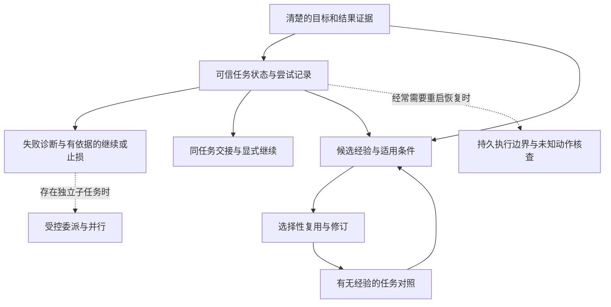

# Nexus：Agent 执行能力与经验积累方向预研

研究日期：2026-10-19（Asia/Tokyo）。源码基线：`9414586e6944785f7d827eea4b9712d38189bf6e`。本文服务于下一阶段的方向讨论，**不是 PRD、已批准功能清单或详细实施计划**。

## 1. 先读结论

**建议优先考虑“可验证、可延续的任务执行”，再通过小范围、带适用条件的经验复用检验学习价值。** 这里的优先顺序来自 Nexus 当前的证据缺口，不意味着所有 Agent 都必须按同一架构发展，也不要求先完成通用恢复平台才能试验经验。

Nexus 已经能够连续调用工具、读取反馈、调整行动，具有上下文压缩、人工交互、后台任务、Skill 和独立上下文的子代理。下一步的关键问题不是再增加一个“会规划”的角色，而是：

1. **知道任务推进到了哪里。** 区分用户目标、当前尝试、已验证成果、未完成工作与等待条件，而不是让整份对话同时承担这些职责。
2. **知道一次失败改变了什么判断。** 从输出中形成可检验的原因假设，依据新信息重试、换方案或停止；把传输重试与任务策略调整分开。
3. **知道哪些经验值得再用。** 保存适用条件、证据、反例和失效原因；让经验改善行动，而不是仅让模型多读历史。
4. **能证明系统确实改善了。** 对照没有经验、只有当前提示词、加入经验后的任务结果，同时观察误用、成本与用户介入。

默认候选方向是：**任务状态与结果证据 + 有依据的失败处理**。如果实际主要痛点是重复解释项目环境，则**项目范围的经验索引/Skill 整理**也可以成为较小的独立候选。跨进程自动恢复、并行代理调度、自动经验更新，需要分别由实际任务与对照结果证明价值。

## 2. 研究边界与证据等级

### 2.1 本次做了什么

- 阅读本地 Agent 循环、网页运行装配、会话存储、工具注册、命令/后台任务、上下文压缩、Skill、子代理及相关测试。以源码和本轮探针描述现状，未把旧研究中已经修复的问题继续列为缺陷。
- 实际读取本机 DSH 部署中的相关 JavaScript 模块；检查本机 OpenCode CLI 版本。另行读取 OpenCode、Pi、OpenHands 的公开源码或官方文档，明确区分已安装版本与远端源码快照。
- 查阅官方工程资料与原始论文，比较执行控制、恢复、经验和评估路线。两项辅助调查使用 DeepSeek 子代理；涉及推荐的关键结论由主研究过程交叉核对。
- 本轮执行 **90 项相关测试，全部通过，4.13 秒**，并运行临时隔离探针。没有调用真实付费模型来比较任务成功率，也没有复现实验论文的成绩。
- 仅新增本文；不修改正式业务代码、现有 PRD、上一阶段交付记录或用户数据。按本次指令跳过远端推送，没有继续发起推送。

### 2.2 如何理解文中的措辞

| 标记 | 含义 | 不能据此推导的结论 |
|---|---|---|
| **本地事实** | 当前源码可定位；若有运行探针，会另行注明 | 不代表真实模型一定出现相同行为频率 |
| **外部事实** | 官方文档、特定版本源码或论文明确给出 | 不等于本机复现，也不等于独立审计或产品收益 |
| **技术推断** | 从事实推导的机制解释或迁移判断 | 需要后续任务验证，不能当成功能验收标准 |
| **建议** | 在当前规模、产品边界下的取舍 | 尚未获得下一阶段开发授权 |

`docs/PRD.md` 与 `docs/PROGRESS.md` 描述上一阶段优化与交付；本文不改写它们的目标。`docs/愿景/` 只用于理解长期意图，不从其中派生当前开发清单。研究没有发现必须现在决定的架构冲突；第 12 节的问题用于后续选择产品方向。

## 3. Nexus 当前实际具备什么

### 3.1 能力与局限对照

以下均为本地事实；“局限”是当前设计边界，其中一些是否需要改变仍取决于产品目标。

| 能力 | 当前实现与证据位置 | 与本次研究相关的局限 |
|---|---|---|
| 连续执行与反馈 | [Agent.run](../nexus/core/agent.py)，工具结果加入消息后再次请求模型；同一响应中的调用逐个执行 | 任务分解、依赖推理和判断是否完成主要由模型承担；没有独立任务状态或成果验证器 |
| 执行结束 | `Agent.run` 中没有 tool call 就返回 `stopped="complete"`；步数用尽返回 `max_steps`；默认 `max_steps=40` | `complete` 表示本轮循环正常结束，不证明用户目标达成；直接调高上限不能解决过早结束或无效循环 |
| 计划与进度 | [todo.write](../nexus/tools/todo.py) 用完整列表替换 `{content,status}`；结果文本可进入历史 | `ToolContext.todos` 初始为空，网页每轮重新 build；没有恢复独立待办状态。历史中可能仍有清单，因此不能说“下一轮完全不知道计划” |
| 工具选择 | [ToolSpec / Registry](../nexus/tools/registry.py)、[build](../nexus/tools/__init__.py) 提供声明、参数校验、配置可用性过滤和统一派发；MCP 工具并入同一目录 | `requires` 是配置依赖，不是执行步骤依赖图；工具选择/组合交给模型；没有动态工具检索或通用数据依赖调度 |
| 错误反馈 | `ToolResult` 有 `ok/content/data/error_code`；错误作为工具结果返回；[retry](../nexus/core/retry.py) 仅重试特定模型请求错误且不重放已产生输出的流 | 没有任务级尝试记录、原因分类和卡住检测。系统提示已经要求不要重复相同失败调用，但这只是行为指引 |
| 结果保存与重载 | [Handler._persist](../nexus/web/server.py) 保存调用 ID、参数、文本、ok/error；[SessionStore](../nexus/session/store.py) 使用 JSONL、写入锁和 flush/fsync | 本轮 assistant/tool 消息在 `_run_turn` 的 `finally` 中批量调用保存；进程硬退出前已发生的工具副作用，可能还没有相应落盘记录 |
| 模型可见反馈 | Agent 内部工具消息记录 ok/error；[protocol](../nexus/core/protocol.py) 转为三类提供商请求时，工具反馈主要只传文本；网页 `_internal` 也主要重建工具文本和调用关联 | `ToolResult.data` 没有通用进入 Agent 消息，内部 ok/error 没有直接转成模型可见的统一状态。许多工具已在文本里说明错误，所以不等于模型收不到失败；重载也不是这项限制的唯一来源 |
| 上下文连续性 | [compaction](../nexus/core/compaction.py) 先裁剪大结果，再生成结构化摘要；配对保留工具交互；保留原始会话记录 | 摘要是当前 run 的工作上下文，不作为可复用摘要条目持久保存；下一轮从原始会话重建。摘要不等于跨任务经验，也不能保证保全所有证据 |
| 后台任务 | [JobRegistry](../nexus/tools/_jobs.py)、[jobs](../nexus/tools/jobs.py) 按会话跨轮持有；输出有界、cursor 可继续读；退出时清理进程树 | 已确认产品语义是服务退出后结束、不恢复。恢复 Agent 逻辑任务不能被解释成恢复后台进程；后台命令也不等于 Agent 可脱离连接持续执行 |
| 子代理 | [run_subagent](../nexus/core/subagent.py)、[spawn](../nexus/tools/subagent_tool.py)、网页 factory：独立上下文、同一模型配置、共享审批/取消和会话任务资源；父调用等待返回 | 当前装配没有并行任务句柄、对子代理注入再委派 factory 或保存完整子轨迹；模块的深度上限不能当成网页已支持多层代理的证据 |
| 子代理结果语义 | `run_subagent` 收集所有 `delta` 文本；工具层只将 `error/cancelled` 视为 `ok=false` | 实际返回可能拼接中间说明和结尾报告；`max_steps` 仍可 `ok=true`。因此不能直接用子调用 ok 给经验标记“任务成功” |
| Skill 与项目指引 | [skills.discover](../nexus/skills.py) 支持项目优先的目录发现；摘要入提示、正文按需读取；[workspace](../nexus/core/workspace.py) 收集项目指引 | 已有程序性知识载体，但没有自动提炼、效果追踪、冲突/失效判断或受控晋升流程；也不是完整 Agent Skills 规范实现 |
| 指标与测试 | 流有用量、步骤和耗时；每条 assistant 可保存其用量；已有大量工具/协议/集成测试 | `RunResult.usage` 被最新模型请求覆盖，done 不是完整父子/摘要总成本账本；工程回归与真实任务质量评估是两种证据 |

### 3.2 本轮实际探针

| 探针 | 观察 | 结论边界 |
|---|---|---|
| 同一临时目录先 build、写 todo，再次 build | 第一上下文有 `in_progress`，第二上下文 `todos=[]` | 证实内存状态不跨 build；没有否认模型可以从历史文本重建 |
| 注入返回 `stopped="max_steps"` 的子代理结果 | `spawn` 返回 `ok=true, stopped=max_steps` | 证实工具层状态映射；不是测量子代理真实成功率 |
| 将带 `ok=false,error=timeout` 的会话工具消息交给 `_internal` | 重建后剩 role、tool_call_id、name、content | 证实重载时的字段损失；内容本身仍可含失败说明 |
| 子 runner 先发中间文本再发结尾文本 | 返回文本是两段拼接 | 证实“只回传最终报告”的模块描述与当前归约方式不完全一致 |
| 真实 `_run_turn` + 本地 HTTPX MockTransport；模型先写临时文件再回复 | `tool_result`、`done` 回调时磁盘会话只有 user；函数返回后有 user/assistant/tool/assistant；文件已创建 | 证实运行中副作用与落盘有窗口；未做断电或强杀故障注入 |
| 模型 mock 对“创建 absent.txt”直接回复 finished | `stopped=complete`，文件不存在 | 证明 Harness 没有目标验证门槛；mock 故意构造，不能推断真实模型经常如此 |

**技术推断：** Nexus 的近期增长点更接近“把已有反馈变成可信的执行状态”，而非重新建设 Agent 基础循环。尤其在经验入库前，必须区分工具成功、循环结束、任务验证通过和用户认可；四者不是同一个标签。

## 4. 模型、Harness 与产品系统分别负责什么

这里的 Harness 指模型周围实际组织上下文、调用工具并管理运行的程序，Nexus 已经是一个 Harness。

| 责任 | 模型擅长提供 | Harness/工具应提供 | 需要产品选择的部分 |
|---|---|---|---|
| 分解与规划 | 理解约束、提出步骤、依据新发现调整方案 | 保存目标/当前状态/证据，暴露可用能力及边界 | 长任务是否必须展示计划，用户可否修改目标 |
| 选择下一步 | 诊断假设、比较方法、决定信息是否足够 | 实际环境观察、明确错误、预算与取消边界 | 能自主工作多久，何时应询问或停止 |
| 质量判断 | 解释结果、提出验证办法、辅助评阅 | 真正运行测试/查询状态/检查成果；保存验证对象和结果 | 哪些质量只能由用户判断，如何表达“未验证” |
| 恢复 | 看状态后制定继续策略 | 持久记录、未完成动作标识、环境重查、进程/审批生命周期 | 用户手动继续、显式恢复、还是自动恢复 |
| 经验 | 归纳、抽象参数、识别潜在共性 | 来源关联、范围和版本、检索、更新与撤回入口 | 经验可影响哪些项目、是否自动采纳 |
| 持续改进 | 根据反馈改变当前输出 | 对照评估、可回退的经验版本与统计 | 可以花多少成本改善哪些任务 |

模型的思考能力不提供磁盘持久性；框架的 checkpoint 不证明任务正确；多代理也不会自动带来独立可靠的裁判。三者不能互相替代。

有现实反例说明应避免重复建设：Anthropic 对 2025 年 `think` 工具文章的后续更新指出，多数场景应使用已改善的原生 extended thinking；2026 年长任务工程文章也描述了因模型能力变化而移除原先需要的 context reset。**可迁移的是“随目标模型重新验证补偿机制”，不是替 Nexus 规定必须重置上下文或新增思考工具。** [think 更新](https://www.anthropic.com/engineering/claude-think-tool)、[长任务 Harness 的后续实验](https://www.anthropic.com/engineering/harness-design-long-running-apps)

## 5. 成熟实现：借鉴机制，而不是复制功能清单

### 5.1 本机 DSH：明确的持久边界与状态投影

**外部事实（本地部署源码已读）：** DSH Desktop 为 `2.0.17`，相关包为 `0.2.0-rc.2`。`dsh-session-checkpoint-policy` 在下游模型流开始前 flush 已记录请求，在顶层工具体开始前 flush 会话，在 pre-step 边界 flush；flush 失败会阻止对应下游调用。它不是只在整个任务末尾保存。

`dsh-tool-todo` 把完整列表写成 `todo/write` 事件，再由 projection 还原；但当前包会在 `turn/start` 清空该 projection。**不能因为它有持久化事件，就声称 DSH 的 todo 产品语义一定是跨轮常驻。** 这正说明存储能力与任务生命周期必须分别决定。

**可迁移判断：** 参考“重要执行边界先留下可追溯记录”和“日志/当前状态/模型上下文分别投影”。Nexus 可在现有 JSONL 边界讨论这些原则，无需照搬 Cordis 插件体系、SQLite 查询层或 DSH 事件格式。持久化能缩小未知窗口，不能消除所有外部副作用歧义。包来源：[DeepSeek Harness 官方仓库](https://github.com/deepseek-ai/deepseek-harness)；本机位置和哈希见第 13 节。

### 5.2 OpenCode：反复调用检测与恢复的实际边界

**外部事实：** 官方权限文档把相同输入的工具连续重复三次称为 `doom_loop`，默认进入 ask。这是一种有意简单的启发式，不能证明已正确识别“没有进展”。[官方权限文档](https://opencode.ai/docs/permissions/)

本机 CLI 实测为 `opencode v2.0.30`。本轮另读远端 `dev` 的固定快照 `ba06ff9…`，其实现已在 `packages/core` 下，不能使用旧版 `packages/opencode/src/session/processor.ts` 的路径描述当前源码。`session/execution/restart.ts` 对遗留 execution claim 进行恢复，持久计数限制连续恢复，并明确说明恢复是 **at-least-once**，不能保证外部副作用不重复。[固定快照源码](https://github.com/anomalyco/opencode/blob/ba06ff9e0bf2dcefbbbc3a1d6094f3572d77c84e/packages/core/src/session/execution/restart.ts)

**可迁移判断：** 借鉴“中断状态显式化”和“恢复本身也要止损”。不要照抄固定次数：轮询同一 job 或验证文件变化可能是正常重复；更有用的判断还要结合结果是否改变、前提是否改变。本轮未运行 OpenCode 的崩溃恢复实验，也未证明远端快照与本机二进制逐项一致。

### 5.3 Pi：小核心也能支持连续任务

**外部事实：** 原 `badlogic/pi-mono` 当前重定向到 `earendil-works/pi`。官方 README 明确保留小核心，不内置 subagent、plan mode 等所有流程。固定快照 `d2e7d8b…` 的 `agent-loop.ts` 区分 steering、follow-up 与 `finishTurn` 的继续/结束决定；session manager 将 compaction 写成带原记录关联的独立条目，并据此构建当前上下文。[README](https://github.com/earendil-works/pi/blob/d2e7d8b7c1d31d3661f769d5caef7ba8d50c3e03/packages/coding-agent/README.md)、[循环源码](https://github.com/earendil-works/pi/blob/d2e7d8b7c1d31d3661f769d5caef7ba8d50c3e03/packages/agent/src/agent-loop.ts)、[会话源码](https://github.com/earendil-works/pi/blob/d2e7d8b7c1d31d3661f769d5caef7ba8d50c3e03/packages/coding-agent/src/core/session-manager.ts)

**可迁移判断：** 把“模型当前回复结束”和“系统是否还有待处理工作”分开，复用可追溯摘要；不必因此建立完整工作流引擎。显式继续若没有预算、停止原因和成果检查，也可能把错误延长。本轮只核对源码，没有运行 Pi 与 Nexus 的质量对照。

### 5.4 OpenHands：动作/观察事件，以及朴素的跨任务记忆

**外部事实：** SDK `v1.55.1` 的 `ActionEvent`、`ObservationEvent` 使用 tool call ID 等关联；运行时区分可回给模型纠正的工具级错误和会终止运行的 conversation 级故障；`LocalConversation` 有持久目录、恢复入口、迭代限制和 stuck detector。stuck detector 包含重复 action/observation、action/error 等检测，并可先给一次纠偏提示。[事件架构](https://docs.openhands.dev/sdk/arch/events)、[固定版本 LocalConversation](https://github.com/OpenHands/software-agent-sdk/blob/v1.55.1/openhands-sdk/openhands/sdk/conversation/impl/local_conversation.py)、[stuck detector](https://github.com/OpenHands/software-agent-sdk/blob/v1.55.1/openhands-sdk/openhands/sdk/conversation/stuck_detector.py)

更贴近本次经验问题的是可选 Persistent Memory：用户/项目两级 Markdown，简短 `MEMORY.md` 索引入上下文，长日志按需读，内容由 Agent 维护且明确视为未验证提示。当前文档给出可运行示例，本轮也核对了该示例存在于 `v1.55.1`。[官方记忆指南](https://docs.openhands.dev/sdk/guides/persistent-memory)、[固定版本示例](https://github.com/OpenHands/software-agent-sdk/blob/v1.55.1/examples/01_standalone_sdk/55_persistent_memory.py)

**可迁移判断：** 这是“可审阅文件 + 小索引 + 按需读取”的实际工程参考，证明不必先上向量库。它没有证明自动维护内容必然正确或长期带来净收益。Nexus 可比较人工整理与自动候选两种方式，不能把“系统能加载记忆”作为“经验有效”的证据。

### 5.5 LangGraph：明确流程与持久执行，适用面有条件

**外部事实：** 官方区分单 thread 的 checkpointer 与跨 thread 的 store；checkpoint 保存图状态和待执行信息，super-step 中成功节点的 pending writes 可用于恢复而免于重复已成功节点。[Persistence](https://docs.langchain.com/oss/python/langgraph/persistence)、[Checkpointers](https://docs.langchain.com/oss/python/langgraph/checkpointers)

**可迁移判断：** 当已有固定审批、分支和恢复节点时，这是成熟机制参考。将完全开放的任务步骤硬编码成图，可能只是把模型计划换成脆弱的预设流程。采用框架还带来状态 schema、节点粒度、序列化及迁移成本；当前没有证据要求 Nexus 迁移。图 checkpoint 也不能回滚图外世界，必须另外处理工具的幂等性和未知结果。

### 5.6 SWE-agent：工具交互设计比工具数量更值得学

**外部事实：** 官方 ACI 文档讨论带窗口的文件查看、简洁搜索、明确空输出、带 lint 反馈的编辑等设计。它们改善的是模型看见什么、怎样纠错。官方当前已把主要开发转向更简单的 mini-swe-agent；不能只凭旧设计复杂度判断路线先进。[ACI 文档](https://swe-agent.com/latest/background/aci/)、[当前项目状态](https://swe-agent.com/latest/)

**可迁移判断：** Nexus 现有 read/grep/patch/命令已经覆盖基本操作，先观察模型是否误解参数、漏看截断或误读空结果，再按任务证据改善接口。其受控容器 Shell 不宜直接替换 Nexus 的 Windows 命令语义；本次没有发现必须引入容器或状态 Shell 的需求。

### 5.7 长任务工程实践的共同启发与相反证据

Anthropic 的 2025 长任务示例依赖明确的功能状态、进度记录与实际测试，说明 compaction 本身不等于持续推进；它是特定应用开发实验，不是通用恢复规范。[原始工程文章](https://www.anthropic.com/engineering/effective-harnesses-for-long-running-agents)

2026 后续实验进一步分离生成与评阅，但也展示了更长运行和更高成本，而且模型升级改变了哪些控制机制仍必要。**本报告推断：** 可以借鉴成果契约与独立观察，不能据此推出必须上三代理、每轮评阅或固定 context reset。[后续工程文章](https://www.anthropic.com/engineering/harness-design-long-running-apps)

## 6. 经验学习研究究竟支持了什么

下表是原始研究的机制与证据范围，不是 Nexus 的实测收益。本次避免把不同模型、预算和 benchmark 的分数排列成架构排行榜。

| 研究 | 经验如何影响行动（论文事实） | 适用条件与 Nexus 可借鉴之处（技术推断） | 不能外推之处 |
|---|---|---|---|
| [Reflexion，2023](https://arxiv.org/abs/2303.11366v4) | 从任务反馈形成语言反思，保存在 episodic buffer 中用于后续尝试，不更新权重 | 优先用于已有测试/环境反馈的失败修正；反思应回答“哪个假设错了、下一次如何验证” | 多次尝试与反馈有成本；同一题的改进不证明跨任务长期记忆有效；论文中的 pass@1 不能忽略其尝试协议后与普通一次采样混比 |
| [ExpeL，2024 修订版](https://arxiv.org/html/2308.10144v3) | 从成功/失败轨迹提炼自然语言 insight，并在新任务检索经验示范 | 支持“经验条目与证据轨迹分开”和任务相关检索；成功/失败对照比孤立复述更有信息 | 任务分布、检索与反馈方式受控；没有证明长期变化仓库中的过时和冲突能自动解决 |
| [Voyager，2023](https://arxiv.org/abs/2305.16291)、[项目实现说明](https://voyager.minedojo.org/) | 自动课程、环境反馈迭代、可执行代码 Skill 库共同支持 Minecraft 探索 | 稳定操作环境中，可验证的重复子程序适合固化；Skill 不一定只是自然语言指南 | 整体成绩不能全归因于记忆；跨工具版本/仓库迁移远比固定游戏环境复杂 |
| [Agent Workflow Memory，2024](https://arxiv.org/html/2409.07429v1) | 从轨迹抽取更细粒度子流程，参数化具体值；离线/在线加入工作记忆；在线成功判断使用模型评价 | 适合反复出现的局部流程，而不必缓存整份任务计划；提供了工作流复用的实证 | Mind2Web/WebArena 结果不代表通用编码；在线预测“成功”可能出错；复用动作不能跳过对当前环境的观察 |
| [ACE，2025，v1](https://arxiv.org/html/2510.04618v1) | Generator/Reflector/Curator 分工，条目化 playbook、局部增量更新及 helpful/harmful 反馈；研究涉及 AppWorld 等 | 避免每次让模型重写整本经验，保留条目身份和修订依据；可借鉴局部更新而不复制三角色架构 | 论文自己承认依赖强 Reflector，差的提炼可能有害，也非所有任务都需要长知识上下文；模型自报有用次数不是因果收益 |
| [LongMemEval，2024/2025](https://arxiv.org/abs/2410.10813) | 评估信息提取、跨会话推理、时间、知识更新与拒答等长期对话记忆能力 | 过时、更新和不知道时不乱答，可作为经验系统的附加测试维度 | 主要测历史事实记忆，不直接测“过去工具经验是否让下一项任务做得更好” |

三种“学习”必须区分：

- **当前任务内适应：** 读取错误、修改假设、再次行动；Nexus 已具备基础能力。
- **外部经验积累：** 下一个任务可以检索此前经验证的诊断或流程；改变的是模型输入/可复用工件，Nexus 没有专门机制。
- **参数学习：** 微调/RL 改变模型权重，涉及数据与训练/部署条件；上述外部记忆工作的有效性并不构成现在训练模型的理由。

当前值得跟踪但证据较新的方向包括 [SelfSuite（2026-09）](https://arxiv.org/abs/2609.33717) 的冻结评价器与带结果记忆、[EvalMem（2026-09）](https://arxiv.org/abs/2609.22231) 的记忆操作分层诊断。本轮只核对其原始摘要，不采用其成绩作选型依据，也没有核查完整复现和长期部署情况。

**建议：** 先寻找 Nexus 用户任务中模型并不知道、但反复有价值的局部知识，例如具体项目的启动条件、一个工具的真实限制、特定错误的验证路径。一般性“先看错误再行动”更适合提示规则，不值得每次额外提炼成经验。

## 7. 技术路线比较

### 7.1 任务执行与规划

成本为相对工程复杂度判断，不是工时估算；收益尚未在 Nexus 真实任务上测量。

| 路线 | 主要收益 | 成本/风险 | 适用条件 | 当前判断 |
|---|---|---|---|---|
| A. 保持单 Agent，改善提示、工具说明与结果 | 改动小，可直接影响下一次行动 | 不能提供持久任务状态；规则过多可能干扰模型 | 单会话可完成、较少中断，失败主要来自工具误用 | 是必要对照，也可能已足够，不应跳过 |
| B. 单 Agent + 简明任务状态、验证证据、尝试记录 | 更易延续、定位卡住、避免把结束当成功 | 状态与对话需一致；模型填写状态也会出错 | 多步任务、跨轮工作，用户关心进展和完成依据 | **最值得优先讨论的能力组合**，不预设存储/API |
| C. 独立 planner/executor，动态重规划 | 可把目标分解与局部执行分开 | 计划容易过早固化，多一次模型成本；交接丢信息 | 问题确实需要长期高层协调，B 仍频繁偏离 | 暂无充分证据设为默认；先用任务层级而非角色数诊断 |
| D. 显式状态机/图 + durable checkpoint | 明确暂停、分支、恢复和流程可观察性 | 状态版本、重放、外部副作用与节点设计成本较高 | 固定业务流程，或经常需要重启后恢复 | 条件候选；参考框架机制，不默认迁移 |
| E. 异步多代理 + 依赖调度 | 可并行探索与隔离上下文，缩短适合任务的等待 | 预算、共享写入、依赖与取消复杂；报告仍可能不可靠 | 有多个真正独立、产出可合并的子任务 | 先证明串行子任务值得委派，再谈并行调度 |

一个轻量计划只需要表达当前目标、少量里程碑、下一步及依据、剩余问题，不必事先生成所有工具调用或 DAG。遇到新证据要允许重规划；用户改变目标与模型改变技术路线应有区别，前者不能被“坚持原计划”覆盖。

Anthropic 的研究系统采用 orchestrator-worker 并行探索，官方同时指出强依赖、共享上下文的任务不适合盲目并行，且会增加 token。该文章中的约 15 倍是**相对普通聊天**，不是所有多代理相对单代理的固定倍数。[官方实践](https://www.anthropic.com/engineering/multi-agent-research-system)

### 7.2 工具选择与组合

**建议从三个层次逐级判断，出现需求再增加复杂度：**

| 层次 | 做什么 | 何时有价值 | 不应误解为 |
|---|---|---|---|
| 接口质量 | 明确输入单位、环境前提、结果状态、截断、如何继续读取；提供能决定下一步的反馈 | Nexus 当前就可以从实际误用轨迹分析 | 每个工具都要扩展许多参数或长文档 |
| 过程复用 | 用 Skill 描述操作顺序/判断点；稳定且反复出现的片段可转为参数化脚本或复合工具 | 多次证明同一片段有效，且有清楚输入输出 | 将整段历史命令无条件重放 |
| 目录与调度 | 按任务发现相关工具、显式数据依赖、并行无冲突调用 | 工具目录实际过大或等待成为真实瓶颈 | MCP 自带任务规划，或工具多就必须向量检索 |

官方工具工程资料强调工具名称/说明、输出的有效信息和可测效果；不同格式、粒度没有普适最优。[Writing effective tools](https://www.anthropic.com/engineering/writing-tools-for-agents)

MCP 规范定义发现、调用、结果 schema 和工具错误回传，不能代替任务成功判断。Nexus 当前 MCP 桥接主要取文本，对结构化结果没有完整保留；是否补足取决于实际接入工具是否需要该数据，不应为了规范全覆盖扩大本阶段目标。[MCP Tools 2025-11-25](https://modelcontextprotocol.io/specification/2025-11-25/server/tools)

### 7.3 连续性与恢复应分为四级

| 级别 | 用户实际得到什么 | 额外成本 | 对当前 Nexus 的判断 |
|---|---|---|---|
| 会话继续 | 下轮根据历史继续 | 已有；需维持上下文正确 | 已具备，不等于自动恢复 |
| 任务交接 | 可读的当前状态、证据、待办/等待条件与下一步 | 中低；要防止状态失真 | 与复杂任务目标直接相关 |
| 显式恢复 | 用户重开后确认继续，系统核对未知动作和当前环境 | 中高；动作边界、记录与环境重查 | 若常中断，值得进入候选 |
| 自动跨进程恢复 | 运行服务重启后自行继续逻辑任务 | 高；还需恢复限额、运行归属、授权与副作用规则 | 未有需求，不默认投入 |

**技术推断：** 崩溃可能发生在“动作意图已记录 → 外部操作已生效 → 结果已记录”的任意边界。中间断开时，真实状态是“未知”，不能改名为“失败”后直接重试。应先查文件/远端实际状态；外部接口支持幂等键时再考虑利用；无法判断且后果重要时交给用户。不能承诺所有工具 exactly-once。

以上只讨论逻辑工作状态。此前确认的“后台进程在服务退出时结束”保持为已知产品边界；如果未来要求恢复后台程序，需要独立确认，不从长任务研究自动推出。

## 8. 失败处理：记录信息变化，而不是只有重试次数

### 8.1 按失败性质决定下一步

下表是建议的决策原则，不是拟定错误码全集，也不是要求每类增加独立模块。

| 观察 | 合理动作 | 应保留的依据 | 不合理动作 |
|---|---|---|---|
| 模型请求限流/短暂连接失败，尚无输出 | 沿用有限退避；确认错误是否可重试 | 错误类、尝试数与服务端提示 | 重放已产生可见输出的响应 |
| 参数/工具选择错误 | 根据 schema 或现有文档修正，再尝试 | 哪个参数假设改变了 | 原参数原环境反复调用 |
| 缺失依赖、路径或权限条件 | 核实真实环境、使用已授权替代方案，或提出具体阻塞 | 检查结果与缺少的条件 | 把授权拒绝当成技术失败，换工具绕过 |
| 命令执行失败/测试失败 | 读相关错误和局部代码，提出可被下一次检查区分的原因 | 错误片段、修改、验证对象与结果 | 每次整套重跑却不解释新信息 |
| 输出截断、没有观察到结果、超时 | 区分“操作失败”和“观察不完整”；按可用 cursor/产物继续查询 | 任务句柄、已知状态、观察缺口 | 将没读到输出等同于没执行 |
| 重复失败且前提未变 | 归纳已排除假设，查官方/指定参考，换途径或停止该分支 | 尝试差异与仍未确定的问题 | 只换命令拼写，实际重复同一策略 |
| 测试通过但功能不满足目标 | 回到成果条件，补相应用户路径观察 | 测试覆盖了什么、遗漏什么 | 用一个成功 exit code 给全部任务判成功 |
| 用户改目标或停止 | 更新任务范围/停止，并说明已生效工作 | 最新用户意图、未完成和外部状态 | 用“坚持执行”覆盖用户控制 |

### 8.2 怎样检测“没有进展”

简单重复指纹适合发现完全相同的工具/参数/错误；它便宜、可解释，但会漏掉语义重复并误报正常轮询。模型反思更灵活，却有成本与自洽误判。较合理的组合是：**轻量信号发现候选 → 向模型提供已尝试与未变化的证据 → 要求下次行动有新依据 → 无新信息则换路线或停该分支**。

进展不能只按工具调用数、todo 勾选或模型自述衡量。更可靠的信号是获得了新的事实、排除了一个原因、产物改变且验证更接近目标。这里不建议现在建设通用“信息增益打分器”；只需能说明当前尝试为什么值得。

停止要区分分支结束、等待外部条件、预算耗尽、用户停止与任务完成；清楚的“未解决且原因已界定”本身也可能是一次有质量的交付。

## 9. 从执行记录变成可复用经验

### 9.1 五种东西不要混存为同一种记忆

| 内容 | 主要用途 | 更新方式 | 是否默认影响其他任务 |
|---|---|---|---|
| 执行记录 | 回看实际发生的调用与观察 | 保留原始证据，补关联和结果 | 否，按需检索证据 |
| 当前任务状态 | 当前做到了哪、还缺什么 | 随执行和用户目标变化 | 否，任务范围内 |
| 项目/环境事实 | 当前仓库如何启动、工具有什么已知条件 | 与版本/观察相联系，环境变化后重查 | 项目内按相关性使用 |
| 操作经验/Skill | 在某条件下有效的判断或步骤 | 经验证后提炼，保留适用条件与修订 | 可以，但需要范围筛选 |
| 用户明确偏好/约束 | 应当遵循的选择与边界 | 以用户明确表达为依据 | 范围由用户决定，不从执行成功推导 |

Nexus 的 JSONL 是经验的部分证据来源，但不是无损执行审计：本轮保存窗口、输出裁剪、未保存的结构化 data、未保存的完整子轨迹都有边界。不能将历史“完整”作为自动提炼已可靠的前提。

### 9.2 一个经验至少要回答的问题

**建议的语义内容，而非最终数据格式：**

- **何时适用：** 任务类型、工具/版本、项目或环境条件；不适用情况。
- **观察与判断：** 实际失败/成功现象；解释属于已证实原因还是待验证假设。
- **可复用做法：** 下一次要检查什么、怎样调整，必要时给参数化过程。
- **证据与结果：** 来源调用/产物、针对什么做过哪种验证；结果可能是通过、失败、部分或未知。
- **维护状态：** 候选、可用、存在冲突、已被反证或替代；谁/什么证据使判断改变。

不应把模型给出的 `confidence=0.95` 当成校准概率。证据支持次数、成功机会数、相反观察、实际使用情况比一个自报小数更可解释；但相关计数仍不直接证明因果收益。

### 9.3 成功、失败与未知应如何提炼

成功经验应保留“在什么条件下，经过什么验证有效”，避免把偶然成功推广成通用规则。失败经验优先保留可观察限制或已排除方案；如果根因未确认，记录为假设，不让一次超时生成永久禁用规则。未知结果可保留为待核查记录，不能给正负经验训练标签。

**来自本次本地事实的示例（建议写法）：**

> 在当前 Nexus 命令工具中，命令按参数列表执行，环境没有默认 shell。遇到 shell builtin 或管道没有按预期工作时，先核对当前工具契约与命令解析方式；不要把本机 PowerShell 的交互规则直接套进 `bash` 工具。若使用显式 shell 程序，需要按实际授权和参数规则处理。

这个示例的范围是“当前 Nexus 工具/版本”，不是“Windows 不支持管道”。它属于工具契约知识，若已经在工具说明里清楚表达，继续保存同一经验未必有额外价值。真正值得积累的是稳定接口说明之外、需要实测才得到且后续反复用得上的知识。

### 9.4 入库、使用与修订

建议把生命周期理解为：**执行证据 → 候选经验 → 检查适用范围与证据 → 小范围使用 → 观察效果 → 晋升、修订或停用**。这些可以先由人工和文件完成，不要求自动流水线。

检索应先匹配项目、工具/版本、前提、任务类别，再考虑语义相似；“文字很像”不足以证明适用。只注入少量有助于当前决策的条目，保留回看原始证据的入口；不存在合适经验时允许不检索。经验使用后要再核对现实，不能跳过读文件、检查权限或重新验证。

对冲突，优先检查是否条件不同、环境变了或其中一条证据较弱，而不是让模型强行合并。对变化，按相关环境事实变化重新验证，不建议先建立复杂全局失效依赖系统或任意统一 TTL。对被反证条目，退出默认使用并关联替代结论；所有者应能修订/删除。旧经验是参考资料，不得自行升级为系统指令、授权或新的产品目标。

### 9.5 存储与自动化路线的取舍

| 路线 | 收益 | 成本/限制 | 当前判断 |
|---|---|---|---|
| 手工项目笔记/Skill，小索引按需读 | 最透明，已有文件能力可承载；便于试验哪些知识有价值 | 依赖维护；规模大后检索差 | **经验候选的低成本对照** |
| 自动提炼候选，人审或证据确认后使用 | 减少整理负担，便于看到模型会总结什么 | 模型可能过度概括；审阅成本可能抵消收益 | 若有足够真实重复任务，值得小范围讨论 |
| 条目存储 + 条件/关键词检索 | 可追溯修订和筛选，不要求新外部服务 | 要维护关联、排序和冲突语义 | 出现条目管理需求后再选 JSON/SQLite 等形式 |
| 向量/混合检索 | 大量异质经验中找相似候选 | 相似不等于适用；embedding、重排与失效增加成本 | 未有规模和召回问题证据，暂不先建 |
| 自动 playbook 持续更新 | 可能在重复任务分布中累积收益 | 错误反馈、遗忘、偏置放大；需持续对照和回退 | 研究候选，非默认产品方向 |
| 微调/RL | 可能改善广泛稳定的行为模式，减少输入负担 | 需数据、训练/部署能力，撤回与归因更难 | 当前不建议投入 |

## 10. 怎样判断“执行更好”和“经验有效”

### 10.1 先保证评价问题成立

**建议：** 使用实际用户任务的少量代表样本，明确最终对象和可观察条件。开发现有 90 项相关测试证明的是工程契约，没有测量模型是否自主完成复杂目标。反过来，单次真实模型成功也不能证明工程恢复与数据一致性。

任务质量信号可以分层：工具是否正确执行、产物是否满足可检查条件、用户路径是否可用、主观质量是否符合意图。确定性检查优先；模型裁判用于难形式化维度，需用用户评价校准并保留可核对意见。同一个模型既生成又给自己打分，不能被当作独立验证。

官方评估实践强调同时看实际 outcome 与轨迹、区分能力与回归评估，并谨慎解释不同多次尝试指标。[Demystifying evals](https://www.anthropic.com/engineering/demystifying-evals-for-ai-agents)

### 10.2 能区分路线的任务样本

这是一组方向验证问题，不是下一阶段待开发的测试系统或验收标准。

| 样本类型 | 能区分什么 | 不应只检查什么 |
|---|---|---|
| 多步骤改动，既有测试和用户路径都要成立 | 是否持续推进，是否过早宣布完成 | 最后一条回复是否说“完成” |
| 缺依赖、参数错误、一次暂时超时 | 是否分清原因并改变行动，有无无效重试 | 是否最终恰好跑通 |
| 中途取消/浏览器断开，稍后显式继续 | 任务状态能否恢复，是否核对已生效动作 | 是否能重新读到聊天记录 |
| 同项目不同任务共享一个环境知识点 | 经验是否减少重复探索并改善/维持结果 | 是否成功检索同一句话 |
| 表面相似但工具/版本不同 | 能否拒绝错误迁移 | 检索召回率越高越好 |
| 先有正确经验，后来环境改变/用户纠正 | 是否停用/修订，避免旧结论持续影响 | 经验库是不是越来越大 |
| 用户偏好与旧经验冲突 | 是否遵循当前意图并解释约束 | 是否坚持最常用历史方法 |

### 10.3 有用的指标与对照

**主要看：** 目标达成率及其人工抽查、错误宣告完成、未解决项是否诚实可定位、重复失败次数、用户纠偏次数、恢复后的重复副作用，以及完成任务所需时间/调用/token。

经验方面要分开记录：有没有检索到相关条目、有没有实际使用、适用判断是否正确、最终结果是否改善。另看有害迁移、冲突处理、旧知识更新和无经验时的表现。检索命中率、模型表示“很有帮助”和库大小都不是主目标。

比较至少需要这些视角：原 Harness、仅改提示/工具说明、加入任务状态、加入经验；可分别试验，不必一次实现全部。固定或明确记录模型、参数、环境和预算，给各组相当的总资源；经验提炼、检索、评阅也计成本。对同类任务重复运行，公布样本量与波动；不要从一次演示推断百分比收益。

经验来源与测试目标按任务/项目/时间划分，防止把待测答案提前放入经验；“同一任务失败后再试”应单列任务内适应，不能混算为新任务迁移。长时间序列还要观察早期正确经验是否被冲掉、发生纠正后是否仍误用。全程给 no-memory 对照和关闭经验后的回退路径。

**继续投入的依据：** 目标任务中出现可重复的净收益，且有害迁移和维护负担可接受。**停止/调整依据：** 仅靠提示说明已解决问题、经验几乎不被使用、改善来自额外预算而非经验、或误用抵消收益。阈值应由具体任务价值决定，本报告不伪造数字目标。

## 11. 能力之间的促进与前置依赖



图表示能力关系，不是架构图或实施顺序。实际含义如下：

- 可靠结果标签同时帮助失败处理与经验提炼；这是最强的共同基础。**不要求先建通用评价平台**，一条可核对的验证也可以开始。
- 任务状态让摘要和交接有目标；原始历史提供证据，摘要提供可用工作视图。二者不应相互覆盖或被等同为经验库。
- 小规模手工经验可以与执行状态研究并行，不依赖向量库、自动恢复、多代理或模型训练。
- 自动经验更新比手工经验多依赖质量检查、可撤回更新和持续对照；仅“自动总结”不构成完整能力。
- 并行代理需要独立输入/产出、资源与写入范围、结果合并及全局预算。先有 DAG 不代表任务就能并行；先有上下文隔离，也不代表结论互相独立可靠。
- durable execution 需要动作边界与状态持久性；它与跨任务经验是不同分支，没有必须同时建设的理由。

## 12. 下一阶段候选目标与产品问题

### 12.1 候选优先级

以下优先级表示**当前值得优先选择和验证的方向**，不是已授权开发顺序。成本仍是相对判断。

| 候选 | 产品价值与当前依据 | 复杂度/主要风险 | 推荐级别与成立条件 |
|---|---|---|---|
| **A. 复杂任务可延续、结果可核对** | 已有循环与工具，缺独立任务状态；结束/成功不分，跨轮清单依赖历史；能直接支撑用户观察和继续 | 中；状态写得更多却不可信，或强迫所有任务填表 | **优先**；适用于当前编码/调查多步任务。聚焦状态与证据，不预设 planner 或新 UI |
| **B. 有依据的失败恢复与止损** | 有错误回灌和请求重试，却没有尝试差异/卡住信号；与用户“不无限盲试”高度一致 | 中；误停正常轮询，分类过度复杂 | **优先，可与 A 合并为一个候选主题**；成果看更少无效尝试、清楚剩余阻塞 |
| **C. 项目范围的经验复用** | 已有 Skill/文件/历史；可检验是否减少重复探索 | 小到中；过度概括、旧事实误用、整理负担 | **有条件优先**；需要选出真实重复任务。先比较人工索引/Skill 与自动候选，不立即自动采纳 |
| **D. 显式中断恢复** | 当前主要保留会话，run 内存在落盘窗口；长任务中断可能昂贵 | 中到大；副作用未知、授权恢复、记录兼容 | **痛点驱动**；若中断少，则先做任务交接已可能足够 |
| **E. 受控异步委派/并行** | 已有串行子代理，独立调查可能受益 | 中到大；状态/预算/写入冲突/汇总可信性 | **后置或独立验证**；只针对能明确拆分且成本有回报的工作 |

**推荐默认讨论 A+B。** C 不应被无限期推迟：若用户最关注“下次不要重新摸索”，可以选择一个项目任务族，讨论 A/B 的最小证据基础与 C 的小范围复用如何组合。尚无依据把所有候选合并成一次大版本。

### 12.2 当前不建议投入或提前决定的方向

- 无条件常驻、自行寻找目标或持续后台行动：当前研究没有这类产品授权，也不等同于“复杂任务持续推进”。
- 全自动把每段对话/每次成功写成全局规则：结果与适用性不足，容易重复、冲突并放大错误。
- 先建向量数据库、知识图谱、通用调度平台或插件框架：未有规模、检索或固定流程瓶颈证据；先比较简单形式。
- 默认 planner/executor/critic 团队、每步强制反思或多代理投票：可能增加同源判断与延迟，先证明比单 Agent + 好反馈更有价值。
- 通用执行重放、自动回滚一切外部行为、exactly-once 承诺：对当前任意命令/MCP 工具不成立，不应包装为恢复能力。
- 依赖外部论文的榜单成绩直接选框架或承诺收益：本地任务、模型、成本和使用方式尚未对应。
- 自我修改核心提示/权限/工具实现以及在线训练模型：当前缺少数据、评价与产品需求；经验更新不能扩大授权。

### 12.3 需要所有者进一步确认的产品选择

不需要现在逐项作答；选择下一阶段时，前两项最影响优先级。以下推荐都是待讨论假设。

| 产品问题 | 为什么影响方向 | 当前建议的讨论起点 |
|---|---|---|
| 首先希望哪类任务明显变好：代码修改调试、技术调查、还是其他实际工作？ | 决定可验证成果、反馈来源和经验迁移边界 | 从现有 Windows 编码/调查任务中挑经常遇到的类型，不先扩成通用数字员工 |
| 最不能接受的是过早结束、反复盲试、中断后重来，还是下次忘记已知经验？ | 分别指向 A、B、D、C；不能假定同等优先 | 当前证据更支持先解决前两类，但真实使用痛点可改变排序 |
| “继续工作”需要达到哪一级：用户下一轮继续、显式恢复，还是服务重启后自动继续？ | 持久执行、授权和预算成本差异很大 | 先保证明确交接；不自动改变已确认后台任务退出语义 |
| 经验只在当前项目使用，还是跨项目/用户层共享？ | 决定环境条件、误迁移范围和用户控制方式 | 初期优先项目范围；跨项目只复用有明确适用证据的通用片段 |
| 经验由用户整理、Agent 提候选，还是可自动采纳？用户希望怎样纠正/关闭？ | 决定质量门槛与交互负担 | 先让条目可见可改，以受控候选检验自动提炼价值；避免每次琐碎确认 |
| 愿意为复杂任务增加多少时间/token？哪些成果必须有实际验证？ | 影响重试、评阅、并行与经验提炼是否划算 | 以具体任务价值讨论；不把无限循环或更多 token 当持续能力 |

## 13. 证据位置、版本与复核

### 13.1 本地源码定位

位置均相对源码基线；函数比行号更稳定。

| 文件 | 关键位置 | 用于支持的结论 |
|---|---|---|
| [core/agent.py](../nexus/core/agent.py) | `_fold`（约 136 行）、`run`（221 行）、无 calls 分支（383 行）、工具循环（398 行）、`_invoke`（438 行） | 循环、结束/步数、反馈记录、权限与取消、摘要边界 |
| [web/server.py](../nexus/web/server.py) | `_internal`（285 行）、`_run_turn`（656 行）、子 factory（764 行）、finally（848 行）、`_persist`（858 行） | 跨轮装配、历史投影、子代理与保存边界 |
| [tools/__init__.py](../nexus/tools/__init__.py) | `ToolContext`、`build` | 每轮上下文、todo 初值、工具装配 |
| [tools/registry.py](../nexus/tools/registry.py) | `ToolSpec`、`ToolResult`、`Registry.execute` | 校验/配置依赖、结构化结果与裁剪 |
| [core/protocol.py](../nexus/core/protocol.py) | `_chat_messages`、`_anthropic_messages`、`_responses_input` | 内部工具状态如何投影成提供商请求，与内部记录/界面展示的区别 |
| [tools/todo.py](../nexus/tools/todo.py) | `write` | 列表替换与模型驱动状态 |
| [core/subagent.py](../nexus/core/subagent.py)、[tools/subagent_tool.py](../nexus/tools/subagent_tool.py) | `run_subagent`、`spawn` | 文本归约、结束原因与 ok 映射 |
| [core/compaction.py](../nexus/core/compaction.py)、[core/prompt.py](../nexus/core/prompt.py) | 摘要模板、`prune`、`select`、`ROLE` | 有界上下文、已有纠错规则与限制 |
| [skills.py](../nexus/skills.py) | `parse_frontmatter`、`discover`、`default_roots` | Skill 装载范围及能力边界 |
| [session/store.py](../nexus/session/store.py) | `append`、`_append_record`、`load` | JSONL 的实际保存保证与读取 |

相关测试命令，本轮实测结果为 `90 passed in 4.13s`：

```powershell
.venv/Scripts/python.exe -m pytest tests/test_agent_loop.py tests/test_retry_abort_tools.py tests/test_compaction_skills.py tests/test_fold_regression.py tests/test_web_runtime.py -q
```

### 13.2 临时探针的复核方式

探针在单独 Python 进程、`TemporaryDirectory`、fake model key 与 `httpx.MockTransport` 下运行。没有向真实提供商请求或读取真实凭据。可在仓库根目录用当前虚拟环境复核以下短例：

```python
from pathlib import Path
from tempfile import TemporaryDirectory
from nexus.tools import build
from nexus.tools.subagent_tool import spawn
from nexus.core.subagent import SubagentResult
from nexus.session.store import Session, Message
from nexus.web.server import _internal

with TemporaryDirectory() as directory:
    registry, first = build(root=Path(directory))
    registry.execute("todo_write", {"todos": [
        {"content": "check", "status": "in_progress"}
    ]}, first)
    _, second = build(root=Path(directory))
    print(first.todos, second.todos)  # 前者有条目，后者为空
    first.spawn_subagent = lambda task, budget: SubagentResult(
        text="partial", steps=1, stopped="max_steps")
    print(spawn(first, {"task": "task", "max_steps": 1}))  # ok=True

session = Session(id="probe", items=[Message(kind="tool", text="no result",
    data={"tool_call_id": "c1", "name": "probe", "ok": False,
          "error": "timeout", "arguments": {}})])
print(_internal(session))  # 没有 ok/error 字段
```

保存边界探针复用 [test_web_runtime.py](../tests/test_web_runtime.py) 的模拟协议帧和隔离 runtime 装配方法：在 `tool_result` 与 `done` 的 emit 回调中重新 `SessionStore.load`，与 `_run_turn` 返回后的读取比较；mock 的第一个响应调用 `write_file`，第二个返回文本。实际观察见第 3.2 节。没有进行强杀主服务、系统断电或真实远端副作用实验。

### 13.3 本地参考部署与远端快照

本机 DSH 根目录：`C:/Users/Nivalis/AppData/Local/Programs/DSH Desktop/resources/app/`；包根为其 `node_modules/@deepseek-ai/`。以下哈希针对实际阅读的 `lib/index.js`，不是源码仓库 commit：

| 模块 | 包版本 | SHA-256 |
|---|---|---|
| `dsh-agent-loop` | `0.2.0-rc.2` | `00C4814D63F3D1E2754EB09144832D19B30499D6EA444730473F740B587948C2` |
| `dsh-session-checkpoint-policy` | `0.2.0-rc.2` | `80A4475DE0594399BFDD3203E000CFE0BF1967AF163F8747C45B9B80E9549F2A` |
| `dsh-tool-todo` | `0.2.0-rc.2` | `6BAAD8BF8E53647319B408CBAB0C8C13C0693F65D20B779484C4436F47A6A11B` |

本机 OpenCode 入口为 `C:/Users/Nivalis/AppData/Local/Programs/@opencodedesktop/resources/opencode-cli.exe`，`--version` 输出 `opencode v2.0.30`；没有把该二进制当成已审阅源代码。

| 外部实现 | 本轮所用版本/快照 | 阅读范围与边界 |
|---|---|---|
| OpenCode | `dev` → `ba06ff9e0bf2dcefbbbc3a1d6094f3572d77c84e` | runner/step、runner/index、execution/restart、tool/runtime；不宣称等同本机安装版 |
| Pi | `main` → `d2e7d8b7c1d31d3661f769d5caef7ba8d50c3e03` | agent-loop、session-manager；官方 README/compaction 资料 |
| OpenHands SDK | `v1.55.1` | action/observation、LocalConversation、stuck detector、persistent-memory 示例；当前官网说明另按访问日期处理 |
| LangGraph / SWE-agent / MCP / Agent Skills | 2026-10-19 访问；MCP 引用固定 `2025-11-25` 规范 | 官方说明，未在 Nexus 安装或运行这些体系 |

网络源码的少量调查副本放在 Git 忽略的 `.artifacts/execution-research/`，仅便于本轮核对；报告中的固定版本链接和本地源码位置足以追溯，不依赖这些缓存交付。没有克隆整个参考项目或改动其安装目录。

### 13.4 关键来源导航

正文已在相关结论旁给出来源。按用途回看时：

- 执行反馈与工具接口：[Anthropic 工具工程](https://www.anthropic.com/engineering/writing-tools-for-agents)、[SWE-agent ACI](https://swe-agent.com/latest/background/aci/)、[MCP Tools](https://modelcontextprotocol.io/specification/2025-11-25/server/tools)。
- 连续任务与恢复：[长任务 Harness](https://www.anthropic.com/engineering/effective-harnesses-for-long-running-agents)、[后续生成/评价实验](https://www.anthropic.com/engineering/harness-design-long-running-apps)、[OpenHands Persistence](https://docs.openhands.dev/sdk/guides/convo-persistence)、[LangGraph Checkpointers](https://docs.langchain.com/oss/python/langgraph/checkpointers)。
- 经验载体与边界：[OpenHands Persistent Memory](https://docs.openhands.dev/sdk/guides/persistent-memory)、[Agent Skills 规范](https://agentskills.io/specification)、第 6 节原始论文。
- 质量验证：[Agent Evals 工程实践](https://www.anthropic.com/engineering/demystifying-evals-for-ai-agents)、[LongMemEval](https://arxiv.org/abs/2410.10813)；后者用于记忆子能力，不代替任务执行评估。

尚未验证：Nexus 不同真实模型上的任务成功率、经验的迁移收益、长时间经验冲突/过时比例、参考实现的实际崩溃重放行为。本报告的推荐应在具体任务与产品选择明确后进一步检验，不构成这些能力已经实现或路线已经被实验确认的声明。
