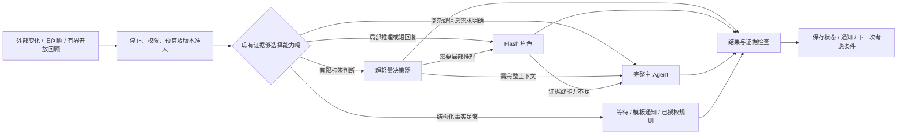

# LingNexus 自主性补充研究：多模型按需协同决策

研究日期：2026-10-20（Asia/Tokyo）。本地基线：[468fdb7](https://github.com/nivalis2284-art/Nexus/commit/468fdb7e7b90dff85d4069ae522f8639f99cfa5b)。依据：[自主性研究 PRD](PRD.md)、[上一轮研究](RESEARCH.md)、[产品定位](../../PRODUCT.md)及[愿景](../../愿景/01-概念与原则.md)。

**研究范围：独立补充研究，保留原报告；不开发、不部署、不执行收费模型实验。** 研究阶段按当时要求仅在本地整理；2026-10-20 所有者另行授权安全合并远端变更并推送研究成果。本文中的调用配额、路由比例、延迟和费用情景均不是所有者已批准预算或实测表现。研究使用三个 DeepSeek Max 子代理，分别调查超轻量模型、Flash API、路由与评价证据；主代理负责整合、源码适配和成本推导。

沿用原报告证据标签：**F** 为本轮直接核对的本地事实，**S** 为一手来源声明/实验或公开源码，**D** 为推导与建议，**H** 为待验证假设。供应商声明不等于本项目复现；“未找到”仅限本轮检索；多模型一致、参数少和价格低都不能直接证明决策可靠。

## 1. 问题及初步结论

研究对象是整个系统如何分配判断与行动责任，包含选择不调用模型。超轻量决策器 U、Flash 级模型 F 和主 Agent M 是**能力角色**：一个物理模型可以兼任 F 与 M；主 Agent 代表拥有完整任务上下文和执行职责的运行实例，不必是价格最高、参数最多或另一个供应商的模型。

需要区分三种协作：调用前选择一个模型；先尝试再升级的级联；不同模型承担互补子问题。它们不能统一称为“每层把关”。推理深度、信息量和权限是另外三个维度，不能用低/中/高三档代替。

**D：最值得比较的是可直接选择能力的有限路径，而非固定 U→F→M。** 已知结构化事件可以由程序处理；有上下文的短回复可由适合的 F 直接完成；明显需要完整历史、模态或复杂行动时可直接 M；只有先做低成本判断能改变后续选择时才调用 U/F。这个方向尚未证明优于单模型；低事件量、主模型已足够便宜或没有校准资料时，单模型可能更合理。

模型路由不是自主目标来源。无即时指令时的新问题仍需来自真实观察、既有开放问题及获准回顾；“向哪个模型发请求”不能替代“为什么值得开展”。本补充不将目标范围缩成提醒、客服或编码。

## 2. 四种责任应分别分配

| 责任 | 无模型可处理部分 | U 的候选价值 | F 的候选价值 | 应直接考虑 M 的情况 |
|---|---|---|---|---|
| 简单事件筛选 | 事件 ID 去重、版本未变、已过期、目标被撤回、结构化状态变化 | 有明确候选标签时判断语义相关性、是否缺信息；输出可弃权 | 模糊文本、多事件合并或需要少量历史的解释 | 只有完整上下文才能理解的新证据；不能由筛选器永久封死 |
| 自主目标判断 | 检查预算/停止状态；不能据规则自动确定开放价值 | 对已经提出的候选做有限相关性/冲突判断 | 生成或修订有依据的短目标，比较调查、等待与放弃 | 跨兴趣冲突、长期目标修订、重要承诺或高成本活动 |
| 主动回复 | 已验证状态的简短模板，如“任务已完成，可查看结果” | 判断是否值得打扰、当前事件对应哪个已知意图 | 基于证据生成可直接发送的短回复，说明不确定性 | 复杂解释、敏感承诺、重要决策请求、需要完整交流背景 |
| 复杂行动 | 工具参数校验、权限和预算准入、稳定操作 ID | 不把一个分类标签当行动计划 | 在能力与授权适配时可直接执行有界工作，无需强制升级 | 长工具链、复杂调查、附件/图像、长时工作与重要状态迁移 |

这是 **D 类可测分工，不是固定产品规则**。权限按实际操作影响和所有者授权决定，不能因为换成 M 就扩大；F 若具备合格能力与同样控制，也不应因层级名称而被禁止行动。

“主动回复”有两道独立问题：是否应该打扰，以及回复是否准确、符合交流背景。完成状态可以模板化；研究发现、主动提问和创作分享不能全部退化为模板。获准的页内通知也不自动授权发送邮件等外部通信。

## 3. 模型与一手证据核查

本节区分模型家族事实、服务可用性与 Ling 场景适用性；参数量、API 名称和列表价均按来源记录。以下页面查阅于 2026-10-20；动态页面不是永久版本承诺。

### 3.1 Jev：专门的决策接口，不是会写短回复的小聊天模型

**S：**[TypeSafe 官方介绍](https://docs.typesafe.ai/introduction)确认 Jev 接收 `state` 与 typed questions，返回 Choice、Score 或 Noul；没有自由文本生成。问题和候选由调用方定义，多问题可以共享同一状态。它适合有限判断，不会自行提出候选集合以外的新目标或撰写回复。

| 核查项 | 一手事实及边界 |
|---|---|
| 身份与内部规模 | [2026-09-15 官方发布](https://typesafe.ai/blog/introducing-system-one-models-and-jev)的 System One 模型；未公开确定参数量或完整架构。不能把“超轻量决策”当成已知小参数量 |
| 端点、版本与别名 | [官方模型页](https://docs.typesafe.ai/models)：`POST https://api.typesafe.ai/v1/systemone`；1.14 于 10-14 发布，但 `jev-latest` 仍指向 `jev-1.13.0`，`jev-preview` 指向 `jev-1.14.0`。应固定具体版本并记录实际响应版本 |
| 计费 | 同上：输入 $0.042/百万 token，输出免费。费用仍随状态、问题和选项描述增长；不能按“只返回一个标签”推算输入费 |
| 上下文和语言 | 同上：默认每请求 64K、每问题 32K；长上下文开关可达 262K，但官方明确更慢且更不准确。英文效果最好，CJK 不等同质量，须用本项目材料验证 |
| 权重与部署 | 本轮未找到官方开放权重；现有可核实接入为托管服务。SDK/网关开源不代表模型开放，不将本地复现项目写成可离线部署的 Jev |
| 时延与可靠性宣传 | 官方发布称 70–500ms，说明极大倍数收益来自特定工作流；“没有类型错误”是输出结构性质，不能推导没有错误判断。不是 Ling 的时延 SLA 或安全证明 |

**概率语义（S/D）：**[官方 Confidence](https://docs.typesafe.ai/confidence)说明 Choice/Score 的 confidence 根据分布形状计算；高集中度不是独立测得的答错概率。[Noul](https://docs.typesafe.ai/primitives/noul)返回对明确命题为真的估计；也不自动成为跨问题校准的事实概率。不同候选集合、问题和量表的 0.8 不能随意平均成“行动安全 80%”。需固定题目/版本并在适用材料上校准，权限仍由程序独立控制。

多问题可共享状态并行求值，不表示得到了一套联合一致的计划。诸如“现在可以行动”“应等待更多事实”可能分别获得高分；调用方须表达互斥终态、优先级和未知路径，不能把各题独立概率相乘当作联合成功率。把量表机械归一化也不能把不同价值维度变成同一个客观风险。

**D：**Jev 可独立结束“已知候选中哪个相关”“是否有足够依据进入局部调查”等有限判断，并将结果交代码；它不能独立完成自由回复、开放目标生成或复杂行动计划。对有副作用的任务，这个标签仅是输入，不是执行许可。

### 3.2 便宜与合法输出之外的能力证据

以下均为 **S 类作者报告，未在本项目复现**；包含较新的预印本，不能视为已经充分独立确认。

| 来源/版本 | 支持或反对的证据 | 对本项目的适用边界 D |
|---|---|---|
| [Evaluating and Benchmarking Jev，v1，2026-09-29](https://arxiv.org/html/2609.37647v1) | 固定 1.13.0、37 数据集、346,009 请求；正文报告主评测输入 217.9M token、$9.15，客户端平均 .36 秒。不同任务表现不均，二元概率的固定 .5 阈值未必适用 | 支持廉价有限判断具有实际可用性；平均输入约 630 token，不能挪成 8K 历史材料费用、中文目标质量或本机延迟。1.13 成绩不直接代表 1.14 |
| [Chinese-Jev，v1，2026-09-29](https://arxiv.org/abs/2609.36965v1) | 研究者为中文决策另训练 encoder-only 模型及领域版本，报告通用中文任务优于闭源 Jev | 是新模型研究，不是 TypeSafe 自动获得中文增强；收益来自特定训练/数据，不能直接外推自主目标 |
| [Can Decision Models Understand Stance?，v1，2026-10-08](https://arxiv.org/abs/2610.11901v1) | Jev 在英文立场任务有竞争力，在中文对话立场中落后强模型，涉及回复关系和正反方向理解 | 不能单凭短文本分类高分让它裁决中文交流意图；对话复杂性不只取决于长度 |
| [Benchmarking Candidate Coverage，v1，2026](https://arxiv.org/html/2610.03387v1) | 刻意移除正确候选，分别看缺失检测和错误拒绝；其 TREC 五候选配置中 Jev 缺失检出 24.8%、误拒 0/109，零观察的上置信界仍非零 | 必须测试候选集合不完整。低置信度不是可靠的“正确答案不在列表”检测器，高闭集准确率不代表开放世界适用 |

**暂不选为默认裁判：**尚无证据证明 Jev 能可靠决定 Ling 的开放目标价值或何时主动打扰；它可以进入受限、可弃权、能抽查漏判的候选试验。已核实的快与省，不足以替代这些未知。

### 3.3 相关开放候选及部署条件

| 候选 | 可核实内容 | 不能省略的代价/局限 |
|---|---|---|
| [Mapika Decider-2B，查阅日 v11 模型卡](https://huggingface.co/Mapika/decider-2b) | 1.9B Qwen3.5-2B-Base 派生的开放决策模型，Apache-2.0；独立复现 System One 类接口，不是 Jev 权重 | 模型卡明确 English only，并记录不同任务有收益也有退化；不能直接用作中文现成组件。需要本地推理栈、宿主和校准 |
| [Unisound U2-Decision 4B 仓库](https://github.com/Unisound-LLM/u2_decision_4b) | Qwen3.5-4B 上的 LoRA 适配器，发布方称用于路由、安全与通用决策；仓库 Apache-2.0，基座另遵许可 | 仓库只含适配器，不是独立完整权重；质量数字为发布方自测，未找到足以支持 Ling 中文目标/回复的独立复现 |
| Chinese-Jev（上表论文） | 提供中文专用训练路线的研究证据 | 本轮未核实到可直接作为本项目稳定 API 使用的服务合同/定价/兼容包；不将论文性能视为即可部署 |

本地候选只作为改变部署前提后的选项；原 PRD 主要依赖外部 API，不默认追加训练、GPU 或本地服务项目。公开权重也不意味着隐私与安全自动成立，实际数据去向取决于选用的运行服务。

### 3.4 Flash 角色的 API 事实与成本

标准文本 API、USD/百万 token，不使用免费额度或 Batch 折扣。不同 tokenizer 会使同一中文材料的 token 数不同。

| 候选与一手价格源 | 输入 / 输出 | 缓存及期限 | 判断与直接生成的条件 |
|---|---:|---|---|
| [DeepSeek `deepseek-flash`，V4.1-Flash-1017](https://api-docs.deepseek.com/quick_start/pricing/) | 峰 .30 / 1.20；非峰 .15 / .60 | 输入命中峰 .006、非峰 .003；不预设命中 | [Chat API](https://api-docs.deepseek.com/api/create-chat-completion/)支持不思考/思考、JSON 与函数工具；有最终文本，可直接短回复，也可兼任 M |
| [Gemini `gemini-3.8-flash`](https://ai.google.dev/gemini-api/docs/pricing) | .75 / 3.75 至 2026-12-31；2027-01-01 起 1.50 / 7.50 | 读取 .075→.15；存储 .50→1.00/百万 token·小时 | 输出含 thinking。介绍期价格不能恒定外推一年；Flash 名称不是参数规模或绝对延迟 |
| 同页 `gemini-3.5-flash-lite` | .30 / 2.50 | 读取 .03，存储 1.00/百万 token·小时 | 原研究候选仍可比较，不因为有新型号就自动替换；实际任务质量未知 |
| [Claude `claude-haiku-5-5`](https://platform.claude.com/docs/en/models/haiku-5-5/overview) | 输入≤100K：.10 / .50；超过后 .50 / 2.50 | ≤100K 读取 .01；5m 写 .125、1h 写 .20；高输入档另价 | 10-07 发布，adaptive thinking，官方称适合分类/抽取/路由；可生成短回复，当前 Nexus 推理配置存在兼容缺口 |

**S：**DeepSeek Chat 现行 `reasoning_effort` 支持 none/low/high/max，默认 high；JSON object 不等于任意字段语义正确，严格工具模式是 Beta。[Gemini 兼容文档](https://ai.google.dev/gemini-api/docs/openai)可将 reasoning_effort 映射到 thinking，不能同时混用原生 thinking 配置。基础兼容请求可研究，不能假定所有原生工具、签名和 SSE 已被 Nexus 覆盖。

**F/S 适配警示：**本地 [effort.py](../../../nexus/core/effort.py) 会把 none/off 归一为不发字段；对默认思考的端点，省略字段不等于强制关闭。Anthropic 分支启用推理时发送 `thinking:{type:enabled,budget_tokens:...}`，而 [Haiku 5.5 官方迁移说明](https://platform.claude.com/docs/en/models/haiku-5-5/migration-guide)明确该旧形状返回 400。故“none 基线”和 Haiku thinking 都不能当作目前只换模型 ID 就已可运行；本轮只记录，不修改。

本轮上述生成模型官方页未提供可迁移到中文短请求的完整 TTFT/端到端分位数，因此延迟保留未知，不能将 Fastest 等相对标签当 SLA。在 ≤100K 的所列无缓存价格中 Haiku 单位价更低，但 tokenizer、质量、推理消耗与适配成本会改变总费用，不能据此排名实际方案。

### 3.5 路由研究提供什么增量

| 一手研究 | 可借鉴机制 S | 不能外推的部分 D |
|---|---|---|
| [RLCascadeRouter，v1，2026-08-16](https://arxiv.org/abs/2608.15817v1) | 观察结果后，可选停止或再调用模型，突破固定次序；将选模和停止联合学习 | 公开基准的质量/成本工作点不等于处处支配简单级联；不是无数据即可用于 Ling 的策略 |
| [UCCI，v1，2026-05-11](https://arxiv.org/abs/2605.18796v1) | 用校准误差概率优化升级阈值，作者测量真实 NER 端到端费用/时延 | 特定任务、硬件和静态校准；最优性依赖显式假设，不能将 NLP 标签迁移成目标价值 |
| [Conformal Cascade，v3，2026](https://arxiv.org/abs/2607.25018v3) | 研究多级风险覆盖及所需假设 | 边际覆盖不自动给每种事件或升级子集条件保证；多级选择和 fallback 另有边界 |
| [Co-Failure Ceiling，v1，2026-06-25](https://arxiv.org/abs/2606.27288v1) | 研究模型共同失败对路由/投票的限制 | 只取成员答案的组合与生成新答案的融合系统不同；平均相关性不足以识别全错尾部 |
| [When Summaries Distort Decisions，v3，2026-09-17](https://arxiv.org/abs/2606.29251v3) | 金融分析中直接摘要可改变后续决策，需比较不压缩重复阅读的自身波动 | 不是证明所有摘要都不可用；支持单独测交接的信息损失 |
| [Steerable Clarification Policies，v3，2026](https://arxiv.org/abs/2512.04068v3) | 将是否澄清、直接回答与交互成本一起学习 | 问答和用户模拟器不能证明真实用户打扰成本或自主目标质量；普通提示不保证能执行数值成本偏好 |

这些来源提供不同机制，未共同验证 Jev→Flash→M 的组合；公开分数来自不同任务和价格条件，不直接横比或拼成产品准确率。原研究中的 RouteLLM/FrugalGPT 思路仍是基线，不因新论文而失效。

## 4. 候选协作方案与反例

| 方案 | 何时成立 | 优点 | 会失败的条件 |
|---|---|---|---|
| E：纯事件/规则 | 目标、条件与动作已经给定且可观测 | 模型检查费可为零，行为清楚 | 不能独立生成开放目标或理解未编码语义；不得用少完成活动冒充同质量节省 |
| S-F：一个 Flash 模型 | 模型能覆盖所需判断与行动；不同任务采用不同输入/推理额度 | 无跨模型交接和额外路由器，可能已经很便宜 | 长期目标质量、工具能力或模态不足；不能只靠价格判定 |
| S-M：一个主模型 | 事件量少，状态复杂，质量要求高 | 调用链短、上下文一致、维护最简单 | 对重复无价值事件也完整推理时成本高；同样应先去重 |
| C：固定三级逐层调用 | 三层每次都贡献不可替代证据 | 结构直观，便于作为反例基线 | 前两层总转交时增加费用与串行延迟；一致性不等于安全 |
| C-early：逐级尝试、提前结束 | 便宜层能直接完成较大比例且可以可靠验收 | 输出提供更丰富的升级信号 | 升级时已付低层费用；漏升级会直接交付错答，错误自信使阈值失效 |
| R：调用前直接选 U/F/M | 现成元数据或已校准信号可判断任务要求 | 简单情况少调用，复杂情况可跳级 | 先验难度估错、未知任务错投；若路由器也是昂贵模型则收益缩水 |
| G：直接选择＋必要时升级 | 一些路径容易先分，另一些需观察答案/工具结果 | 不要求每次都过所有层，保留有限回退 | 路径过多难校准、错误被摘要隐藏、回退无限循环 |
| P：并行多模型/竞赛 | 低频且价值高、结果可验证、延迟价值大 | 可减少等待或提供不同线索 | 两边可能都计费；相同错误与合并费用抵消收益，不适合常态心跳 |

**S：**[Routing, Cascades, and User Choice，v1，2026](https://arxiv.org/html/2602.09902v1)在两模型、固定成功概率、可观察策略与用户重试/退出的博弈模型下，多数条件更偏向直接选模型。它是“级联不天然最优”的理论反例，不是证明自主 Agent 永远不应级联：真实状态随行动变化，也不满足论文独立同分布假设。

**S：**[vLLM Semantic Router 路由机制，查阅日 v0.4 文档](https://vllm-sr.ai/docs/overview/signal-driven-decisions/)区分信号、策略和模型执行，并在优化之前检查模态、上下文、工具及数据位置等资格条件。**D：**可借鉴“先有资格、再选经济路径”，没有理由为了这条原则先部署完整网关。

**S：**[LiteLLM fallback 官方说明](https://docs.litellm.ai/docs/proxy/reliability)将服务失败后的回退与重试配合，并描述回退目标的模型访问及预算复核。**D：**服务可用性回退和答案质量升级是两种机制；HTTP 成功不证明答案正确，预算检查也不能代替并发额度预留或远端副作用核查。本文没有部署、审计或验证这两个项目。

## 5. 可跳级的运行语义

以下为 **D/H 类设计候选**，不是实现计划。



资格检查依赖可信配置和真实状态；语义相关性不明时不能只靠硬规则分类。路由机制本身的费用、误判和延迟必须计入。超出当前模型的模态、长上下文或工具需求可直接排除它，无需先花一次请求证明不能做。

### 5.1 传递事实与未解决事项，不复制一份被美化的结论

建议共享最小可追溯材料：事件/目标 ID、版本、来源、用户边界、原始资料引用、当前已知事实、缺失事实、候选动作及剩余额度。低层的解释和推荐标为建议；原文可按需读取。上层不能只拿到低层的最终标签或自由摘要，否则无法发现被遗漏的前提。

材料压缩并不免费：预先已有的结构化事件可以便宜读取；若先用强模型总结长历史再交给 U，该总结必须计费。U 只读 500 token、M 读 8K 的对比不是同输入能力测试；系统实验可允许不同材料，但须把压缩/检索和信息损失一起评价。

### 5.2 在稳定边界换模型

不要在尚未结束的原生工具调用或供应商专用推理续传中随意切换模型。跨模型宜在完整工具结果/任务检查点之后，通过可读事实和未决问题交接；不假定不同模型共享 KV 缓存、内部思维或加密续传数据。活动期间可暂时固定执行模型，只有任务性质改变、证据不足或服务不可用时重新选择，避免每一步再付路由费。

换模型前应保留工作、授权与预算的同一版本；一次升级不是新授权，也不能重置活动额度或无进展计数。无法判断外部操作是否生效时应核查，不能换个模型直接重发。

### 5.3 主动回复只有一次对外事实提交

低层直接生成的短回复可以作为正式候选，不要求 M 每次重写。需要完整审议时先内部升级，避免先发低层猜测、再由主 Agent 否定。已展示的流式内容无法撤回；不能为了降低首 token 时间随意暴露不可靠答案。已验证状态的占位提示应与实质结论区分，且不宣称任务已经完成。

发送前复核目标版本、是否已通知、用户是否已处理、当前停止状态。不同模型共用 Ling 的交流记录与已验证事实，但无需共享隐藏推理；语气相似不构成长期同一性。不要让多模型各自独立向用户发一遍回复。

### 5.4 升级、弃权与服务失败

可观测升级条件包括：无法找到所需来源、标签集合不适用、证据互相冲突、输出结构不合法、上下文/模态不足、动作越过当前能力验证范围、或抽查发现该分布下不可靠。模型说“95% 有信心”不是经校准概率。

未知可以升级，也可以等待补充观察；不能因低层故障就默认无限调用 M。需要有限次数、总费用和总时间上限。主模型不可用时，降级只能交付仍能验证的结果，其他保持待处理；不能把便宜模型的猜测当成完成。

### 5.5 不同事件不需要走相同路径

以下是用于验证的**假想场景**，没有在 Nexus 中实施：

| 场景 | 应比较的路径 | 为什么不必固定过三层 |
|---|---|---|
| 已确认任务完成，只有状态和链接需要通知 | 程序模板；或直接 F 生成适量说明 | 任务完成事实已由存储与证据确认，U 再分类、M 再复述可能没有增量 |
| 新短文可能反驳旧开放问题 | 元数据直接 F；或 U 有限相关性判断后转 F/M | U 若看不到旧问题必须弃权，不能因当前文字看似普通就丢弃 |
| 没有新事件，但先前探索留下两个解释 | 获准回顾直接 F/M，比对继续调查或弃题 | 尚无候选就让 U 决定“值不值得产生候选”会抑制发现 |
| 需要跨文档理解、复杂工具和重要行动 | 直接合格的主 Agent；有边界的小任务再独立分配 | 所需能力已明确，先完整调用 U/F 未必提供新信息 |
| F 得出一个可供分享的新认识 | F 在适用范围直接回复；或带原始依据交 M | 真正复杂时先内部升级；不能让 M 每次只为统一措辞重新读全历史 |
| 用户通过控制界面暂停自主活动 | 可信控制立即阻止新准入 | 不能让任何模型先讨论“是否值得服从暂停” |

它们体现对同一 Ling 的能力分配，不是让三个模型各自拥有一套互不相认的目标和通知入口。

## 6. 质量与误判：为什么不能只报路由准确率

事件相关性、目标是否值得追求、回复是否该发送、复杂行动是否成功是不同标签。目标价值还包含开放创作与探索，不能用预写任务列表当唯一正确答案；没有被列入参考答案的新目标应经独立评价。

**H 类数字示例：**若一条固定串行路径上，事件层、U、F 在此前保留下来的有效机会中依次保留 98%、95%、96%，闸门总通过率为 89.376%。这还不是活动成功率：通过后仍可能答错、错发或行动失败。这里不要求错误独立，条件分母已经改变；将三个独立数据集的边际准确率相乘则没有依据。

对有跳级和等待的系统，应按有效机会最终经过的互斥路径 r 分解：`R_最终 = Σ π_r × R_门控,r × h_r`。π_r 是有效机会分配到路径的比例，h_r 是通过后在评价时间窗内正确完成/正确回复的条件率。等待在本时间窗未完成不等于永久无价值；其后续成果另追踪。直接 M 和无模型路径也要进入分母，不能只看成功升级的请求。

相同训练来源、同一错误摘要和相似提示词可让模型相关地犯错。双模型同意不是两次独立验证。对已被低层丢弃的机会保留有限、随机的盲审样本，否则永远看不到漏判；抽查本身也要计费并受数据权限限制。

校准与选路区分力也要分别测：始终预测群体基准成功率可能看似校准，却无法区分该升级的案例。需同时看校准误差/Brier、风险—覆盖曲线、升级排序和最终结果；不能只用一个 confidence 阈值或平均 ECE 宣布路由可靠。分布、问题措辞或模型版本变化后，旧校准不自动有效。

主动回复的错误成本不仅是一次推理费，还包括重复打扰、错误承诺、泄露和后续纠错。一个模型能判断“与任务有关”，不表示它知道“现在应打断用户”。目标漏判、错发通知、错误动作须分别报告，不能压成平均准确率。

开放目标形成还存在路由任务没有的盲点：没有先生成候选，就无从判断这个候选值不值得做。若 U 只见当前事件并负责批准所有探索，它可能系统性抑制跨经历的新问题。应单独比较“先允许有界回顾提出问题”与“先用 U 决定是否值得回顾”，并评价遗漏的新兴趣；不能把在已知问题上的分类正确率外推为创造目标的能力。开放回顾同样受预算与停止控制，不要求持续推理。

长期行为也不能从单次准确率外推。仅在独立且每步无错率 99% 的假想条件下，30 次全程无错概率约 73.97%；真实错误可能相关，结果会不同。需评价可检测、可纠正的失败以及没有新增信息的空转，而非只要求每一步更贵模型批准。

## 7. 总成本、延迟及条件性算例

### 7.1 统一比较单位

固定观察来源、共同的程序去重与合并，令 N 为同一期间**进入语义决策的相同逻辑案例集合**，包含约定的开放回顾。系统比较允许每条路线看到不同材料包 X_i,r，但固定机会集合、最终质量/时效目标与动作权限；同材料能力比较则固定原文、问题和证据。不同材料压缩和上下文长度需列明，不能一边按原始轮询次数、一边按去重候选数计算后直接归因于模型。

对任意策略 π：

```text
C(π) = C_共同观察 + C_路由与检索 + Σ实际模型调用费
     + C_验证与盲审 + C_真实行动/回复 + C_重试/超时已计费部分
     + C_缓存存储 + C_托管/电费 + C_备份/外部工具/税费

模型调用费 = (未缓存输入×单价 + 缓存读取×单价
             + 独立缓存写入×单价 + 总计费输出×单价) / 1e6
```

供应商无独立缓存写费时不重复加；输出已含 reasoning 时不重复算。响应丢失、取消或升级不保证免计费。开发本次研究的子代理不是 Nexus 实验账单，本文没有估计它们的费用。

### 7.2 不要求所有请求走同一条链

令 u/f/m 为各角色一次调用费用，含该路径实际输入与总输出。固定三级每次调用的成本为 `u+f+m`。有提前结束的级联中，U 后转 F 的比例为 a、到 F 后转 M 的条件比例为 b，则 `u + a f + a b m`；这是允许 U/F 独立完成部分结果时的算式，不能默认质量达标。

直接选择中，pU+pF+pM=1。U 的转 F 与转 M 比例分别为 aUF、aUM，二者互斥且和≤1；所有到达 F 的请求中，转 M 的比例为 b：

```text
nU = pU
nF = pF + pU aUF
nM = pM + pU aUM + nF b
C_平均判断 = nU u + nF f + nM m + c_route + c_handoff
```

这些是调用次数期望，不是独立性假设；实际回退再分支时应继续加条件路径。不同路径长度导致单价不同时，分别使用 f_direct/f_afterU 等，不能偷用同一个低成本。

**加入 U 的局部成本持平条件：**相对直接 F，若 U 可正确结束比例 s，转 M 比例 eM，其余转 F，所有终态质量与动作相同、没有额外提问/等待/发送成本，则需要 `u + h + (1-s-eM) f + eM m < f`，即 `u+h+eM(m-f) < s f`。h 含额外交接/核查成本。这是理想条件下的局部算式，不是一般的增量效益证明。若 U 只能输出路由、从不独立完成/安全等待，又没有替代别的判断工作，则不能靠“便宜”自动节省。

一般比较须对同一案例配对看结果、总费用、完整延迟、用户负担与外部影响，再施加预先确定的质量/权限/时间约束。只有 U 自己留下的样本无法估计 F 本来会怎样；可用离线配对或有界盲审取得对照，不让用户为获知反事实而承受两次真实动作。硬权限不得作为可以用收益补偿的风险扣分。

### 7.3 算例约束与可替换价格

以下先用明确的情景参数演算，不把某个输入长度的单位成本当作通用 API 价格：`u=$0.00005/次` 是假设成本，不是 Jev 报价。`f=$0.00072` 对应 DeepSeek 峰时无缓存的输入 2K/总输出 100、输入 $0.30/百万、输出 $1.20/百万；`m=$0.020` 对应 8K/400、输入 $2/百万、输出 $10/百万。m 是可替换的主角色价格情景，不规定供应商，也不声称该价格对应更强质量。

真实活动统一 `A=$0.24`（累计 80K/8K，使用上述 m 的单位价），额外状态整理 `d=$0.012`（4K/400）。回复、子代理及工具轮次必须纳入活动总请求；若后面另计一次回复就不得在 A 中重复计。

条件性调用比例：直接选择 pU=.60、pF=.32、pM=.08；aUF=.15、aUM=.03、b=.10，故 nU=.60、nF=.41、nM=.139。级联取 a=.40、b=.35。这里**不是测出的比例，也不是同质量保证**；它们仅用于揭示数量级和反转条件。

另加更有竞争力的双角色对照：不用 U，8% 已知复杂请求直接 M，其余 F，假设最终 M 调用比例仍为 .139，平均判断费为 `.92 f + .139 m = $0.0034424`。这相当于假设去掉 U 后仍可识别同样需要 M 的案例；实际是否成立须实验，不能仅以调用比例相等认定质量相同。

| 情景参数 | 语义决策 N/日 | 完整活动 P/日 | 额外整理 S/日 |
|---|---:|---:|---:|
| 空闲但保留开放回顾 | 4 | 0 | 0 |
| 日常活动 | 200 | 2 | 1 |
| 高活跃 | 2,000 | 20 | 4 |

共同活动成本为 `K=P A+S d`。下表每格依次是 **日 / 30 天 / 365 天**，USD；只列模型部分。原始观察、检索、交接、抽查、托管和外部工具尚无实测，须另加，不能当作零。表中 F、M 的输入不同，体现角色材料假设，不用于比较同输入模型能力。

| 路线 | 空闲 | 日常活动 | 高活跃 |
|---|---|---|---|
| 单主角色 M | 0.080 / 2.400 / 29.200 | 4.492 / 134.760 / 1,639.580 | 44.848 / 1,345.440 / 16,369.520 |
| 单 F 完成判断 | 0.00288 / 0.08640 / 1.05120 | 0.636 / 19.080 / 232.140 | 6.288 / 188.640 / 2,295.120 |
| 固定 U＋F＋M 每次全调用 | 0.08308 / 2.49240 / 30.32420 | 4.646 / 139.380 / 1,695.790 | 46.388 / 1,391.640 / 16,931.620 |
| 提前结束级联 | 0.012552 / 0.376560 / 4.581480 | 1.1196 / 33.588 / 408.654 | 11.124 / 333.720 / 4,060.260 |
| 直接 F/M，必要升级，无 U | 0.0137696 / 0.413088 / 5.025904 | 1.18048 / 35.4144 / 430.8752 | 11.7328 / 351.984 / 4,282.472 |
| 可跳级 U/F/M | 0.0124208 / 0.372624 / 4.533592 | 1.11304 / 33.3912 / 406.2596 | 11.0584 / 331.752 / 4,036.316 |

“单 F”只代表同数量判断能直接完成时的费用；共同实际活动仍按 A 计，**不是完整单 Flash 系统的质量或账单预测**。若真的用同一个 F 做全套活动，应替换 A 并重新测量成功率与纠错消耗。纯事件方案未放进表中，因为它未必产生相同开放目标与回复；只对确实等价的结构化子集可与零模型检查费比较。

**读表结论：**固定全调用比直接 M 更贵；可跳级与有提前结束的级联，在这些参数下日常模型费只相差 `$0.1968/30天`，不是数量级胜利。加入 U 相对直接 F/M 只少 `$2.0232/30天`；新增本地常驻、服务订阅、交接与维护如果超过此值，就没有净费用收益。不同路由达到同样质量才有资格比较这个差额。

**代入 Jev 官方输入价（D）：**若每次总输入恰为 2K（包含状态、问题与选项），u 为 `$0.000084`，保持其余假设不变，可跳级判断均值为 `$0.0031256`，日常完整模型情景为 `$33.5136/30天`，相对无 U 对照只少 `$1.9008/30天`。若 U 也需要 16K 输入，则 u 为 `$0.000672`，日常情景变为 `$35.6304/30天`，已高于无 U 的 `$35.4144`。这里没有声称 2K 与 16K 拥有相同质量；它说明必须把材料需求算进经济性。

### 7.4 反转、稀有机会与本地部署

- **主角色也使用便宜模型：**将 m 换成 `$0.00288`（8K/400，按 f 同一单位价），可跳级判断均值变为 `$0.00072552`，略高于单 F 的 `$0.00072`。不同输入与质量仍需实测，但已经足以否定“有三层一定更便宜”。主 Agent 的角色与模型价格不能混为一谈。
- **U 只是远端决策服务：**需要连带计算网络时延、上下文准备和失败调用。Jev 按输入 token 收费，多问题共享 state，问题与选项仍占输入；不是按一次请求固定收一份价，也不能把 20 个问题机械算成 20 份完整 state。其他服务若按决策数或最低请求费计价则另用其规则。
- **U 本地运行：**无 token 账单不等于免费。期间托管、增量电费、下载/常驻内存和维护费分摊到实际 U 调用；电脑本来已开机时只算增量，不把已有硬件全额摊给 U。日常情景仅 3,600 次 U/月，假设云 U 每次 $0.00005 的费用也只有 $0.18；低频量下，额外常驻服务容易贵于远端调用。
- **便宜层上下文膨胀：**F 若从 2K/100 增到 16K/1K，使用上述单位价每次从 $0.00072 增至 $0.006；升级后的 M 还可能重读原文。不得只报标签输出很短。
- **稀有有效事件：**每日 2,000 个决策点、20 个真正机会，若召回 95%、无效误唤醒 2%，约有 19 个真升级、39.6 个误升级，精确率约 32.4%。不是说所有升级都要行动，强模型拒绝也会收费。
- **行动与纠错：**高活跃样例共同活动费 $4.80/日；每项真实活动变为 10 倍则为 $48/日。错发回复导致用户追问、模型重读历史与撤销动作，也要回到总账，不能只比较判断层。

### 7.5 延迟不是三个模型速度的平均值

串行路径的完整延迟包含各层排队、网络、准备上下文、生成、检索与验证之和。可跳级方案的期望可写作 `nU tU+nF tF+nM tM+t_route+t_handoff`，但 **p95/p99 不能从期望推算**，必须保留路径级分布；升级案例通常正是较难、较慢的请求。

仅作算例，若 tU=.05 秒、tF=.6 秒、tM=3 秒且无排队，固定全调用为 3.65 秒；上述级联均值 .71 秒，可跳级均值 .693 秒。二者只差 .017 秒，而经过 U→F→M 的个案仍为 3.65 秒，高于直接 M 的 3 秒。这些不是任何供应商的延迟数据；不能将厂商每秒 token 数直接换成用户最终等待时间。

并行抢跑 F/M 可以缩短某些请求的等待，但只要两边开始就可能两边收费；取消失败或慢的一方不保证退款。主动通知可以合并短时同源事件减少打扰，但也会增加发现延迟、合并上下文并掩盖紧急线索，需单独比较。批处理适合可延迟回顾，不能拿离线折扣与实时主动回复直接比较。

### 7.6 硬预算与最小可行复杂度

所有角色、摘要、子代理、验证、失败和 fallback 共用活动/日/月账本；每次分支执行前重新核对并保守预留，已发出且费用未知的调用不能立即释放预留。升级有总次数和总时间上限，U/F 不得自己批准花更多钱。数据与工具授权也对 fallback 目标重新核对。

若网关、模型订阅或本地服务存在固定月费 B0，加入它至少需证明 `调用量×单位净节省 > B0`，再看质量/延迟。低事件量首先比较单模型及直接 F/M，不能以“以后量大”豁免当前经济性。用户预算尚未给出，本文没有代填实际限额。

### 7.7 主动回复应另列生成、复核和纠错

§7.3 的短判断输出不能同时冒充完整主动回复。若活动 A 已含回复则不重复收费；若有独立的 R 条回复，需加上各自实际路径的费用。沿用上述情景单位价，仅作每日 20 条、30 天的算例：

| 一条回复的路径 | 材料及输出假设 | 单条 / 30 天费用 |
|---|---|---:|
| F 直接生成 | 4K 输入、300 总输出 | $0.00156 / $0.936 |
| M 直接生成 | 8K 输入、600 总输出 | $0.022 / $13.20 |
| F 生成后每次 M 全材料复核 | F 如上，M 另 8K/400 | $0.02156 / $12.936 |

不同材料和输出长度不是质量匹配证据；这张表只说明**每次都由 M 完整复核会几乎吃掉 F 直接回复的价格优势**。若还要 M 重写、F 修改或用户追问，再累加，不能把复核费藏进“路由”。不建议以免复核为由默认交付 F；只有在适用材料、风险与质量验证后才可能由 F 独立提交。对无需自由生成的确定状态，应保留模板对照。

令错发概率 ε、每次纠正模型费用 c_fix，则仅模型层的额外期望为 `R ε c_fix`，还不含用户时间、错误承诺与外部影响。是否打扰与能否答对分开评价；无必要却措辞正确的消息仍是失败。

## 8. 可供验证的新组合假设

本节不主张全球首创。候选建立在选择性预测、缓存失效、元推理和稳定交接之上；增量价值须经消融验证，不能用机制名称证明创新。

### 8.1 让低层只解决会改变路由的剩余问题

**H：**先从已存在的可信状态选候选能力；仅当“这条线索是否关联某个开放问题”等未知会改变后续路线时，才向 U 提一个有限问题。U 回答的证据引用与未解决事项进入下一层；直接 M 已有理由时跳过 U/F。相对让 U 每次完整复述“该怎么做”，可能减少输出与交接。

创新增量是把路由从“评估整个输入有多难”缩成“还缺哪个决定性事实”，不是重新发明分工。限制是提问题本身可能需要昂贵推理，或未知根本不可由 U 解决。验证时固定上下文，比较全任务路由与有限问题路由的净调用费、漏判和延迟；生成有限问题的费用不能隐去。

### 8.2 保存有限范围内有效的路由决定

**H：**在同一活动、相同证据/权限/能力版本下，沿用已验证的执行模型选择，直到新证据、上下文越界或可观测失败使其失效；不每个工具结果都重新分类。低层可在独立路径提出候选问题，不侵入仍有效的执行上下文。

它与原研究的“不行动条件”及会话黏性相近；待检验增量是减少长工具链中的重复路由与模型间缓存失效。风险是初始错误被长期保留，或模型版本变化未被发现。需比较逐步路由、整任务固定和有失效条件的复用；检查是否延迟必要升级。

### 8.3 以漏判抽查约束“沉默省钱”

**H：**把有限盲审额度独立分配给已拒绝、已等待、已模板回复的样本，而不只看被升级的请求。抽查不由 U 自己挑选；对自主探索另保留低频、获准的开放回顾，避免模型只优化即时有用事件。

这不是新的主动学习理论；候选增量是将潜意识的负判断、主动回复和自主目标一起纳入成本与状态追溯。高风险误差不能仅靠抽样发现，仍需执行前控制。验证是否发现被普通日志隐藏的漏判，以及加入盲审后节省是否仍成立。

### 8.4 在适用情况下把判断和可交付结果合并

**H：**F 已拥有短回复或小目标所需事实时，一次调用产生“行动/等待判断＋证据引用＋必要的短回复或目标候选”，程序检查结构与版本后按适用范围提交。避免先问一次“要不要回复”、再用同一个模型重读相同资料生成，再交 M 只改写措辞。没有回复需求时不生成多余正文；高影响动作仍遵循独立权限与结果控制。

它属于调用融合的工程假设，不是让一个 JSON 同时证明自身正确。风险是字段变多导致输出更长、相互矛盾，或生成内容反过来诱导模型硬找行动理由。应比较分开调用与合并调用，在相同事实准确、打扰率和目标质量下是否净省费、降延迟；结构化决策模型若不具备自由生成能力，不强行承担此角色。

## 9. Nexus 适配与研究边界

| 本地事实 F | 源码 | 对候选设计的约束 D |
|---|---|---|
| 配置包含多个提供商/模型与显式能力；任务按绑定模型读取 | [config.py](../../../nexus/core/config.py) L119 起；[assembly.py](../../../nexus/runtime/assembly.py) L61 起 | 有模型接入基础，不代表已有自动多模型角色路由 |
| 当前模型网关支持三种流式生成协议，单次请求返回统一事件 | [types.py](../../../nexus/model/types.py) L12–48；[gateway.py](../../../nexus/model/gateway.py) | 专用分类/decision JSON API 不一定可直接复用现有生成网关；不能假装所有端点都是聊天 |
| 任务子代理由父任务 profile/key/effort 构造 | [assembly.py](../../../nexus/runtime/assembly.py) L184–195 | 有子代理不等于已可为 U/F/M 独立选模型；当前结构不构成未来必须限制 |
| 供应商续传材料与显示事件分离 | [types.py](../../../nexus/model/types.py) L174 起 | 不假定原生续传可跨模型重放，需明确交接边界 |
| 网关费用估算要求已知单价且无缓存，事件投影未保留 cost_usd | [gateway.py](../../../nexus/model/gateway.py) L62 起；[agent.py](../../../nexus/core/agent.py) L615 起 | 未补齐实际账本前不能证明多模型硬成本上限，摘要/子代理也要汇总 |

上一轮指出的 MCP 默认授权覆盖、任务恢复和共享工作区边界仍适用；本轮没有改动或重做运行时安全验证。新增模型供应商意味着新增数据接收方；本地 U 能减少发送原文，也可能因反复升级实际把同一资料发给更多供应商。资格过滤不能在 fallback 时被绕过。

不建议仅为研究先接入复杂网关、训练路由器或部署本地模型。是否需要新的传输适配与运行服务，应在候选质量和完整成本证明有价值后判断。小规模个人使用的训练标注、模型维护与本地主机成本可能大于节省。

## 10. 后续比较与失败条件（本轮不执行）

### 10.1 评价对象和对照

沿用原研究冻结场景，但额外区分事件筛选、无明确指令的目标形成、主动回复、复杂行动四种责任，不能只补一批问答。按完整故事/时间段留出，防止同一事件的不同措辞泄漏。先标记可观察事实与多种允许结果，开放目标由所有者或独立评价者盲评；模型自评不能成为唯一真值。

先比较纯事件 E、单 Flash S-F、单主模型 S-M，再比较提前结束级联与直接选择 G；固定三级作为开销反例即可，不需要为明显多余路径大量调用。没有可用、可定价且能表达任务的 U 时，先保留符号参数，不为凑齐三层购买服务或改变部署前提。

### 10.2 三种归因实验分别设计

1. **同材料能力实验：**给各模型相同信息，评价相关性、拒判、目标依据、短回复准确性；检查中文、多义事件、长历史引用与无有效答案。用于区分能力差异，不用不同 token 包冒充同输入。
2. **同压缩预算实验：**同一原文、同一最终问题、同一摘要 token 上限，改变压缩方式；记录决策翻转与缺失条件，和不压缩重复调用的随机变化比较。用于判断问题出在材料还是模型。
3. **端到端策略实验：**允许不同检索/摘要和升级路径，但把全部获取、准备、验证、重试与通信费用计入；在相同目标质量和延迟门槛下比较。冻结轨迹只能比较固定输入决策，后续隔离交互环境才能检验行动改变未来状态。

### 10.3 指标及停止条件

报告质量—费用—延迟的边界，不能只选一个平均数：有效机会召回、错误拒绝、升级精确率、结构合法率、无效打扰/重复回复、错误承诺、经证据支持的目标、活动实际完成率、纠错调用量、每个有效成果总费用、p50/p95/p99 完整延迟。TTFT 与真正可交付答案时间分开；同一样本多次调用不是多个独立场景。

遇到以下情形应否定或缩小候选：只有减少应开展活动才省钱；U 没有独立结束能力却总增加一次判断；错误集中在高价值稀有机会；跨模型交接失去关键条件；回复错发率提高；质量门槛需每次 M 复核才能维持；盲审、托管和维护后没有净收益。留出集不能边看边调阈值。

暂无收费实验许可。后续须先固定具体端点/版本、数据范围、输出和重试硬限、逐请求单价与账本后另行提出调用清单；原研究的 5 美元示例不能自动覆盖新增 U 服务、部署或更多路线。本轮只做公开资料核查和本地算术，未调用这些模型。

## 11. 结论、待决定问题与交付复核

补充研究的推荐是保留“无模型控制＋一个合格生成模型”作为必须击败的简单基线，按证据逐项增加超轻量判断、不同推理额度和必要升级。可直接选择 U/F/M 的方案值得验证，但其路由器必须比省下的工作更便宜、更可靠或更及时。

| 可行性判断 D | 本轮证据支持到哪一步 | 下一步最有价值的证据 |
|---|---|---|
| 无模型筛选＋单生成模型 | 工程基础存在，额外协作最少；不能独立解决开放目标来源 | 先取得同一批中文自主场景的质量、费用与时延基线 |
| F/M 直接选择及有限升级 | 公开接口与成熟路由机制支持，概念上可行 | 证明选路和交接在 Ling 材料上提供净收益 |
| Jev 作为可跳过的有限判断 | 身份、端点、低输入价及公开独立评测可核查 | 中文语境、候选不完整、被丢弃机会与跨题校准；新增 decision 接口不能视为已经接入 |
| Haiku 等生成候选 | 具有公开适用接口/价格，不同供应商可比较 | 先解决当前推理格式适配，再测能力；低列表价不足以选型 |
| 开放本地决策模型 | 权重/适配器或中文研究路线存在 | 实际语言能力、宿主、延迟、维护及许可条件；不默认投资部署 |
| 自主目标及长期活动 | 前述机制可作为底座的一部分 | 交互环境中的长期证据、纠错、放弃与真实账单；短分类试验不能代替 |

所有者后续仍需决定自主体验、可接受漏判与打扰、运行预算、数据可发送位置和预授权；本轮新增的产品变量是：主动回复能否由 F 直接提交，以及 U 若需要本地宿主是否可接受。技术细节与阈值暂作研究变量，不频繁请求确认。

**本轮复核范围：**查阅公开一手资料与本地源码，对假设调用路径、日/月/年费用及延迟算式做本地十进制复算，核对本地文档链接和原文件哈希。没有部署任何候选、测中文质量/真实时延、验证厂商账单或重跑业务测试；无业务变更不把历史测试数字列为本轮成绩。补充建议尚无产品验收结论。

关键外部结论回到官方页面或论文核对；整合中发现的一条子代理论文 ID 与标题错配已排除，相关数字未采用。本文没有把检索摘要、厂商相对速度或其他任务的准确率当作 Ling 的实测结果。外部页面可能更新；进入实验时应重新固定模型 ID、价格、题目、数据和时间窗。

报告用于独立评审，不自动批准开发。原 RESEARCH 与产品文件保留；研究成果仅新增此补充文件，提交与远端同步遵循所有者后续授权。
