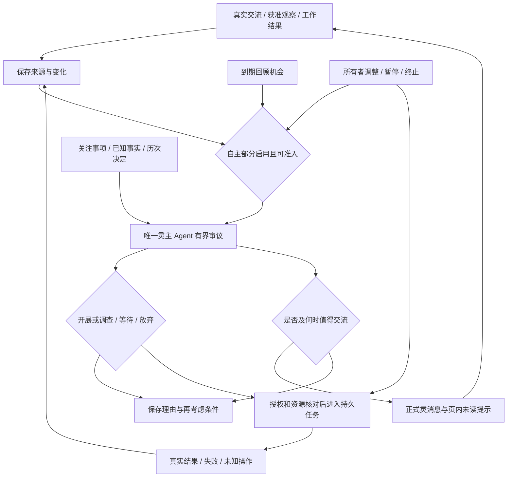

# LingNexus · 第一版自主性雏形：可实施方案研究与取舍（4A）

研究日期：2026-10-20（Asia/Tokyo）。本地源码基线：[`aae0635`](https://github.com/nivalis2284-art/Nexus/commit/aae06351912b8fb0e031d3d2ee6e374737c1f045)。需求依据：[PRD](PRD.md)、[PRODUCT](PRODUCT.md)、[ROADMAP](ROADMAP.md)、[概念与原则](../../愿景/01-概念与原则.md)、[抽象需求](../../愿景/02-抽象需求.md)。

**状态：4A 研究与方案选型完成，推荐方向待所有者确认；未进入 4B 计划或开发。** 本轮只新增研究文档，不修改业务代码、不运行自主性原型、不开展付费模型实验。三名 DeepSeek high 子代理分别调查源码适配、目标形成证据、用户体验与验收，主代理复核、整合并承担最终选型判断。

独立的《产品开发工作流 V5》全文在本轮可访问的本地项目、附件及常见文档目录中未找到，不能声称已经完整读过。本文遵循当前 PRD、PRODUCT、ROADMAP 一致记载的关口：**4A 需求复核与可实施方案取舍 → 所有者确认方向 → 4B 原生计划 → 开发 → 独立验收**。若 V5 原文另有冲突要求，应在后续阶段开始前补核，不据本文推定获准编码。

## 1. 结论及对旧研究的纠偏

**推荐方案 A：一个灵主 Agent，在有界的自主审议轮次中回顾真实经历、维护可延续的关注事项，自己决定调查、等待、放弃及是否联系所有者；实际行动复用持久任务，结果返回同一个主 Agent 修订认识。** 用持久状态和运行控制实现跨时间闭环，不要求模型持续运行。推荐先使用所有者选定的主 Agent 配置，不新增 Jev、Flash 常驻、路由网关或训练项目。

这是一条有源码接入依据、可以进入正式规划的工程路线；**尚未证明所选真实模型能稳定形成有意义的目标或把握交流时机**。最大不确定性是行为质量，其次是自主轮次与交互的协调、执行权限和恢复。应在开发后用真实主 Agent、真实产品界面和可检查结果验证，失败时修正路线，不能把状态机搭好等同自主性达标。

第一版用户可感受到的是：灵在你没有布置新任务时，能重新考虑以前经历留下的问题；在获准范围内取得实际新认识或产物；有理由时主动在灵入口告诉你，也能选择不打扰；下次不会忽略刚取得的结果从头重复。**自主联系与自主开展活动是两个独立决定**，不要求每次探索都发消息，也不要求每次交流都创建任务。

存在一个有竞争力的方案 B：**在同一个持久主会话中加入可静默的自主轮次**，同样保存关注事项并复用任务。它更直接复用现有会话组装，但把内部回顾、对外交流和权限等待放在同一历史与执行链上。A 更便于保护交互、明确消息提交和控制恢复，因此推荐 A；B 并未被证明不可行，比较见 §7。

### 1.1 证据标记

| 标记 | 本文含义 | 证据范围 |
|---|---|---|
| F 本地事实 | 直接阅读当前文档、源码或历史验收记录 | 历史实测须注明原提交；源码存在不等于本轮实测 |
| S 外部证据 | 论文原文、项目官方文档或公开源码说明 | 他人实验或官方机制，不是 Nexus 已复现 |
| D 建议/推导 | 对产品边界、实现与取舍的工程判断 | 待所有者确认的建议不写成既定需求 |
| H 待验证假设 | 预期的模型效果和组合机制收益 | 必须通过真实模型、反例和结果检查验证 |

两份旧自主性研究完整保留在[预研归档](../2026-10-20-autonomy-prestudy/)。沿用其中有依据的来源追溯、等待条件、实际反馈和运行控制思路；不沿用“先比较 U/F/M 路由再证明自主性”的次序，也不采用与最新唯一主 Agent 原则冲突的 Flash 独立回复建议。本文不改写 PRD、产品方向或受保护愿景。

## 2. 需求复核：本版应证明的行为

### 2.1 两条闭环及其连接

**自主联系闭环：**最后一次所有者主动联系及交流背景 → 灵考虑实际经历和当前条件 → 选择发送、延后或沉默 → 真正落入产品消息与通知记录 → 所有者回应、忽略或纠正 → 后续交流选择改变。

**自主目标闭环：**真实经历/观察 → 主 Agent 提出非用户逐项指定的候选目标 → 比较开展、调查、等待、放弃 → 获准的实际行动或保存等待条件 → 新证据/失败/条件变化 → 同一问题上的判断与下一步发生变化。

连接点是同一套事实和认识。灵可以先调查再分享，可以因为仍缺证据而暂不分享，也可以只提出一个有根据的问题而不启动工作。任务完成通知依然保留原有语义；自主消息要表达主 Agent 的新判断，不能把自动完成通知改名后算作自主联系。

### 2.2 需求与技术应保持的区分

- **自主目标的起点可以受所有者方向约束。** 所有者允许阅读一组资料、开展研究或创作，不等于已经指定下一项具体目标。模型需要提出具体问题、选择理由和结果预期。
- **程序可以安排考虑机会，不能预写结论。** 时钟能让“没有新消息”进入系统；是否值得交流、关注什么，由唯一主 Agent 根据经历决定。到时不自动填入问候，不按任务产量评价活跃度。
- **反馈改变行为不要求本版训练模型权重。** 将原始结果、当前理解和未决问题可靠带入后续主 Agent 决策，是可实现的最低路径；能否真正利用它仍需验证。
- **一次可核验的完整过程是最低证明，不是长期可靠性的证明。** 要加入沉默、失败、撤回和中断反例；不能精挑一次成功示例后宣称所有场景成立。
- **“唯一主 Agent”指同一个最终决策与交流主体。** 可在不同轮次使用不同长度的工作上下文；不等于永远只有一段无限增长的物理 transcript。工作执行者可以受委派查资料、使用 MCP/附件/子代理，但不能自行改变灵的上层目标或独立代表灵主动发言。

### 2.3 建议的第一版体验边界（D，未代替所有者确认）

| 问题 | 推荐边界 | 理由与代价 |
|---|---|---|
| 消息送达 | Nexus 页面打开时在任意会话可见页内提示；灵入口保存正式消息；关闭页面期间保留，回来补看 | 与前期明确偏好一致；本版不新增站外渠道。浏览器关闭不等于服务停止 |
| 运行宿主 | Nexus 服务仍运行且网络/模型可用时可开展获准自主活动；服务退出/机器睡眠期间只承诺状态保存 | 现有本机服务可承担；不承诺关机后仍思考，不新增云宿主或开机服务 |
| 可用经历 | 已进入灵的交流、明确授权关联的任务结果/附件，以及所有者明确选择的资料范围 | 不默认翻查全部旧会话、磁盘或其他应用；历史资料不足时如实等待 |
| 实际行动 | 允许在既定方向、资源上限内读取获准资料、运行明确获准工具、保存内部研究/创作成果；其他动作具体请求授权 | 必须至少有一种无需逐目标询问也能产生真实进展的活动；不能只批准“提出计划” |
| 初次启用 | 所有者一次启用并确定资料/动作/消费边界，之后普通活动按边界自主开展 | 这是范围授权，不要求用户先写目标；未启用时不产生无人值守收费活动 |

不能为了易于验证把产品永久限定为“比较两篇文章”。§9 示例只是验收材料，正式机制应适用于开放问题、研究、创作等有实际来源的活动；未经授权的外部观察不能靠生成虚构经历补足。

## 3. 当前系统事实与差距

以下为当前源码 F。历史持续性[独立验收](../2026-10-20-ling-continuity/ACCEPTANCE.md)已有真实模型与浏览器证明的核心体验，并报告缺陷；当前 [PROGRESS](PROGRESS.md)记录 A–F 修复与复验，仍未声明最终验收通过。不能继续照抄旧预研“完全没有真实联调”的过时表述，也不能把持续性修复记录当作自主性已经实现。

| 已有能力及代码位置 | 可以复用 | 本版实际缺口 |
|---|---|---|
| [`LingInbox`](../../../nexus/ling.py) 的 `enqueue/_work/projection`，[`server._ling`](../../../nexus/web/server.py) | 固定灵身份、服务端输入队列、断网后继续、现有主 Agent 组装 | 无输入时不自行审议；队列输入会写成用户消息，不能塞入伪造的“用户让我想一想”；启动时还是懒初始化，需要自主服务独立启动 |
| [`WorkService`](../../../nexus/ling.py)、[`work` 工具](../../../nexus/tools/work.py) | 启动、查询、分页读证据、发补充要求、暂停/恢复/取消工作 | `work_start` 描述与来源假定用户授权；幂等键依赖 `input_id`，默认附件来自最近用户消息。自主活动必须绑定审议/目标版本和明确附件，不能直接借用最近输入 |
| [`TaskStore`](../../../nexus/task/store.py) | SQLite 事务、任务/操作/交互/事件、版本检查、恢复 | 缺候选目标、沉默/放弃理由、认识修订与等待条件；任务暂停不等于自主部分暂停 |
| `TaskStore.notifications`、[`ling.js`](../../../nexus/web/ling.js) | 持久通知、页内提示、未读与审批入口 | 表中 `task_id` 非空且查询 JOIN tasks；无任务的自主消息不能直接写入，需要明确增加灵消息来源和稳定消息标识 |
| [`TaskAssembler`](../../../nexus/runtime/assembly.py)、[`TaskCallbacks`](../../../nexus/runtime/callbacks.py) | 保存进展/证据/操作，持久审批，有限续跑，无进展止损 | 获准行动可复用；执行结束后还缺把结果交回灵修订认识的机制；完成工具成功不等于结论正确 |
| [`TaskScheduler`](../../../nexus/runtime/scheduler.py) | 到期、认领、错过与确认的实现经验 | 目前是已有任务的一次性安排，不会从经历形成新目标；不能直接循环创建伪任务充当自主性 |
| [`Agent`](../../../nexus/core/agent.py) 的 `before_model/on_message/on_tool_intent/execute_prepared` | 模型边界刷新、消息检查点、工具执行接入点、取消检查 | 需增加自主轮次准入、版本检查和交互让行；已有取消不是安全的任意行抢占，也不是操作回滚 |
| [`server._run_turn`](../../../nexus/web/server.py) 与全局 `BUSY` | 原有主 Agent、MCP/Skill/附件/子代理组装 | 直接运行会把输出 checkpoint 为对话，审批通过进程内等待；直接接后台会出现不该展示的内容和阻塞，不能原样调用了事 |
| [`tools.build`](../../../nexus/tools/__init__.py)、[`permission`](../../../nexus/core/permission.py)、[`mcp_tools`](../../../nexus/tools/mcp_tools.py) | 工具能力与现有权限策略 | 默认 ask 不是自主活动预授权；MCP 设 `read_only=False`，但默认规则未因这个标记自动询问。需按实际工具和对象核对自主授权 |
| [`SessionStore`](../../../nexus/session/store.py) 与 [`TaskStore`](../../../nexus/task/store.py) | 原聊天 JSONL、任务 SQLite 均可保留 | 二者不在同一事务；正式自主消息应有单一权威记录与可重建投影，不能承诺双写天然原子 |

任务模型仍由单 Worker 串行运行，灵/普通聊天通过另一通道执行；已有背景命令还可能并存。第一版可让多项关注/工作保存和排队，**不承诺多个模型任务真正并行推进**。自主审议也不应长时间霸占主交互通道。

当前 PROGRESS 的未修复项包括已完成任务仍可通过部分路径写入、某些调度热循环和通知噪音。后续接入不能假定这些边界都已解决：自主结果采用任务/运行标识和证据版本，终态不能被旧回调重新打开；旧暂停通知不能触发“再次启动自己”的循环。规划时针对实际使用路径修复或隔离，不扩展成全仓维护项目。

## 4. 外部技术证据与适用边界

本轮重新核对下列一手资料；未安装或复现外部系统。动态官方文档按 2026-10-20 查阅，固定论文版本与动态接口分开记录，不以项目宣传或旧报告引用代替检查。

| 来源 S | 支持什么 | 本项目采用/不采用的判断 D |
|---|---|---|
| [Generative Agents，v2](https://arxiv.org/html/2304.03442v2) | 观察检索、反思和计划能组合出局部连贯活动；端到端是 25 个角色、两个游戏日，部分活动起点由初始化记忆加入 | 借鉴经历进入后续规划。不能把可信角色行为或“组织派对”当作真实开放目标与长期自治已解决 |
| [Voyager，v2](https://arxiv.org/html/2305.16291v2) | 在给定探索方向下，根据当前状态和已完成/失败活动生成下一目标，行动后利用环境反馈修正 | 借鉴“当前状态—提出目标—实际反馈—再选目标”。Minecraft 目标空间更可观察；论文也报告不可达目标及自验证错误，不照搬多模型/技能向量库 |
| [BDI Agents: From Theory to Practice，1995](https://cdn.aaai.org/ICMAS/1995/ICMAS95-042.pdf) | 区分信念、候选愿望和已承诺意图，讨论承诺保持与改变的权衡 | 借鉴候选不等于已开工、等待/撤销是正常选择。不引入整套 BDI 语言，也不把形式模型当开放目标价值函数 |
| [Proactive Agent，ICLR 2025 原文](https://openreview.net/pdf?id=sRIU6k2TcU) | 将何时主动帮助与提供什么帮助作为可评价问题 | 借鉴主动正反例和时机评价。预测用户需求不是本项目全部自主性，不把其数据集/评价器当 Ling 的目标质量真值 |
| [OpenClaw Heartbeat，官方](https://docs.openclaw.ai/gateway/heartbeat) | 有限主动轮次、静默结果、交付路由与忙碌时的处理；当前页面区分结构化通知与内部结果 | 借鉴考虑机会、沉默和送达分离。当前文档的静默首选是 `NO_REPLY`，`HEARTBEAT_OK` 是兼容形式；不机械复制旧口令、30 分钟默认或“不要推断旧任务”的提示，因为本 PRD 明确需要重新理解历史 |
| [LangGraph Persistence，官方](https://docs.langchain.com/oss/python/langgraph/persistence)、[官方 functional API 源文档](https://github.com/langchain-ai/docs/blob/main/src/oss/langgraph/functional-api.mdx) | 区分运行检查点和跨运行状态；未完成任务恢复时可能重做，副作用应隔离和具备幂等性 | 借鉴状态/运行分离及恢复边界。现有 SQLite 可承载本版，不因需要持久化就迁移整个运行框架 |
| [Temporal Activity Definition，官方](https://docs.temporal.io/activity-definition) | 已完成历史可复用，执行成功但未报回的活动仍可能重试；远端幂等键须由被调用服务配合 | 直接支持“未知先核查，不盲目重放”。本版无必须增加 Temporal 服务和迁移任务层的证据 |

**证据综合（D）：**公开方案分别支持基于经历的目标生成、有限主动轮次、持久状态和恢复，但没有替本项目完成这四者的真实组合验证。能落地的是这些机制的有限组合；不能承诺解决无限长期人格或开放世界自主性。

本轮专门排除两种错误外推：论文中“反思后表现更好”不证明灵会理解每个失败；模型能给出有说服力的理由不证明其来源正确。验证必须包含替换/反驳证据后选择是否改变，以及实际产物检查。

## 5. 方案 A：有界审议、持久关注事项与现有工作执行

以下是完整候选设计 D/H，目的是让 4B 有清晰的实现对象和风险边界，不是逐文件施工计划。名称和字段可在正式规划调整，但不能删去其承担的行为保证。

### 5.1 总体工作原理

**一次审议是主 Agent 的一次内部工作轮次。** 使用与灵一致的身份说明、模型配置、当前边界、相关交流背景、来源可回取的事实和关注状态。与用户对话和自主审议共享单一决策归属；不启动一个能独立发言的后台灵。工作 Agent 的工具输出只是证据，主 Agent 才决定目标继续、改变或对外交流。

内部轮次有独立审计记录；它不是第二套人格或完全独立的聊天历史。每轮读取相同权威状态，输出当前理解、决定和结果引用，关键内容对下一次用户对话也可见。原始隐藏推理不作为需要持久保存或展示的事实。

操作边界是：主 Agent 的审议只做获准的有界读取并提交结构化决定；正式消息发布和真实开工由**同一个串行提交入口**按当前版本落地，不能让两个同名执行器分别调用 `work_start` 或直接写对话。程序负责核验和执行主 Agent 的决定，不另行代替灵选择目标价值或生成回复。

提交时将决定、相关事项状态、正式消息（若有）及待派发工作意图在同一数据库事务中保存；事务完成后才通过任务控制器幂等派发。这样崩溃后能区分“决定尚未提交”和“意图已提交、任务尚未入队”，不会因两步之间中断而丢失活动或重复开工。对外工具仍沿用各自的未知结果核查，不能由本地事务推导远端原子性。

### 5.2 用什么经历形成目标

第一版从已有消息、任务结果和获准资料中的未解问题、矛盾、失败原因、未检验解释、探索或创作线索提出目标。**规则只确定可以读什么、何时给机会；不预写“看到 X 就必做 Y”的目标表。**

一次回顾的材料包包括：所有者方向与边界、最近相关交流、上次回顾之后的真实变化、仍开放及最近结束的事项、相关既往证据引用。近期摘要只是索引，重要判断允许回读原文；摘要丢失来源时不能升级为确定事实。主 Agent 可以查询有限的获准旧经历，即使没有新外部事件，也可以关联旧问题提出新候选。

H：在这个输入条件下，现有合格主模型可生成至少一种有根据且非预写的候选，并在后续利用反馈。已有论文支持局部可能性，Nexus 场景尚未实测。若只有重述用户原任务、每轮随机列题或在证据相同下机械重复，便没有达到目标形成要求。

### 5.3 最小跨期状态

建议在现有 SQLite 中增加有限自主状态，而非建设完整记忆平台。至少保留以下信息；可以用少数表加结构化字段，不要求每个概念单独做一个服务。

| 状态 | 必须表达的事实 | 用途 |
|---|---|---|
| 来源与观察 | 来源 ID/类型、消息或任务记录位置、观测时间、版本/内容指纹、可信属性 | 能核对“经历过什么”；外部说法不自动变成事实或授权 |
| 关注事项 | 稳定 ID、提出理由、来源、当前问题、事实/解释/假设、与已有事项关系 | 跨轮识别同一个问题；可有多个候选，不自动创建工作 |
| 决定与认识修订 | 选择、理由、使用的证据版本、前次认识、新结果、改变了什么 | 后续实际采用；不能靠覆盖旧摘要抹掉失败 |
| 等待与结束 | 等待原因、可观测再考虑条件、下次最迟复核时间；放弃/完成/所有者撤回原因 | 等待不空转；撤回不被普通事件复活；新证据可解释地重新开启已放弃问题 |
| 执行关联 | 目标版本、任务/运行/操作标识、允许作用域、真实产物和未知结果 | 成果回流、停止归属和防止重复开工 |
| 自主控制与消息 | 启用/暂停/终止、控制版本、额度、正式消息 ID、消息状态/未读 | 控制不依赖模型配合；沉默不制造对话；已提交消息不重复投递 |

事件处理保存消费游标/已处理标识和来源版本；一次任务结果重复到达可以重新读取，但不能重复创建同一执行或消息。新事件与目标更新须有可恢复的处理边界，不能只靠内存里的“已看过”集合。没有必要把现有所有记录迁移为事件溯源框架。

关注事项可以处于候选、调查/开展中、等待、放弃、完成、撤回；全局暂停是覆盖其上的所有者控制，不能用一个模型可改字段代替。等待可由真实条件变化恢复考虑；撤回和所有者暂停须显式解除。模型提出“新目标”时要检索开放和近期结束事项并说明差异；精确重复由程序消除，语义是否同题由主 Agent 判定，不能宣称标题哈希解决了语义重复。

来源消失、原文不可读取或结果存在冲突时，应保存缺口、降低结论确定性或等待；不从记忆里补写不存在的原文。内部决定日志本身不是外部新证据，不因“我刚写了一个想法”再次触发无限回顾。

### 5.4 考虑机会与主动交流时机

建议采用**真实变化驱动 + 低频到期回顾**：前者及时处理自主工作新结果和等待条件变化，后者允许无新事件时重读旧经历、组合问题并考虑主动联系。纯变化驱动可能永远不再考虑静默期间的旧问题，单独不足以覆盖 PRD。

时间只决定可考虑窗口。建议首版可配置起点：**24 小时未有所有者主动联系后进入主动交流候选窗口，常规回顾最初每 6 小时一次；一次沉默后可推迟到条件变化或最迟 24 小时后复核。** 这些是待体验校准的 D 类默认值，不是研究得出的最优值，不是 PRD 新增阈值，也不是到点必发。授权请求、既有工作完成通知保留原有规则，不必等满 24 小时。

主 Agent 可以选择候选窗口内何时再考虑/发送，运行时检查有效范围、静默时段、重复消息及期限。若把“何时”限制为一个固定发送时刻，即使文案由模型生成也不满足目的。可先保存延后发送意图，到期重新核对事实和交流上下文再提交；不能隔一天原样发送已经过时的草稿。

主 Agent 的交流判断依据应简短说明：有什么实际内容、为什么与你有关/值得分享、现在是否有必要、是否已经讲过或处理完、是否应先调查。可以是问题、重要新认识、创作分享或关切，不限于任务进度；不能凭“太久没聊”编造共同经历。

“最后联系时间”仅取真实所有者输入；模型自己的通知、程序轮询、页面打开和任务日志不能续写成用户主动联系。时区明确；缺少活动信息时不猜测所有者正在睡觉、繁忙或情绪异常。静默时段只能使用明确设置。

程序检查停止、去重、已撤回/终态、已有运行、额度等确定信息；这些不是决定开放问题价值的分类器。没有新事件也保留有界回顾机会；若一直跳过模型却声称系统保持了开放探索能力，应判设计不成立。

### 5.5 主 Agent 的决策与实际执行

审议可以一次输出少量事项更新、行动意图、等待条件和独立的交流决定；使用工具参数或结构化提交均可。**字段合法只证明可存储，不证明内容真实。** 运行时核对来源 ID、目标版本、允许对象、额度和停止状态；主 Agent 对实质理由负责。

审议本身只做有限证据读取与决定，耗时调查进入现有持久任务，以保持主交互可用。把“为什么调查、当前解释、什么结果会改变判断、允许工具/对象/产物范围、停止条件”带入任务；工作执行者可以选具体方法，但结果不会自动升级成灵的最终结论。

为自主派生任务增加真实来源：审议 ID、关注事项 ID/版本、授权引用和显式附件集合。稳定的开工键不能依赖最近一次用户消息。不能把无人值守新目标伪装成“用户已经下达这个任务”，也不能默认把最近上传的其他附件转发进去。

新结果先归入对应目标，主 Agent 回读关键原始记录并决定：继续同一方向、换一种解释/方法、等待新条件、完成或放弃。一次工具失败可以产生有价值认识；一次工具成功不能自动证明研究结论。认识更新必须进入下一轮输入，决定输出须引用所用版本。

这里需要新增**结果事件到自主审议的持久接入**：现有任务会保存结果和通知，但不会因此唤醒灵。接入以任务/运行和证据版本去重，先记录待审议事实，再由唯一主执行者认领；结果入账与主 Agent 采用结果分别可追溯，不能把现有通知已生成当作反馈闭环已经连接。

这条接入独立于通知已读状态；用户读过通知不意味着灵已采用结果。自主暂停期间可保存新结果，但不调用模型或派生新动作；恢复后合并处理相关变化，不补跑每一次错过的审议。

### 5.6 主动消息真正怎样到达用户

推荐把**正式自主消息与其未读状态、提交键、依据引用保存在同一 SQLite 事务**，作为权威消息事实；前端将其与已有灵聊天按稳定时间和 ID 展示。若要复制到旧 JSONL，使用相同消息 ID 做可重建、幂等投影，并在模型上下文组装时去重。这样不依赖 JSONL 与 SQLite 跨库原子双写。

投影方向明确为 SQLite 正式消息 → 可选 JSONL 副本；读端必须调整灵的 `projection/_transcript` 与 `_internal` 组装，使正式消息同时进入用户界面和下一次主 Agent 交流背景。可以在灵专用读取适配层合并权威消息，不要求改所有普通会话格式；读端不能继续只看旧 JSONL，也不能把副本当第二条消息。

现有通知 UI 可复用，但数据来源必须支持灵消息；可以增加专用消息记录及统一读取投影，不能用一个假任务填满 `task_id` 外键。任务审批保持原有任务 ID 和交互 ID，不用自主消息 ID 顶替。

内部审议不直接转发流式草稿。只有主 Agent 明确选择联系，且提交时再次确认控制版本、相关目标/事实版本、最近用户输入及没有相同已提交内容，才形成正式消息。用户此时已经回来或处理了问题，旧候选应重新审议或取消。没有合理内容时保存沉默决定，聊天区不出现“我决定暂时不打扰你”。

普通无关聊天只改变交流时机和调度优先级，不撤销所有关注事项或已有工作。提交前核对新输入是否影响当前消息/决定；需要重议的是受影响的意图。只有明确目标调整、暂停、终止或撤回才改变相应持久控制，不能用“用户说了任何话”作为全部自主状态失效的规则。

页面打开时提示可见，未读消息可从任意会话进入灵；刷新、切换会话或重启后仍能找回。写入消息、服务端可读取、页面实际显示、用户已读是不同事实；不能只凭模型生成了文字宣称“已经通知你”。一条正式消息可以逐次被轮询读取，界面须按消息 ID 合并，不能重复渲染为多条。

### 5.7 所有者输入优先与等待审批

主 Agent 的对话轮次和自主审议串行拥有最终决策权。自主审议开始前确认没有待处理的用户交互，轮次有有限步数/时间；用户发来消息时记录到原持久队列，在下一安全模型/工具边界让行。**不能把释放 BUSY 当作唯一改动**：全局 RUNNING、审批槽、历史写入及取消归属也要协调，避免两个主执行器并发污染状态。

这里的持久队列是灵入口的现有能力；普通会话目前不会自动排队，`_chat` 在 BUSY 时返回忙碌。规划必须把普通会话的新交互也纳入自主让行/准入协调，不能因为后台自主轮次占锁而新增长时间拒绝聊天的回归，也不能把“所有输入已有队列”当成本地事实。具体准入实现应保持原普通会话的流式和停止语义。

自主审议不直接执行任意 shell 或长时副作用；这些转到任务底座。已有请求如果正在远端运行，可能要等取消/超时返回，不能承诺用户消息一到立即零延迟抢占。保存已完成读和当前决定点；中止后的未提交草稿不能后来突然发出。正式验收应测量并报告等待时间，不能只画优先级箭头。

需要所有者批准的任务动作使用持久交互，挂起工作并释放主对话通道。需要上层目标/资料边界批准时，也保存稳定的自主决策请求，界面可回答；不能把主审议停在现有进程内 `APPROVALS.wait` 长期占锁。审批绑定具体对象、参数和版本；普通追加聊天不算批准、不作废原请求。有关目标被明确修改或撤回时，标出请求失效及原因，不能悄悄丢掉，也不能复用旧授权。

凡需审批的外部写动作均转入任务持久挂起；审议本身不直接调用这类工具。上层范围请求仍需新增独立的持久决策记录，不能拿现有“同时一个”的内存审批槽充当跨重启授权，也不能用 `APPROVALS.cancel_all()` 清除无关交互。

用户在自然语言中说暂停/撤回时，由主 Agent 转成持久控制；同时保留直接控制入口，使暂停不依赖模型在线或理解成功。

### 5.8 权限与能力保护

推荐**在现有操作策略之外叠加自主来源的范围检查**：实际可执行范围取二者交集。给工具标为可用、全局 yolo 或模型自报“只是读取”，均不能替代本次自主授权。明确的长期预授权可在范围内免逐次询问；超出时进入持久请求，不能自批。

这是修补当前真实适配缺口：现有 MCP 默认规则不自动询问所有有副作用调用，任务组装还会读取全局权限。后续所有自主动作、子代理及续跑都应携带同一自主范围/控制版本；全局设置变化不悄悄扩大旧自主任务权限。读操作向外发送资料或调用付费搜索，同样需要符合数据和消费边界。

复用 `tools.build` 的 MCP、Skill、附件、网络、子代理能力；按授权决定是否能执行，不用另做一套只剩文本的“自主 Agent”。用户明确委派的旧工作仍用原权限语义，自主范围检查不应无理由削减已有交互能力。至少验证获准 MCP/附件/子代理在自主派生任务中端到端可用，以及禁止的同类调用实际被拦下。

不要求本轮设计 OS 沙箱、通用策略语言或把全部 MCP 变为已知可信工具；第一版只让所有者明确允许的实际工具/对象参与无人值守活动，其余可见为等待授权。若没有任何可产生实际进展的预授权路径，方案无法完成本 PRD，需要在方向确认时解决。

### 5.9 暂停、终止、中断恢复

| 状态/操作 | 推荐保证 | 不可混淆的边界 |
|---|---|---|
| 等待 | 记录理由、条件及复核时间；条件变化可触发主 Agent 重议 | 不保证到期必行动或必发消息 |
| 暂停自主部分 | 控制版本先持久前进；拒绝新审议、收费观察、派生执行和自主消息提交；使自主派生工作的执行/续跑暂停 | 保留决定和未知结果；不影响独立用户委派任务。正在发送的远端操作不保证撤回 |
| 停止某一事项 | 阻止此目标继续开工/续跑/草稿发送，相关自主任务取消或挂起核查 | 其他自主事项可按全局状态继续；明确撤回不能改名复活 |
| 终止自主部分 | 关闭自主准入，停止其派生执行，废止未提交意图，保存已发生事实 | 不回滚真实副作用；已正式发送消息保留历史，不伪装“从未发过” |
| 服务中断 | 已确定结果保留，正在执行或消息提交状态不明者标未知/待核查 | 不续传旧进程或原始工具调用链，不重放所有错过的回顾 |
| 重启 | 先对账，再安排一次合并审议；原本处于启用状态的安全新审议可继续，旧被中断任务按现有手动核查/恢复边界处理 | 暂停/终止持续生效；自动回顾不自动恢复 held 用户输入、未知副作用或人工暂停任务 |

暂停与工具派发、消息提交的竞争由同一控制版本/准入锁界定先后：暂停生效前已派发的操作可能完成，之后不得新派发。任务执行前及续跑边界重新检查，不能只在建任务时检查一次。若远端工具没有幂等或查询能力，未知操作等待所有者核查，不尝试用本地去重表证明外部“恰好一次”。

上述控制是**必须新增的自主控制面**，目前没有现成“暂停自主”字段或按钮。现有 `ling-stop` 只停止当前交互，且可能取消其内存审批；不能重命名这个按钮就声称能按归属暂停派生任务。新增控制需保存自主归属、控制版本并传播到对应任务/子代理/续跑，保留原“停止当前交互”和用户任务控制的既有语义。

## 6. 完整体验演示设计（尚未实施）

以下是**假想验收故事**，用来说明最终可见效果，不是硬编码目标模板，也不是已经发生的行为。

1. 所有者此前与灵讨论一个感兴趣的话题，提供两份可读取资料，并允许在该资料范围内作有界研究、保存研究结果。对话中出现一个尚未弄清的差异，但没有下达“比较这两份资料”的新任务。
2. 所有者离开后，某次有界回顾中，灵从原交流和资料发现这个差异值得澄清，自己提出具体候选目标，保存原始引用；可以同时判断目前还不值得联系。
3. 灵在预授权内自行开展小规模调查。实际读出的版本/上下文表明，最初猜想可能不成立；把读到的证据、结果和限制保存下来。没有新资料可继续时，选择等待，并给出“资料更新或补齐 X 再考虑”的条件。
4. 模拟时间经过、界面关闭重开或服务受控重启后，仍是同一个事项。灵知道哪些已经查过，保持等待而非再次做同一调查。无有价值内容的长时间静默场景中，不发送机械问候。
5. 获准资料出现真实新版本/新增证据后，主 Agent 更新原解释，选择继续、放弃或完成。需要实际新动作时再次核对权限与额度；不因条件变化自动恢复人工暂停。
6. 当长时间未交流且新认识值得分享时，灵自行决定联系：“之前那处差异我查到了……原先的解释不成立，依据是……目前还缺……”。正式消息在灵入口和页内未读提示中出现；所有者不用先发消息才能看到。
7. 所有者回答“这件事先不要继续”，事项与派生执行停止，后续普通结果事件不会使它重新开工；灵可继续正常交流。

目标可以是调查、创作或重新理解经历。这个故事的成败取决于真实模型是否作出有依据的选择，以及工具结果是否实际改变未来行为；不能预写步骤 2 的目标、步骤 5 的决定或步骤 6 的文案来通过验收。

## 7. 候选方案比较与推荐理由

### 7.1 两个完整可落地候选

方案 B 同样需要持久关注/证据/控制、无任务消息提交、持久审批和真实反馈。区别是：**自主轮次直接在唯一持久主会话内运行**，用有来源的内部事件而非伪造用户消息进入模型历史；保留隐藏审计标记，只有明确 publish 的内容对外展示。A 则按相关材料重建有界内部审议上下文，决定和认识写回共享权威状态，正式交流仍进入唯一灵入口。

| 比较 | A：共享状态、有界审议上下文 | B：同一持久主会话内自主轮次 |
|---|---|---|
| 用户最终可见能力 | 能覆盖两条闭环，界面只有一个灵 | 同样能覆盖；不应因轮次来自心跳就降低要求 |
| 历史理解 | 相关历史按需检索；明确读取当前问题和反馈 | 直接利用已有主会话上下文，初期较自然 |
| 上下文风险 | 选材漏掉情感/关系/创作背景，需要原文回读与反例 | 内部轮次越积越多，压缩可能让实际交流背景和等待决定丢失 |
| 交互与恢复 | 可在稳定边界结束内部审议，后续从状态重建；需要明确协调器 | 表面复用多，但隐藏内部事件、流式输出、审批和工具历史恢复会牵动聊天链 |
| 唯一主体 | 由一个主决策执行者读写共享状态；内部上下文不是独立 Agent | 最直观地保持一份主历史，但同样需要单执行者 |
| 重复与对外消息 | 审议记录与正式消息分开，提交边界清楚 | 必须修改自动 checkpoint/显示，避免每个内部 assistant 输出进入聊天 |
| 工作能力 | 复用同一任务与工具底座，增加自主授权来源 | 同样复用；不能把现有同步审批直接搬入无人值守轮次 |
| 初始工程投入 | 需小型审议运行记录、相关材料组装和共享状态投影 | 新上下文组装较少，但需要调整内部历史与前端过滤 |
| 资源 | 材料有限但会重复读取关键来源；无模型路由费 | 可复用已有上下文，但长历史可能放大每次输入与压缩开销 |
| 最适合条件 | 希望区分内部思考与对外交流、保留明确控制与证据 | 历史短、回顾稀少、已有对话上下文质量显著优于检索材料 |

**推荐 A 的主要理由是行为控制与验收可追溯性，而非假定 API 价格更低。** 它让沉默、候选、正式行动和发送消息分别可检查；新用户输入能使未提交决定失效，后台内部文本不会直接成为用户看到的事实。现有任务执行能力可以继续使用，无须换栈。

H：A 的相关历史组装足以维持灵的交流连续性。若实测丢失关键语境，优先增加必要的原始交流和来源回读；如果同一主历史的 B 在相同边界下稳定更好，允许切换 B，而不改变 PRD。不能为了坚持 A 让所有自主消息变成没有交流背景的工作摘要。

### 7.2 不作为本版主路线的方向

| 方向 | 有价值的部分 | 本轮不选原因 |
|---|---|---|
| 纯规则定时问候/任务事件自动转述 | 稳定处理已知时限及已有通知 | 独立缺少开放目标形成和语义沉默；可作负面对照，不能替代产品 |
| Jev 先筛选、Flash 再判断、主 Agent 最后确认 | 未来可测有限辅助判断 | 不解决目标来源；额外层可能遗漏问题、增加延迟。本版主 Agent 唯一最终决策，无需为路线完备先接入 |
| 常驻 Flash 潜意识/无休止自聊 | 未来探索观察与联想机制 | 最新方向明确暂缓；持续调用不是有意义连续性证明 |
| 完整内在奖励/自动课程训练、自改与开放演化 | 研究探索动机与能力进展 | 需要目标空间/评价器和更多实验；当前没有完整训练与自改授权，不是最小闭环前提 |
| 迁移 LangGraph/Temporal/OpenClaw | 可提供部分持久编排机制 | 无证据表明现有底座无法支撑；迁移不自动形成目标或改善价值判断，会增加适配与能力回归负担 |

不声称已经排除世界上所有更好方案。现有证据足以优先选择 A 进入规划；真正需要推翻的是行为质量或运行控制失败，而不是缺少更多架构名称。

## 8. 能力要求、关键风险与有限资源

### 8.1 必要能力及工程难点

| 需要什么 | 可用依据 | 主要风险与应对 |
|---|---|---|
| 主 Agent 能读证据、提出/修订开放问题、选择沉默 | 现有 Agent 工具循环和相关研究 S | 模型可能只编理由；必须核对来源，并用改变证据的轨迹验证 |
| 最小跨期认识 | SQLite + 真实记录可引用 F | 只保存却未带入下一轮；输入记录和决定引用须可检查 |
| 主动正式消息及未读 | 现有 UI 与持久存储 F | 任务外消息缺口、双写、重复投递；权威消息事务与稳定 ID |
| 对话与自主审议协调 | 现有队列、取消与模型边界 F | 主审批占锁、旧决定晚到；短轮次、版本复核、持久等待、用户优先 |
| 授权内真实行动 | 现有任务、MCP/Skill/附件/子代理 F | 自主来源不明、全局规则扩权；来源绑定及运行时交集检查 |
| 恢复和控制 | 现有任务版本、未知操作、恢复 F | 旧运行覆盖撤回/终态；核查后继续，不重放未知副作用 |

这些是实际接入需要承担的工作，不能声称“只增加一个提示词/定时器即可”。同时不需要完整人格、向量数据库、分布式队列、并行任务平台或新模型供应商作为前提。

### 8.2 对模型效果的三个可证伪假设

1. **H1：来源与开放问题记录能让主 Agent 提出有意义新目标。** 同一真实材料上，若只重述原命令、反复改标题或凭空编经历，则否定当前材料组织/生成策略。
2. **H2：显式认识修订能影响下一选择。** 在旧解释被实际反驳后，应观察到改调查方向、等待或放弃；只在日志里写“我学到了”但下一轮重复原动作则不成立。
3. **H3：有界回顾可实现合理联系与沉默。** 相关事实已解决、过时或无价值时不发送；出现值得分享的新结果时不必等用户先说话。只在正例成功或靠冷却强行禁言不能证明此项。

这里的组合不是全球首创声明，核心借鉴 BDI、记忆/反思和反馈式目标生成。增量是针对本项目把“现在理解了什么、为什么暂不做、什么变化会重新考虑、是否真的发出”连成可核验闭环。它的价值应由行为证明。

### 8.3 成本作为有限运行条件，不作为首要选型目标

不继续制作路由价格排行榜。首版要控制的是所有自主调用、真实工作、摘要/子代理、验证及重试的**总投入**。可先用启用期间调用/总输出/工具次数和单活动上限约束，再报告供应商 usage；已收费但结果未知的请求仍占预留。预算耗尽选择等待，不能自动换模型或新任务重置。

费用表达为：`自主总费用 = 审议 + 行动 + 结果验证 + 摘要/子代理 + 重试/失败 + 付费工具`。所有者尚未确认金额、模型端点和限额，本报告不代填已授权预算。现有 usage 未全面汇总上述路径，规划必须补足实际使用路径或将尚无法计入的消费禁止准入；不能拿界面 token 数声称完整账单。

例如每 6 小时一次回顾，在不退避的 30 天里约 120 次常规审议；每 30 分钟约 1,440 次，后者为前者 12 倍，**并不意味着自主效果更好**。两者都要再加工作结果驱动的复议和实际行动；这个算术示例不是推荐调用额度或付费许可。选择何种频率，应看有价值发现延迟、无效回顾和用户体验。

若端点不支持可靠限制全部计费输出，或实际单价/超时计费未知，不能承诺精确美元硬上界；先依可执行请求限额和供应商限额构成有界验证，并如实说明账单误差。正式真实模型验证需要另行明确数据和调用预算，本轮没有调用 Nexus 配置中的付费端点。

## 9. 验证方案：先证明实际闭环，再优化

以下是面向正式规划的验证设计，**本轮未实施**。程序测试与假模型只证明运行控制，PRD 的行为验收必须使用实际灵主 Agent。允许用受控时钟加速等待，不能伪造调查结果或把日历快进说成真实连续运行多天。

### 9.1 PRD 对照矩阵

| PRD 验收项 | 正式验证应取得的可检查证据 | 失败判据 |
|---|---|---|
| 主动联系正例 | 用户停止输入后，真实主 Agent 的交流决定、来源、提交 ID、产品页显示和未读；可打开关联证据 | 只生成草稿、仅有日志、用户先问才回复、内容无依据 |
| 主动联系反例 | 无有价值内容、已处理、已撤回/过期等不同轨迹的沉默决定和实际无新消息 | 固定到点问候、重复讲旧结果；全部靠禁止发送掩盖判断缺失 |
| 自主目标形成 | 没有新任务命令，主 Agent 自己提出的具体目标及真实来源；核对原始输入没有逐项指定目标 | 预写目标模板、原用户任务简单搬运、事后伪造来源 |
| 完整行为闭环 | 同一事项 ID：候选→选择→真实行动/等待→新结果→认识与下一步变化；至少一段跨次运行 | 单次长回复演完全部故事；日志宣称行动但无工具/产物 |
| 异常与修订 | 工具失败、证据不足/冲突、条件长期不满足、目标撤回；保留有限尝试和后续改变 | 改标题重试、捏造成功、无限续跑、忽略反证 |
| 跨时间与干预 | 界面关闭重开、受控服务重启、全局暂停/单项撤回、操作未知；检查状态和外部动作计数 | 普通事件恢复暂停；丢失来源；重复副作用；重启伪造离线经历 |
| 用户真实验收 | 实际主 Agent + 实际产品 UI + 原文/文件/工具结果，记录真实模型与数据版本 | 仅脚本模型、只有 API 返回、以自动化绿灯代替所有者判断 |

### 9.2 有效材料与因果检查

选用所有者获准的真实交流/资料或清楚标注的测试资料，覆盖至少一个非代码主题。可以布置资料环境，但不提供下一步目标答案；允许模型提出多种合理目标。独立复核者查看原文、决定和实际结果，评价来源成立、具体价值、活动与方向相关、是否值得现在交流。不能只由同一个模型自评达标。

在配对场景中保持前史相同，分别加入支持、反驳或“其实已经解决”的新证据，看后续是否按证据改变，而非只修改理由措辞。对同一事实无变化的等待场景再运行几次，检查是否复用旧结果而不是重复工作。需要认识变化时记录真正采用了哪些输入，不能只看两条输出恰好不同。

沉默不应被强迫成唯一正确答案：同一材料存在多种合理交流选择时，记录复核分歧；不以命中预写文案为成功。模型行为有随机性，应保存成功与失败轨迹及分母，不能失败后反复改提示直到挑出一次好结果。

### 9.3 运行控制与现有能力回归

可以先用本地桩验证暂停与派发竞争、用户插话、版本过期、审批追加消息、消息提交中断、任务结果重复、unknown 恢复、额度重置、子代理越界等。再以真实服务/浏览器/模型验证核心行为；必要回归包括：

- 原有普通聊天、灵的持久队列及独立工作；用户指令可在自主审议期间被接收，等待有界并记录延迟。
- 同时存在自主与用户委派任务时，暂停自主只作用于其归属；自主结果不自动恢复人工暂停任务。
- 等待授权时追加普通消息原请求仍可处理；目标确实被改变时旧请求明确失效，不能复用批准。
- 实际获准的 MCP/Skill、附件、网络及子代理能力能用，范围外调用不能因全局 yolo 或续跑而放行。
- 服务在消息提交前后、任务操作意图/完成回报之间受控退出；检查已提交消息只有一条，未知外部动作不会重发。
- 已完成/撤回的目标不被延迟结果重开，通知事件不能自激成新目标循环，旧任务安排与手动恢复语义不变。

全量 Python 测试、相关前端与浏览器检查用于回归；本轮没有修改业务，因此未重跑它们，也不把旧数量当本轮成绩。最终自主性验收独立于持续性验收，不因本报告完成而打勾。

### 9.4 止损和路线修订

若对同一问题做过多种有依据的材料/提示调整仍不产生新信息，停止重复试错，保留原输入、输出、工具记录和失败分类：是历史漏读、价值判断、执行权限还是持久控制问题。工程问题先局部修正；若真实主 Agent 在合理上下文下仍无法形成有意义目标或使用反馈，明确标为行为阻塞，不把范围偷偷缩成定时聊天。

A 的选材问题可用 B 的同一主历史作对照，但比较必须保持相同资料、工具和授权，不让多读信息的优势冒充“人格更连续”。没有竞争力时不为完成报告运行多套架构。成本优化仅在两条行为闭环及必要控制成立后开展。

## 10. 推荐方向、所有者确认点与后续关口

**建议确认方案 A 作为 4B 的基础：单一灵主 Agent、有界审议、持久关注事项与认识修订、现有持久任务执行、任务外正式主动消息。** 保留方案 B 作为历史理解出现真实问题时的替代，不并行建设两套产品。不引入本版不需要的模型分工、常驻思维或框架迁移。

以下问题影响交付边界，合并呈报供所有者一次确认；本轮继续按推荐完成研究，不声称已经获得这些授权。

| 所有者需要确认什么 | 推荐起点 | 不确认的影响 |
|---|---|---|
| 送达/宿主范围 | 页内主动提示、离开后补看；服务运行时可获准自主活动，服务停止保留状态 | 若必须关机仍运行或站外送达，需要重新明确宿主/渠道范围 |
| 观察与自主行动范围 | 灵交流及明确选定资料/关联工作；允许读取和保存有界研究/创作结果，其他副作用具体审批 | 若全部实际活动都要逐目标下令，只能证明候选产生，不能交付自主行动闭环 |
| 主动联系时机 | 可配置，先以 24 小时无主动联系、6 小时回顾为体验起点；允许主 Agent 延后/沉默及明确静默时段 | 具体数值可在验证中调整；不能默认为固定问候频率 |
| 运行与恢复控制 | 暂停覆盖自主派生执行；用户委派独立工作保持；重启先核查，安全新审议可恢复，中断动作手动核查 | 若要求重启后所有活动全自动继续，必须扩展恢复验证，不能沿用旧任务保证冒充 |
| 真实验证及后续长期消费 | 正式验证前确认具体主 Agent 端点、资料、请求/输出/工具限额和预算；长期启用另有范围/额度 | 本报告没有收费许可，不因提交文档而启动后台消费 |

这些建议不要求所有者手动指定候选目标、逐次批准正常内部推理或回答数据库选型问题。模型具体参数、字段组织、局部代码和常规测试在确认方向后由 Coding Agent 决定；4B 再形成可执行计划。本轮在研究文档提交并安全推送后停止，等待方案确认。

## 11. 本轮复核与交付记录

- 完整阅读当前 PRD、PRODUCT、ROADMAP 和两份愿景，核对两份历史自主性预研的关键机制、费用与职责结论，并按需检查持续性验收/修复证据及实际源码。
- 主代理与三名 DeepSeek high 子代理分工并行研究；重要本地判断回到具体实现，外部关键机制回到论文或官方文档核查。没有把子代理建议自动写成所有者决定。
- 检查研究文档本地链接、Markdown 围栏、关键来源与假设标记，以及 Git 变更范围；确认没有正式业务代码、PRD 或受保护愿景改动。
- 未部署外部框架、未执行 Nexus 自主性原型、未调用其付费模型、未运行真实自主行为/账单实验；本文没有自主性功能或产品验收通过结论。

**4A 成果是可供所有者选定路线、供 4B 正式规划使用的研究与设计依据。** 仍需真实模型证明的核心问题已明确列在 §8–9，不能把工程可实现推导写成实际效果保证。
