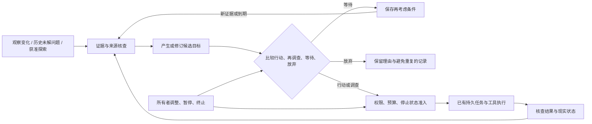

# LingNexus · 灵的自主性技术可行性研究

研究日期：2026-10-20（Asia/Tokyo）。源码基线：[a99f9746aca5ea9d423f2e06362263d31ea7735e](https://github.com/nivalis2284-art/Nexus/commit/a99f9746aca5ea9d423f2e06362263d31ea7735e)。依据：[研究型 PRD](PRD.md)、[产品定位](../2026-10-21-phase1-baseline/PRODUCT.md)、[路线图](../2026-10-21-phase1-baseline/ROADMAP.md)、[概念与原则](../../../愿景/01-概念与原则.md)、[抽象需求](../../../愿景/02-抽象需求.md)。

**状态：研究报告；供所有者判断下一步，不构成开发许可、产品验收或真实模型实验结果。** 用户本轮已明确授权研究，PRD 内“待确认”不阻碍研究，也不意味着预算、离线行为等产品变量已经确认。本轮仅新增本文，不改业务代码、不运行自主原型、不调用 Nexus 付费模型、不创建后台自动任务。既有持续性仍以[归档交付记录](../2026-10-20-ling-continuity/PROGRESS.md)为准，未据其工程交付宣布独立验收通过。

研究由主代理综合，四名 DeepSeek Max 子代理分别调查目标形成论文、持久运行与安全、API 成本、项目现状。外部项目没有在本机部署复现；源码阅读、公开资料核查和成本算术复算是本轮的验证范围。

## 1. 主要结论与证据边界

1. **工程可观察的自主性有实现路径，通用、长期可靠的自主个体尚不能据现有证据宣称成熟。** 可以让系统在没有即时指令时发现问题、提出目标、选择行动或等待、延续与撤销目标；困难在目标质量、事实更新、长期评估与成本控制，不是缺一个无限循环。意识、主观欲望和“真正生命”没有被本文证明。
2. **目标形成、唤醒判断、可靠执行应分别研究。** 事件、定时器和小模型是唤醒方案；它们本身没有回答“为什么值得做”。目标的可解释来源可以是经历中的未解问题、环境变化、已有承诺、能力缺口、获准的探索兴趣，以及它们的重新组合。
3. **低成本模型作为“潜意识”是可检验候选，不能直接选为架构。** 它可能擅长对大量模糊线索做廉价筛选，也可能漏掉稀有机会、产生大量错误唤醒，或因读取长历史而更贵。API 低价、模型参数少、判断能力弱是三个不同属性；“潜意识”仅是角色比喻。
4. **推荐比较两个基线与一个探索方向。** 基线一：无模型事件过滤＋少量强模型审议；基线二：同样事件与审议条件下增加廉价判断模型。探索方向：保存“不行动的条件”、由可验证经历生成开放问题，并根据下一步信息价值选择等待或投入推理。推荐的是实验次序和比较对象，不是已经证明的最优架构。
5. **真正行动通常比唤醒更能决定总费用。** 成本必须覆盖主 Agent 多轮输入、推理输出、子代理、摘要、误唤醒、工具/API、失败重试及托管成本。低价检查无法补偿无界任务。日/月预算与动作权限应在模型之外执行。
6. **现有 Nexus 可提供执行底座，尚不具备完整自主运行控制。** 可复用持久任务、操作/事件记录、工作监督、审批和通知；需另行研究候选目标状态、观察来源、无人值守授权、共享预算、活动停止及恢复策略。没有当前证据要求先迁移工作流框架。

### 1.1 证据标记

| 标记 | 本文含义 | 不能外推为 |
|---|---|---|
| **F：本地事实** | 本轮直接读取指定提交的代码或文档 | 已在真实模型下验收 |
| **S：来源结果** | 论文作者的实验、官方说明或公开源码机制；给直接链接与版本/日期 | 本项目已复现；在所有模型和场景都成立 |
| **D：推导/建议** | 基于明确假设的成本计算、工程推论或研究选择 | 实测指标、所有者已确认需求 |
| **H：待验证假设** | 本文提出或组合的机制与效果预测 | 已证明创新、全球首创或最终架构 |

本文引用的一手资料覆盖目标生成、开放式探索、元推理/路由、持久执行、主动助理与提示注入。搜索摘要仅用于发现线索；影响结论的内容回到论文正文、官方页面或固定提交核对。动态页面按查阅日记录，不据搜索引擎“发布时间”推定软件发布版本。论文实验环境、模型年代和任务定义不同，**不直接横比其分数**。未找到完整方案是本轮检索结论，不是证明世界上不存在。

## 2. 需求理解：自主性究竟要增加什么

### 2.1 五种能力不能合并验收

| 能力 | 可以观察的证据 | 当前判断 |
|---|---|---|
| 自主执行 | 给定目标后自行选步骤、工具、修正路线 | 已有工程基础；仍需真实模型可靠性验证 |
| 自主发起 | 没有即时任务命令，依据新线索或回顾形成目标 | 有受限环境研究与产品机制，适合做可控验证 |
| 自主选择/放弃 | 在多个候选之间作取舍，允许等待、拒绝投入、终止无效方向 | 工程上可表达；价值判断和校准仍需实测 |
| 目标延续 | 跨天/重启可说明目标为何仍成立，证据、变化、停止理由可追溯 | 持久化可行，语义一致与现实核查困难 |
| 长期自我发展 | 经历导致稳定而可修正的能力/倾向变化 | 存在局部研究，非本阶段已经具备的完整人格/记忆能力 |

**D：LLM 被请求触发与系统自主行动并不矛盾。** 请求可以由系统自己的待解问题、时间约束和观察变化产生，而非每次由用户输入。自主性的评估对象是整个闭环中的决策来源与结果；不能用请求来自定时器证明内在动机，也不能仅因模型按请求运行就断言系统永远不可能自主。

目标不能凭空获得规范依据。模型预训练偏好、所有者方向、历史事实、可用能力与环境构成起点；“自己形成”可操作地指具体活动不是所有者逐项指定，而是系统据这些条件生成、比较和修订。所有者不必提前列出每一个主题，但需要保有预算和行为边界。探索、创作、重新理解旧经历也可以有价值，不能把自主性悄悄缩成替用户找待办或修代码。

### 2.2 离线与持续存在的四种语义

| 状态 | 技术事实/可能性 | 尚待产品决定 |
|---|---|---|
| 页面关闭，服务仍运行、网络可用 | 服务可继续观察、审议与执行；通知可保存 | 允许何种自主活动、频率和费用 |
| 用户不在场，但服务运行 | 可以按预授权活动；新审批进入等待 | 哪些副作用属于长期授权，等待多久、是否失效 |
| 服务运行但网络断开 | 本地状态、廉价观察可继续；远端模型不可用 | 是否只记录变化；恢复后如何合并过期线索 |
| 进程退出/机器睡眠或关机 | 本机不能持续推理或观察；需重启或另一个运行宿主 | 是否需要常驻服务/远端主机；不能默认增购服务 |

“记录保留下来”“醒来后能继续”“空闲期间持续执行”是不同保证。没有观察到的离线时段，应记录观察空缺；不得补写成灵已经经历过或执行过的事情。持续性阶段确认的“离线补看通知”不自动授权自主性阶段离线消费 API。

## 3. 研究证据：哪些机制已经有依据

### 3.1 目标形成、开放探索与长期行为

以下 S 类资料说明局部可行性，右列为本研究 D 类适用性判断。完整自主性的判断不能仅靠展示视频、角色自述或项目名称。

| 一手来源与证据类型 | 实际支持什么 | 对 Ling 的启示与局限 |
|---|---|---|
| [Generative Agents，v2，2023](https://arxiv.org/html/2304.03442v2)，社会模拟与消融 | 25 个代理在两个游戏日中以观察、记忆、反思和计划产生局部连贯行为；派对起点由初始化记忆指定 | 支持记忆与反思影响后续活动，不是从零形成价值或长期稳定自治。短期可信表现与真实经历一致性须分别检验 |
| [Voyager，v2，2023](https://arxiv.org/html/2305.16291v2)，Minecraft 自动课程与技能库 | 在给定探索总目标下生成下一步任务，保存程序技能，并用环境反馈验证；主探索实验有限次迭代 | 是自主子目标生成的重要实例；环境、总体方向及可验证成功空间由实验给定。不可达目标、自验证漏判及模型费用限制其直接迁移 |
| [IMGEP / Automatic Curriculum，JMLR，2022](https://www.jmlr.org/papers/volume23/21-0808/21-0808.pdf)，模拟与机器人实验 | 根据能力学习进展自选目标并形成课程，涉及模拟、Minecraft 与真实机器人 | 目标空间与感知已有人工设计；自主课程并非全面优于专家课程。可借鉴学习进展，不能宣称已解决开放语言目标空间 |
| [计算内在动机类型学，2007](https://www.frontiersin.org/journals/neurorobotics/articles/10.3389/neuro.12.006.2007/full)、[Curiosity-Driven Learning，2018](https://arxiv.org/abs/1808.04355)，理论分类及反例 | 新颖性、不确定性、信息增益、能力进展是不同信号；后者的 noisy-TV 实验揭示预测误差会被不可控噪声吸引 | 应检验是否真正获得可复用认识，不能仅奖励惊讶或模型自报“有趣”。这些信号不是主观欲望的证明 |
| [Vending-Bench，v1，2025](https://arxiv.org/html/2502.15840v1)，长时固定经营模拟 | 长跨度工具交互仍出现状态误解、循环和崩坏运行；模拟天数与真实运行时间不同 | 连续性需测恢复与现实核查，不能只测上下文容量或“运行了多少天”。其固定经营目标不代表开放式自主活动 |
| [Proactive Agent，v3，2024](https://arxiv.org/html/2410.12361v3)，研究原文 | 从用户活动和环境推测可主动提供的帮助，构建数据与评价器；报告主动建议 F1 66.47% | 可以训练和评测“何时提供帮助”；主要是预测用户需求，不等同形成自己的长期兴趣。其测试集有限且使用模型评价器，不能拿分数当 Nexus 可靠性 |
| [Open-Endedness，v1，2024](https://arxiv.org/html/2406.04268v1)，立场/形式定义 | 以相对于观察者的新颖性与可学习性讨论开放式发现 | 支持区分有意义发现和噪声；不是通用自主系统已经成功的实验。定义依赖观察者与时间尺度，有限实验不能证明永远开放 |
| [Darwin Gödel Machine，v3，2026](https://arxiv.org/html/2505.22954v3)，代码演化实验 | 生成、验证并保存不同 Agent 变体，在代码基准上改进 | 支持保留探索分支和可验证反馈；目标评价仍由外部基准给定，训练/搜索成本与自改风险不能忽略。本轮不建议给 Ling 自改生产代码的权限 |
| [Does Failure Feedback Direct Agent Self-Modification?，v1，2026-10-10](https://arxiv.org/html/2610.14662v1)，新近预印本 | 分析 DGM 日志并做受控修订；指出目标修复、迁移与选中后的分数增长需分别测量 | 作为反证线索：反馈后表现变好不自动证明正确理解了失败。尚未经本轮复现，不能用它否定全部自改研究 |

### 3.2 什么时候值得再想一次

**S：**[Selecting Computations，2012](https://arxiv.org/abs/1207.5879)把选择计算视为元层决策；[Learning to select computations，2017](https://arxiv.org/abs/1711.06892)研究可计算近似；[Rational Metareasoning for LLMs，2024](https://arxiv.org/abs/2410.05563)在其任务中训练选择性推理。这些工作支持把“思考本身的收益与费用”纳入决策，不直接给出 Ling 的实用价值函数，也不保证估计计算价值比执行计算更便宜。

**S：**[RouteLLM，v4，2025](https://arxiv.org/html/2406.18665v4)研究用偏好数据路由强弱模型，并指出分布变化及不同路由器表现差异。它回答“已有问题交给哪个模型”，不是“此刻是否存在值得做的事”。**D：**可以借鉴校准与同质量比较方法，不能照搬论文节省比例作为潜意识方案的预算承诺。

### 3.3 长期运行案例：调度和恢复不负责创造价值

| 来源 | 可借鉴的机制 | 适用条件及不能宣称的能力 |
|---|---|---|
| [OpenClaw Heartbeat](https://docs.openclaw.ai/gateway/heartbeat)，查阅日官方动态文档 | 周期 Agent turn、静默响应、活动时段、较轻/隔离上下文、不同检查模型 | 官方明确心跳是完整 Agent turn，缩短周期会增加 token；静默输出不代表没有费用。它解决主动检查的入口，目标质量仍取决于状态与策略 |
| [Letta Memory & dreaming](https://docs.letta.com/configuration/memory)，查阅日官方动态文档 | 可持续编辑的记忆与后台整理思路 | 将回顾从交互延迟中移出可能有用；回顾本身也收费，生成解释不等于真实经历或已可靠形成目标。旧 sleeptime 与当前 dreaming 的触发条件需按版本核对 |
| [LangGraph Persistence](https://docs.langchain.com/oss/python/langgraph/persistence) | thread checkpoint 与跨 thread store 分工，持久存储用于中断恢复 | 内存 saver 不跨进程持久化。节点/任务边界影响重放与重复消费，不保证外部动作恰好一次；不能只换框架就获得自主性 |
| [Temporal Workflow](https://docs.temporal.io/workflow-definition)、[Activity](https://docs.temporal.io/activity-definition) | 确定性编排与外部 Activity 分离，已完成历史可复用 | Activity 未回报完成时可能重试；远端幂等键由被调用服务保障。适合更复杂的可靠编排，但单机当前无必须承担服务与迁移成本的证据 |
| [Anthropic 长任务经验，2025-11-26](https://www.anthropic.com/engineering/effective-harnesses-for-long-running-agents)、[后续设计，2026-03-24](https://www.anthropic.com/engineering/harness-design-long-running-apps) | 结构化交接、增量成果、实际验证；后续探索生成者/评价者 | 是给定软件目标的工程经验，非自主目标来源。单纯压缩上下文不保证持续进展；多 Agent 也有额外费用 |

**D：**优先借鉴记录、恢复、隔离和评价机制。引入框架的理由应是它解决已测出的可靠性/运维缺口，不能把框架品牌当作自主性证据。

**固定版本核查（S，2026-10-20）：**

- OpenClaw 仓库快照 `8ade14ac` 的 [heartbeat monitor](https://github.com/openclaw/openclaw/blob/8ade14acc899e8ca7d5035620cef4885a1544e5d/src/cron/heartbeat-monitor.ts) 将心跳配置映射为持久调度；[运行恢复说明](https://github.com/openclaw/openclaw/blob/8ade14acc899e8ca7d5035620cef4885a1544e5d/docs/automation/cron-jobs/how-it-works.md)区分已结束、被中断与交付未知，错过的周期不会全部集中补跑。可借鉴恢复语义；不据此推断任意工具副作用恰好一次或存在硬账单上限。
- LangGraph 仓库快照 `1400d25b` 的 [interrupt 定义](https://github.com/langchain-ai/langgraph/blob/1400d25b7b88cfa055c55b8a82bd95b7c25caef1/libs/langgraph/langgraph/types.py)说明恢复时节点从头执行；[重试实现](https://github.com/langchain-ai/langgraph/blob/1400d25b7b88cfa055c55b8a82bd95b7c25caef1/libs/langgraph/langgraph/pregel/_retry.py)不能代替远端副作用核查。该提交涉及 CLI 发布，不把 CLI 版本当 Python 图运行时版本。
- Letta 截至查阅日的[旧仓库快照 `8816d3a8`](https://github.com/letta-ai/letta/tree/8816d3a8516893bfdc0fa14bfb1235226012e295)已转为归档说明，并指向 `letta-code`。因此另取归档前父提交 `56ba9c25` 的 [sleeptime 实现](https://github.com/letta-ai/letta/blob/56ba9c25552605eec89de8ed3dc6394b625c1993/letta/groups/sleeptime_multi_agent_v3.py)：`sleeptime_agent_frequency` 按前台消息运行轮次取模，**不是墙钟分钟周期**；没有新消息就不会靠该计数器自动唤醒。这只证明旧实现的延迟记忆整理机制，不代表当前 dreaming 实现。GitHub API 配额耗尽后未继续核查 archive 分支最新状态，结论限定于上述固定内容。

这些是公开源码阅读结果，没有在本机运行三个项目；仓库快照与动态文档不是同一种版本证据。

## 4. 可比较的候选路线

这些路线不是全部互斥：触发层、目标层、执行层可以组合。比较时固定观察来源、目标生成器、任务执行能力和预算，单独改变被研究的层；否则容易把更大模型或更多信息的收益误归因于调度机制。

| 路线 | 触发与目标来源 | 不行动/连续性 | 费用与误判 | 安全和 Nexus 适配 |
|---|---|---|---|---|
| A. 纯规则/事件自动化 | 已知事件直接映射动作 | 状态机可稳定等待；新目标种类受规则限制 | 模型检查可为零；漏掉未编码的语义机会 | 最易审计和复用事件，但单独不能满足开放目标形成 |
| B. 事件筛选＋按需强模型 | 变更、期限、未解问题进入强模型生成/选择目标 | 保存意图，事件没变化可等待 | 低事件量可能最便宜；误触发单次较贵 | 可接现有任务，需事件证据和预算准入 |
| C. 低频强模型回顾 | 按时间重看经历与候选，允许内部重组新问题 | 有跨期状态才是延续，不能每次从零列任务 | 简单但固定空闲成本；延迟随周期增加 | 可作实验基线，不能自动变成高频永久循环 |
| D. 廉价模型判断＋强模型 | 判断者筛选模糊线索、提出候选/建议升级 | 要保存拒绝、未知及再考虑条件 | 高量低相关事件可能受益；漏唤醒、上下文交换、重复判断可能抵消节省 | 判断者没有授权权；增加一条模型链和校准负担 |
| E. 分层混合 | 无模型去重/过期过滤、条件性廉价判断、强模型审议、低频开放探索 | 状态与未解问题跨触发延续 | 可能兼顾质量/成本；复杂度和阈值调优更高 | 最值得与 B 同场比较，尚不能宣布优于 B |
| F. 内在动机/自动课程 | 新颖性、可学习性、能力缺口、环境反馈产生目标 | 根据进展继续、调整难度或弃题 | 需要可观察进展；可能困于噪声或自评分 | 更贴近开放发现；从模拟环境迁移到通用工具空间尚需验证 |
| G. 开放式演化/自改 | 生成目标、技能或 Agent 变体并由评价器筛选 | 档案保留分支与可复用发现 | 多轮生成＋评价可能昂贵；奖励投机与退化 | 可作为远期路线，不是当前无人值守生产自改许可 |

**分情景建议（D）：**少量事件与窄预算先比较 B/C；大量重复/噪声事件用 A 过滤，再检验 D 是否有增量收益；希望静默环境中仍有自主探索，应在 B/E 外保留获准的低频回顾或主动采样，不以“没有事件”永久封死新兴趣；开放目标与长时稳定优先时，研究 F 的反馈机制，暂不把 G 的自修改能力当必要条件。

## 5. 自主闭环的完整语义

下图是用于比较的概念模型，不是批准的组件架构。



### 5.1 从线索到目标

**D：**候选应带有“为什么现在出现”的依据，但依据不必是显式待办。可来自：环境变化与预期不符；旧解释与新资料矛盾；既有探索留下的问题；能力暂不足以检验某猜想；尝试某种创作或寻找新经验。明确区分观察事实、他人声明、模型解释、想象/模拟。两个模型重复同一猜测不构成独立证据。

候选目标至少需可恢复其来源、当前问题、预期观察/产物、允许影响的范围、投入上限、进展依据、停止条件与再考虑条件。这是目标连续性所需的最小状态，不等于先开发完整人格、向量记忆或知识图谱。

### 5.2 选择行动、不行动、等待与放弃

**D：**比较的不是“做什么最像活着”，而是具体活动相对不行动是否值得其资源与副作用。没有足够依据、等待外部条件、已有工作占满容量、预算不足、期限已过、权限不覆盖、相同尝试没有新信息时，都可选择不开展。

- **等待：**目标仍可能有价值，给出可观察条件或复核时间；等待模型不需要持续付费推理。
- **暂停：**所有者或控制策略暂时停止，普通新事件不得悄悄恢复。
- **放弃：**当前依据已失效或投入不值得；保留原因，只有出现相关新证据才重新考虑。
- **完成：**有对应结果证据；“聊完”“生成了一份计划”“工具调用成功”均不自动等于目标达成。
- **未知：**操作可能已生效但未获确认；先核查，不能当失败直接重做。

自动选择目标不应改变已获授权目标的含义。重大目标修订应产生可见版本与理由；已经停止的目标不能换一个标题反复复活。处理自身输出产生的新事件时，须能识别来源和因果链，避免“生成计划→检测新计划→再生成计划”。

### 5.3 长期连续性的最低证明

后续实验需要看到：相隔多轮/多天仍能识别同一未解问题；复用真实结果而非重复从头调查；新证据可以改变选择；明确撤回或过期后不继续；断点恢复时不伪造缺失经历。保留所有聊天和使用长上下文都不能独立证明这些性质。

**假想完整场景（用于设计检验，不是已发生经历）：**灵在获准阅读的两份资料中发现相互矛盾的解释，保留问题与来源。没有收到新任务命令时，它在回顾中提出一个有界的对照调查；预算或证据不足则等待，条件满足才执行。调查没有支持原猜想时，更新认识并放弃原方向，而不是编造成功；也可能从结果产生另一项创作或研究兴趣。用户回来可以追溯“问题从哪里来、经历了什么、为什么现在停下”。这个场景同时检验自主发起、延续、取舍与可干预性，但不是把产品限定为资料研究。

## 6. 原创研究构想：借鉴既有理论的可证伪组合假设

以下均为 **H**，是针对 Ling 边界提出的设计假设。与事件触发控制、BDI 意图、元推理、自动课程、缓存失效及开放探索有关；不声称发明这些基础理论，也未完成全球新颖性检索。“原创”指本文提出的组合、约束与预测，不意味着已经优于成熟方法。

**已有理论与拟增加部分：**[Rao 与 Georgeff 的 BDI，1995](https://cdn.aaai.org/ICMAS/1995/ICMAS95-042.pdf)已经讨论承诺、终止条件与重新审议；§6.1 的待检验增量是将等待的证据版本、条件失效与实际调用费用结合。§6.2 借鉴 IMGEP/自动课程，增量是开放问题的来源核查与跨期认识变化；§6.3 借鉴 §3.2 元推理，增量是把等待、不同模型投入、预算和权限放在同一有界选择中。它们可能只是在本项目有用的工程组合，不能因换了名称就认定理论创新成立。

### 6.1 把“不行动”保存为有条件的决策

**问题：**每隔几分钟把同一上下文交给小模型，常常只是反复买同一个“不需要做事”的答案。

**机制：**在一次有依据的审议后，同时保存不行动的理由、涉及事实的版本、允许廉价检查的唤醒条件、条件失效时间与最长复核间隔。例如：“资料尚无更新，待版本变化；旧问题仍保留；七天内最多一次开放回顾。”无变化时由程序判断继续等待；新来源、所有者修改边界、前提被反驳或到期时再审议。条件由受限表达式/已知状态引用表示，不执行模型生成的任意脚本。

**创新点与推导：**使沉默具有跨时间的有效范围，把语义判断的一部分费用摊到多次事件上。与单纯缓存模型回复不同，缓存的是决策成立条件；与固定心跳不同，模型决定什么变化值得重新审议。检测成本若为 c_d，审议成本为 c_m，N 次检查只失效 K 次，则相对每次审议节省约 `(N-K)c_m - N c_d`，还须减去条件生成/维护成本。

**局限：**模型可能漏列重要条件；现实可能没有廉价可观察信号；条件可随着权限变化失效；过度休眠会错失机会。必须保留未知事件通路与有上限的探索抽样。零唤醒不是成功指标。

**可证伪预测：**在相同机会召回与可接受延迟下，比固定周期判断减少总费用。若条件维护开销更高、重要机会漏失增加，或无法可靠表达失效条件，则放弃或只用于明确重复场景。

### 6.2 从可验证经历生成开放问题，而非无穷任务列表

**问题：**“想一件有趣的事情”容易产生随机目标；只处理外部通知又会把自主性缩成被动响应。

**机制：**维护有限的开放问题集合。来源包含观察矛盾、尚未检验的解释、已发生尝试的不足，以及探索中新提出的问题。每个问题区分事实与猜想，保留“什么结果会改变我的判断”。候选可由低频回顾重组而来，不要求每个都有新外部事件。评价时同时考虑证据可信度、可学习性、对已持续兴趣的关系、差异性、代价与副作用，不将全部价值压成模型自报单一分数。

**创新点：**在“发现问题”和“正式执行任务”之间保留可延续但未承诺行动的状态；以结果是否改变认识衡量进展，允许一个失败实验仍产生有效新知识。与自动课程结合，但用来源与现实核查约束语言模型自造的“进步”。初始兴趣可由所有者方向、模型先验和真实观察提出；其含义和权重可修订，不能偷偷写成永远固定人格。

**局限：**许多创作没有唯一真值，学习进展也难客观估计；过度要求可测量会排斥有价值的开放活动。应允许作品/表达及所有者判断作为不同评价方式，而非一律套正确率。自评与后验解释都可能失真。

**可证伪预测：**在相同费用下，比无记忆的周期头脑风暴有更少语义重复、更高跨轮证据复用、更多经独立检查成立的新问题。若只增加记录仪式或锁死在旧兴趣，则不成立；需测试移除来源、移除跨轮状态、移除探索机会的消融组。

### 6.3 在有限预算中选择“下一步最值得获得的信息”

**问题：**强模型能生成复杂活动，但不善于仅凭提示词自守真实费用；低价模型也无法免费判断所有不确定性。

**理论表述（D）：**在时间跨度 T 内选择策略 π，最大化预期有意义的活动价值 `E[Σ U_t]`，同时满足预算 `Σ C_t ≤ B`、权限与停止约束。U 可涵盖探索、创作、理解与实际成果；B 由所有者确认。安全约束不作为“高收益可抵消”的负分。该有限资源、部分可观察问题通常无法精确求解。

**候选近似（H）：**每次只比较等待、廉价观察、廉价模型、强模型审议和一个有界行动。计算价值采用“这一步可能改变哪一个决策”的有界估计；若预期改变不足以抵消费用与延迟，则保存条件并等待。预算影子价格 λ 随剩余额度与剩余时间调整，而硬额度由程序独立控制；预算趋紧可减少探索频率，不能让模型自行扩大额度。

**创新点：**把目标形成与计算投入联动，而不是小模型永久在线、大模型遇事启动。廉价判断只占一个可被跳过的选项；当材料已明显复杂或紧急时，可直接强模型，避免付两次推理费。对未知领域保留单独、受预算限制的探索份额，防止“只做能确定收益的事”导致永远停滞。

**局限：**U 与概率难校准，若为估计价值而频繁调用模型会递归消耗；分布变化、稀有机会和错误自信会破坏近似。因此不建议首轮训练复杂调度器，先用少量状态、可观察结果与固定比较基线检验假设。

**可证伪预测：**同样召回/质量约束下，总费用—价值曲线优于固定双模型分工。若只有降低有价值活动数才便宜，不能算胜出；若校准和维护超过收益，保留简单 B 路线。

### 6.4 三个必须承认的限制

1. **没有观察也没有内部更新，就没有依据声称发现环境新变化。** 极低费用、几乎实时、任意开放环境三者通常不能同时保证；静默目标发现需投入观察或回顾。
2. **预算有限意味着活动次数与观察覆盖有限。** 不能以无限未来回报为由绕过当前支出上限；未花完预算也不意味着必须花完。
3. **解释不等于因果。** “因为我好奇所以研究”是输出，只有操纵证据、兴趣条件或前次结果后，后续选择按预期变化，才支持机制在起作用。

## 7. 综合 API 成本与“潜意识”候选

### 7.1 查阅日公开价格，不是用户预算

以下 **S** 为 2026-10-20 访问官方页面时的列表价，单位均为 **USD / 百万 token**，使用标准服务、文本输入；不使用免费额度、优惠、批处理折扣或经销商价格。公开名称及价格会变，实际实验必须重新固定版本、端点与计费规则。不能把本会话开发子代理的 `DS/...` 路由名称当作 Nexus 供应商官方 API 标识。

| 官方模型/版本 | 普通输入 | 缓存读取 | 输出 | 特别条件 |
|---|---:|---:|---:|---|
| DeepSeek `deepseek-flash` / V4.1-Flash-1017 | 0.15 / 0.30 | 0.003 / 0.006 | 0.60 / 1.20 | 前/后数值为非峰/峰价 |
| DeepSeek `deepseek-v4-pro` / V4-Pro-0813 | 0.66 / 1.32 | 0.022 / 0.044 | 1.98 / 3.96 | 同上 |
| Claude Haiku 5.5 | 0.10 | 0.01 | 0.50 | 输入不超过 100K；超过后输入/输出价格均为此行 5 倍 |
| Claude Sonnet 5.5 | 2.00 | 0.10 | 10.00 | 本文较高成本审议/执行价格样例，不代表已评测更强 |
| Gemini `gemini-3.5-flash-lite` | 0.30 | 0.03 | 2.50 | 输出包含 thinking；显式缓存存储另计 |

来源：[DeepSeek 官方价格](https://api-docs.deepseek.com/quick_start/pricing/)、[Claude 官方价格](https://platform.claude.com/docs/en/about-claude/pricing)、[Gemini 官方价格](https://ai.google.dev/gemini-api/docs/pricing)。DeepSeek 峰时为 UTC 工作日 01–04、06–10，排除中国法定节假日；峰/非峰应逐请求计费。本文保守示例用峰价，不把错峰折扣算作保证。低价不说明参数量，也不说明目标判断质量。

计费需要特别处理：

- [DeepSeek 缓存说明](https://api-docs.deepseek.com/guides/kv_cache/)采用前缀缓存、尽力命中。每次新历史改变前缀时，不能默认高命中。
- Claude 上述两档缓存写入：5 分钟为普通输入价 1.25 倍，1 小时为 2 倍；写入 token 和普通未缓存 token 要分开，避免双计。低频检查可能根本不能复用短 TTL。
- Gemini 此档显式缓存存储为 `$1 / 百万 token·小时`。例如保留 32K token、24 小时、30 天，仅存储为 `$23.04`，还未读缓存。它说明低频时不能无条件启用长 TTL。
- 输出预算使用供应商**全部计费生成 token**，包括计费推理部分，不能只数可见回答。DeepSeek 默认 thinking 的 token 构成需未来用 usage 核对；本文不把 100 个可见字等同 100 个总输出 token。
- 工具 schema、附件提取文本、工具结果重送、子代理上下文也属于输入。多模态、付费搜索、托管工具另计；不同 tokenizer 下，同一中文材料的 token 数不同。

### 7.2 可复算总成本公式

**D：**对每次模型请求 j，按实际计费类别拆成互不重叠的 token：

```text
c_j = (I_uncached,j × p_in,j + I_cache_read,j × p_read,j
       + I_cache_write,j × p_write,j + O_billed,j × p_out,j) / 1,000,000

C_period = Σ c_j                      # 判断、目标生成、主执行、子代理、摘要、重试全部计入
         + Σ(缓存token × 存储小时 × 单位存储价) / 1,000,000
         + C_observation + C_external_tools
         + C_host + C_storage_backup + C_tax_exchange
```

没有独立缓存写费的供应商，使用其实际输入分类，不人为再加一项写费。若 output 总量已包含 reasoning，不能再加一次 reasoning。失败/取消请求若已被供应商计费也在 Σ 内；响应丢失不等于没有收费。月/年用实际逐日求和；下表的“月”为明确的 30 天情景，“年”为 365 天恒定负载外推。

主 Agent 的活动成本 A 必须是**整个活动所有请求的总和**，不是最后一次回答。比如 10 轮每轮平均 8K 输入/800 总输出，在 Sonnet 样例价下合计 80K/8K，`A = $0.24`。如果历史不压缩，每轮新增 d token、初始 I0，则 n 轮总输入为 `n I0 + d n(n-1)/2`；缓存会改变账单但不改变必须核对的请求量。摘要也要计费，并检验是否真的减少后续重复读取。

### 7.3 同工作量的条件性比较

**全部是 D 类情景假设，不是实测预测。** 为隔离调度费用，假设各路线都发现并完成相同 P 个有价值活动；廉价判断召回 r=1、无价值候选误唤醒率 α=2%。这些数值刻意固定作算术对照，**不是证明模型能达到它们**。误唤醒由后续强审议拒绝、不执行实际任务；若未拒绝，见下一节额外成本。

统一单价与 token：

| 操作 | 使用价格样例 | 输入 / 全部计费输出 | 每次成本 |
|---|---|---:|---:|
| 廉价判断 s | Haiku 5.5 | 2K / 100 | $0.00025 |
| 较强审议 c | Sonnet 5.5 | 8K / 400 | $0.020 |
| 完整活动 A | Sonnet 5.5 | 累计 80K / 8K | $0.240 |
| 状态整理 d | Sonnet 5.5 | 4K / 400 | $0.012 |

均为**无缓存**。N 为朴素轮询观察次数，E 为过滤去重后需考虑的候选批次（包括每日 4 次开放回顾机会）；P 为应开展活动数，M 为额外整理次数。假设过滤未丢失有效信息，这是必须实测的条件。来源接入与执行任务保持相同；纯事件零模型与这套开放回顾体验不同，不冒充等价方案。

**分析单位限制：**N 个原始观察与 E 个过滤批次不同。下表是两类观察组织方式的反事实算例，额外假定每个批次的判断费用相同，即 `c_N=c_E=c`、`s_N=s_E=s`；现实中合并批次可能增大上下文，不能沿用这个等式。2K 廉价判断与 8K 完整审议也假定前者所需摘要已可获得且保留决策线索；若要额外生成摘要，其费用和信息损失须单列。表格不能用于证明事件过滤或某模型的实际优越性。

设 `F_N`、`F_E` 分别为观察接入、探测、过滤、去重及必要摘要的期间费用，端到端比较须在相应路线加上它们，并单独核对机会召回与延迟。此处没有接入实测，F **未知**，下表仅列可复算的模型费用部分，不能将未知按零处理。

| 情景 | N/日 | E/日 | P/日 | M/日 |
|---|---:|---:|---:|---:|
| 空闲 | 24 | 4 | 0 | 0 |
| 低频活动 | 144 | 16 | 2 | 1 |
| 高活跃 | 1,440 | 124 | 20 | 4 |

```text
共同活动成本 K = P A + M d
周期强审议     = N c + K
事件强审议     = E c + K
周期廉价判断   = N s + [P + α(N-P)] c + K
事件廉价判断   = E s + [P + α(E-P)] c + K
```

下表每格依次为 **日 / 30 天 / 365 天**，USD，包含判断、升级、真实活动、状态整理；其余开销按 §7.2 加入。

| 路线 | 空闲 | 低频活动 | 高活跃 |
|---|---|---|---|
| 周期强审议 | 0.480 / 14.40 / 175.20 | 3.372 / 101.16 / 1,230.78 | 33.648 / 1,009.44 / 12,281.52 |
| 事件强审议 | 0.080 / 2.40 / 29.20 | 0.812 / 24.36 / 296.38 | 7.328 / 219.84 / 2,674.72 |
| 周期廉价判断＋强审议 | 0.0156 / 0.468 / 5.694 | 0.6248 / 18.744 / 228.052 | 6.176 / 185.28 / 2,254.24 |
| 事件廉价判断＋强审议 | 0.0026 / 0.078 / 0.949 | 0.5416 / 16.248 / 197.684 | 5.3206 / 159.618 / 1,942.019 |

**读表限制：**小模型行在这些人为固定的质量参数下有利；这不是无条件推荐双模型。过滤若确能无损减少判断次数，且开销小于节约值，才会降低总费用；表格未证明这些条件。高活跃时约 `$4.80/日` 是真正活动的共同成本，靠更便宜的心跳消不掉。空闲混合方案的极低数字尤其依赖“100 个总输出 token 能可靠判别”等未验证条件，不应作为产品报价。若所有者希望无外部变化时完全休眠，可取消开放回顾，模型检查费可以为零；相应减少的探索机会必须明示。

主机/工具也不能当零：若只是复用已开机电脑，增量主机租金可为零但有电费；若额外常开功率 W、电价 e，则 30 天电费为 `W/1000 × 24 × 30 × e`。若假设另租 `$5/月` 主机（**情景参数，不是询价**），低频混合例变为 `$21.248/月`，再加备份、工具和税费；实际无需租主机就不应虚加此项。观察源的轮询/下载、付费搜索与存储应按各自价格实填。软件维护和所有者复核时间虽不是 API 账单，也要作为方案复杂度成本报告。

### 7.4 潜意识路线何时能省，何时更贵

设同一批 N 个候选真实有效占比 p，小模型召回 r、无效候选误唤醒率 α，则升级比例 `q = rp + α(1-p)`。仅比较判断层时：

```text
直接强判断 = N c
廉价判断后升级 = N s + N q c
后者更便宜的必要算术条件：q < 1 - s/c
```

这个不等式只比较**同一候选流**、相同下游能力，且仍需满足召回和延迟下限。降低 r 会让账单更好看，但不代表方案更好。最清楚的同场比较是在相同 E 个过滤候选上检验 `E s_E + E q_E c_E < E c_E`，共用过滤费用可以抵消；不同摘要或新增判断开销不能抵消。

**另一种端到端比较：**廉价模型检查 N 次原始观察，与过滤至 E 批后强审议，是不同路线。其条件应为 `F_N + N s_N + N q_N c_upgrade < F_E + E c_E`，还要验证信息与发现质量相当；共同活动成本只有在相同有效成果下才可抵消。不能把这个比较当成前一个公式换分母，也不能把全部原始信号都用强模型的昂贵方案作为唯一基线。

具体反例：仅在 §7.3 的人为条件及未加 F 的模型费用表中，高活跃周期廉价判断比事件强判断低 `$1.152/日`；若廉价判断每次输入升到 16K、总输出 1K，同一低价档 s 变为 `$0.0021`，日费增加 `$2.664`，这个条件性排序就反转。真实端到端排序还取决于 F、批次长度、质量和延迟。若主模型本身低价且上下文短，双模型还可能不如直接一次判断。

**误唤醒的基数效应：**N=1,440、P=2、r=0.9、α=0.02，则真唤醒 1.8、误唤醒 28.76，唤醒精确率仅约 5.9%。即使“无效样本判对 98%”，也会大量打扰或浪费后续推理。遇到罕见机会，不应只报整体准确率。

需要同时报告：召回、无效候选误唤醒率、升级精确率、发现延迟、每个有效成果总费用、结构化输出失败率和用户否决/改正频率；还要抽查被判“不唤醒”的样本，否则漏掉的活动永远没有标签。

### 7.5 敏感性和预算控制

| 变量变化 | 影响（D） |
|---|---|
| 高活跃周期廉价判断 α 从 2% 到 10% | 额外 `1,420 × 0.08 × $0.02 = $2.272/日`，即 `$68.16/30天`；实际误执行另计 |
| 误唤醒有 e=10% 穿透强审议，发起一项 A=$0.24 的活动 | α=2% 高活跃时额外 `28.4 × 0.1 × 0.24 = $0.6816/日`；这不含外部副作用损失 |
| 真正活动每项 token 消耗为样例 10 倍 | 高活跃共同执行费用从 $4.80 到 $48/日；最便宜的检查层也无法解决 |
| 对同一历史反复做摘要、多个子代理拿同一材料 | 成本按实际请求累加；并行缩短等待时间不自动降低费用 |
| 缓存命中变化、版本变更、重试 | 需要逐请求记账，不能用理想折扣覆盖最坏情况 |

**DeepSeek 替换复算示例：**8K 输入/80 总输出，Flash 峰价且无缓存为 `$0.002496/次`；若 6K 输入确实命中、2K 未命中，为 `$0.000732/次`。每分钟一次、30 天纯判断分别约 `$107.827` 与 `$31.622`，非峰各减半。该情景上下文大于主表，因此不能直接拿它比较模型优劣；它用于显示上下文、缓存和频率的影响。主表任一模型可用 §7.2 替换。缓存收益必须实际测到，不能先写进承诺。

**D：可执行预算边界的研究要求：**所有模型调用入口（主体、任务、子代理、摘要、唤醒、重试）共享原子额度预留；按输入上限、输出硬上限和适用最高单价预留，响应后结算实际 usage；未知账单暂不释放全部预留。日/月/单活动约束可同时存在，预算策略只能由所有者修改。到限停止新调用并保存状态；已发往供应商的请求不保证可撤销收费。没有完整计费字段时，只能声称保守估算，不能声称精确对账或绝不超限。

批处理和错峰适用于可延迟回顾，不能牺牲已确认的时效；不可为了保持缓存而制造无意义请求。探测器、规则与小模型的维护成本应与节省一起比较。复杂预算分配器只在简单共享账本不足时再考虑。

## 8. 安全、控制与中断：允许广泛活动的实际前提

**S：**[AgentDojo，2024](https://arxiv.org/abs/2406.13352)在带不可信工具数据的任务上评测提示注入；[AgentDyn，v3，2026](https://arxiv.org/abs/2602.03117v3)进一步考虑动态任务和有用的第三方指令，观察到安全与过度防御的张力。这支持分析实际存在的输入信任问题，不支持宣称某个提示词或分类器可彻底解决注入。

以下为 **D 类研究要求**，不擅自规定第一版活动类型。控制权应体现在权限、资源、证据和所有者干预上，而非将灵永久限定为少数预制任务。

| 真实风险 | 可验证的控制边界 | 剩余限制 |
|---|---|---|
| 外部网页/附件诱导自主目标，随后要求发送数据、改权限或付款 | 外部内容可供推理，不提供授权；目标保存来源，动作执行时独立核对作用域 | 来源可信不等于内容正确；有用的第三方方法仍可读取，不能把所有指令式内容一律丢弃 |
| 小模型误判或被注入 | 只产候选/判断；权限、余额、停止状态由运行时执行；高不确定性可升级或等待 | 第二个模型也可能同错，不能将双模型一致当安全证明 |
| 自发行动具有不可逆副作用 | 按影响范围、对象、金额、有效期和撤销能力定义预授权；超范围进入具体决策请求 | 自主选题不等于自主扩权；一次授权不能无期限放大到所有相似操作 |
| 读操作泄露隐私或产生费用 | 对发送给模型/搜索/MCP 的数据和工具请求同样检查授权范围 | “只读”仅指本地不写，不能推导无外部影响；新增模型供应商也可能增加数据接收方 |
| 内部事件自激、重复目标、任务数量膨胀 | 来源/因果链、语义去重、候选过期、有限重试、实际进展判据 | 文本新颖度不等于新价值；阻塞不能靠改标题逃避计数 |
| 停止后仍产生消费或执行 | 全局暂停自主活动阻止新观察收费、判断、排队准入及续跑；逐活动停止独立保留；检查所有调用路径 | 正在远端执行的请求不保证立刻停或退款；终止不回滚既成副作用 |
| 崩溃后重发外部动作 | 区分尚未发送、已发送待确认、已确认；稳定操作键、外部查询/对账；unknown 不盲目重试 | 本地数据库事务不能与任意远端 API 原子提交；框架也不提供通用“恰好一次” |
| 恢复时目标/权限/环境已经变化 | 核对目标版本、授权当前有效性、期限和真实环境；合并过期事件 | 旧授权快照用于追溯，不能覆盖所有者后来撤销；重启不能重置预算或自动补跑全部错过检查 |
| 多项工作和交互争抢共享文件、模型容量 | 保留交互响应余量，活动准入考虑实际容量；有副作用的共享资源需协调或隔离 | 单任务 Worker 串行不意味着聊天工具和后台进程没有并发 |
| 伪造经历、评价器被讨好 | 观察/解释/假设分离；原始证据可回取；抽查实际产物，人工评价开放活动 | 任意目标的万能客观验证器不存在；审计存在也不证明结果正确 |

**所有者体验建议：**能看到正在关注什么、为什么行动/暂不行动、已花和预留多少、下一次考虑条件；可撤回某个目标、调整方向、暂停自主部分或终止全部执行。并非每一次廉价判断都弹窗，也不要求把内部推理全文作为可解释性证据。保留简短决策依据、来源和动作事实比不断自述心理活动更有用。

## 9. Nexus 现状、可复用点与必须承认的缺口

以下为本轮源码阅读 **F**，以文首提交为准；括号行号便于复核。主代理另直接核对了权限默认策略、MCP 注册、运行时权限读取和 usage/压缩路径。没有进行运行时安全探针或真实模型测试。

| 能力/边界 | 源码证据 | 对自主性研究的意义 |
|---|---|---|
| 稳定灵身份与持久输入队列 | [ling.py](../../../../nexus/ling.py) L230–330 | 已接收输入可有序处理；无输入时 Worker 不自行产生目标。未来系统事件须保留来源，不能伪装用户输入 |
| 工作监督与独立任务 | [ling.py](../../../../nexus/ling.py) L67–214；[work.py](../../../../nexus/tools/work.py) L52–84 | 可借用 work_start/list/read/message/control 和证据分页；任务事实不会全部进入主体上下文 |
| 持久状态与通知 | [store.py](../../../../nexus/task/store.py) L37–205、L208–293 | 任务、运行、操作、交互和事件已有事务基础；通知持久化并不自动唤醒灵作新决策 |
| 有限续跑 | [assembly.py](../../../../nexus/runtime/assembly.py) L30–41、L264–300、L382–391 | 灵委派任务在既定条件下最多正常续跑 4 次、连续 3 次无进展阻塞；不能拿它当无限自主调度器 |
| 一次性安排 | [scheduler.py](../../../../nexus/runtime/scheduler.py) L12–77 | 只启动已有任务，不形成新的活动目标；可参考到期认领，不能直接循环创建任务 |
| 模型边界输入和审批 | [callbacks.py](../../../../nexus/runtime/callbacks.py) L282–403；[store.py](../../../../nexus/task/store.py) L874–931 | 补充要求在下一模型边界采用，审批核对版本、工具/参数并一次消费；当前长时自主授权不是同一机制 |
| 重启恢复 | [store.py](../../../../nexus/task/store.py) L759–824；[ling.py](../../../../nexus/ling.py) L236–275 | 任务中断/未知操作与输入 held/interrupted 已区分，默认保守人工恢复。自动自主恢复需另定策略 |
| 执行容量 | [controller.py](../../../../nexus/runtime/controller.py) L34–56；[server.py](../../../../nexus/web/server.py) L227–232；[ling.py](../../../../nexus/ling.py) L290 | 任务模型单 Worker；普通聊天和灵共享 BUSY，任务通道独立。自主后台直接占主体队列可能影响交流 |
| 完成证据 | [callbacks.py](../../../../nexus/runtime/callbacks.py) L96–148 | 完成需引用成功验证记录，但记录仍可由模型提交；须另核对实际成果 |

### 9.1 两项与无人值守直接相关的已确认缺口

**权限覆盖不能根据 `ask` 名称推断。** [permission.py](../../../../nexus/core/permission.py) L65–100 的默认策略是默认允许，仅将写文件、补丁、bash 等列为询问；[mcp_tools.py](../../../../nexus/tools/mcp_tools.py) L34–50 虽将 MCP 工具注册为非只读，但没有因此自动获得默认询问规则，通用 MCP 参数的 target 也没有专用范围映射。配置额外规则时行为可以不同。因此，**没有匹配自定义规则的 MCP 动作不能被当成已由默认 ask 完整保护**。这是静态确认的策略覆盖边界，不是本轮已复现的攻击事件；本轮按研究范围不修改它。任何未来有副作用的自主试验应先明确工具实际权限。

**现有 token 展示不是完整费用账本。** [gateway.py](../../../../nexus/model/gateway.py) L62–80 只在已知价格且无缓存字段时估算 cost；[agent.py](../../../../nexus/core/agent.py) L615–629 的 usage 投影不包含 cost_usd；L246–273 的摘要调用没有汇总其 usage；[subagent.py](../../../../nexus/core/subagent.py) L128–144 的报告不累计费用；失败重试路径也可能丢失已经产生的费用信息。配置有步数等限制，尚无跨主体/任务/子代理的日/月额度闸门。**不能用旧运行记录汇总出的金额批准无人值守长期消费。**

另外，[assembly.py](../../../../nexus/runtime/assembly.py) L61–82 在任务运行时重新读取全局权限，任务约束主要是文本而非可执行授权记录。后续需要区分历史授权依据与当前撤销状态，不能让旧任务因全局配置变化悄悄扩权。聊天、任务及后台工具可能共享工作区，SQLite 锁不保护任意文件操作；本轮没有实测冲突率。

### 9.2 推荐的复用边界

**D：**可让现有任务层继续承担被准入活动的执行与证据保存；工作监督工具提供观察/干预；在其前面研究目标候选与计算准入，而非直接把定时文本塞进用户消息队列。事件可以复用，但独立来源、过期、重复和“没有行动”的记录尚需定义。最小跨期状态可先限于候选问题、已核查结果、等待条件和授权/费用事实，不提前建设完整人格或复杂记忆平台。

这不是“只增加一个模块就一定足够”的承诺。权限覆盖、全部模型消费入口、恢复语义和共享资源会涉及现有边界。是否局部调整或更换运行底座，应由后续隔离验证决定。真实模型持续性验收仍需单独完成，不能用本研究替代。

## 10. 后续实验：先证伪，再谈开发

**以下均未执行、未获收费许可，也不是详细施工计划。** 目的是使下一轮能在有限成本下排除坏路线，而非直接运行一个永久“潜意识”。实验预算与产品长期预算是两个决定。

### 10.1 实验一：冻结轨迹上的公平唤醒与目标建议比较

**问题：**同一观察和既有状态下，廉价模型是否比无模型过滤＋直接审议提供净收益？它是否遗漏只有关联历史才能发现的目标？

**资料与分组：**构造/脱敏 120 个带时间顺序的决策点，覆盖研究学习、创作、个人工作管理等场景，不能全是代码待办。建议包含 40 个有价值机会（至少一半没有显式任务指令）、40 个无变化/重复/已撤回/过期、20 个信息不足或相互矛盾、20 个包含不可信越权诱导。保留问题前后证据，分清假想情景与真实记录；不读取全部私人历史作为默认数据集。

按完整场景划分 40 个校准、80 个留出样本，防止同一故事泄漏到两组。对可行动性标签保留所有者/独立复核者分歧，不拿主模型自己的判断当唯一真值；允许多种有效新目标，不要求恰好匹配预写答案。遇到小模型提出未列入标注的有价值探索，应盲评后记为新发现而非自动判错。

比较无模型基线、直接较强判断、两种廉价模型判断后升级；观察资料完全相同。目标生成和唤醒角色先分开评分。每种有模型路线最多 3 次重复，用于观察随机性，校准之后不得边看留出结果边修改阈值。无模型基线可以在本地重放，但本轮没有搭建该实验。

**指标：**有效机会召回、无效机会误唤醒、升级精确率、未知/弃权比例、发现延迟、重复目标率、跨轮证据复用、单位有效目标总费用。目标质量以来源成立、可观察成果、没有偷换所有者方向、可以等待/放弃来评估；不是以任务数量越多越好。

**可证伪门槛建议（不是 PRD 已批准验收线）：**在同等可接受召回和延迟下，廉价路线总费用至少减少 20%，且没有新增越权建议被当作授权、伪造经历或不可恢复状态。可预设召回 90%、无效误唤醒 5% 作为探索门槛，但样本较小，必须同时报告分母与置信区间；零事故也不能证明长期安全。若效果只靠漏掉活动获得、跨领域明显退化或复杂度无收益，则否定该候选，而非继续盲调提示词。

**可复算收费上界示例：**每个短判断最多 2K 输入/200 个总计费输出，360 次/模型。Haiku 样例每次 $0.00030、DeepSeek Flash 峰价每次 $0.00084、Sonnet 样例每次 $0.006；三组共 `$2.5704`。另给最多 60 次 8K/800 Sonnet 完整材料复核 `$1.44`，10 次 4K/400 整理 `$0.12`；合计 `$4.1304`，最多 20% 同规格额外尝试为 `$4.95648`。可提出 **$5 作为这个限定实验的申请上限**，并非所有者已批准金额；不含税费、付费工具和主机，有这些费用时应减少调用或重新申请。正文长于上限则记录不适配/转入有限复核额度，不悄悄截掉关键证据后声称失败来自模型。

这项实验不执行模型建议的外部动作。20% 是明确的调用额度预留，不是无限重试概率；真正开始前须确认所选端点能限制全部计费输出并可靠记账，否则不能声称 $5 是硬上界。实际模型能力排名、冷启动/缓存、超时费用仍需从供应商 usage 和账单核对。

**有效性边界：**冻结轨迹让各路线看到相同输入，适合比较判断层；它阻断了行动改变环境、后续观察再改变目标的反馈。因此不能用该实验宣布闭环自主性成立。不同策略在真实环境会产生不同轨迹，后续需要隔离的交互环境与分支复核；还应区分同材料判断和压缩材料判断的效果，不能将压缩丢失的信息归咎于廉价模型本身。120 个样本及重复调用不是数百个独立场景，统计结论应按场景聚合。

### 10.2 实验二：目标延续与“不行动条件”的消融

把同一组已标注事件按虚拟七天重放，比较：固定周期全量审议、只读当前事件、带跨期目标记录、额外保存不行动条件。包含新证据反驳旧判断、完全静默、用户撤回、重新开放旧问题、环境断联和恢复。

验证 §6 的三项假设：在不降低有效发现的条件下减少重复审议；跨轮活动有可追溯的认识变化；不行动条件失效时能够恢复考虑。移除事实来源、移除跨期状态、移除探索抽样分别做消融，判断收益到底来自哪里。付费调用应在实验一批准额度内明确分配，或另行按调用上限申请；不能把“七天重放”写成已经连续运行七天。

### 10.3 实验三：无真实外部副作用的运行控制验证

仅在另行批准原型/开发后，用隔离工作区、假的收费服务/工具收据测试：预算预留同时发生、子代理/摘要计入、预算用尽、暂停瞬间新事件、进程在发送前/发送后/回报后退出、重启不能重复外部动作、旧审批撤销、MCP 越权和来源伪造。模型可先用桩，因此模型 API 费可为零，但它只验证运行控制，不验证自主目标质量。

只读影子模式也会发送上下文并消费模型，不能因为“没有写文件”而视为免费或无需数据边界。真正无人值守运行需要上述控制验证以及真实模型质量/账单测量；本轮不开展。

## 11. 所有者后续需要决定的产品问题

这些问题已记录，不阻塞本轮研究，也未被本文建议替代为确认。

| 决定 | 推荐讨论起点（D） | 为什么影响方案 |
|---|---|---|
| 第一版自主性的完整体验 | 选至少一个“无明确任务也能发现并延续”的场景，同时包含静默、弃题与撤回；研究、创作、个人工作均可 | 只测到期提醒无法检验目标形成；一个样例不应变成永久活动白名单 |
| 探索自由与评价 | 允许有界的开放探索，明确所有者如何判断有意义、如何纠偏 | 仅按实用待办或单一新颖度会偏离愿景 |
| 长期日/月/单活动预算及通知阈值 | 先区分观察/判断和真正活动支出，并保留交互所需余量；金额由所有者给出 | 决定频率、模型、可承担任务规模，不能由研究情景替代 |
| 页面关闭、离线、服务退出的行为 | 分别确认；先只承诺明确运行宿主存在时活动，服务退出默认保存而非虚构继续 | 是否需要系统服务、远端运行、自动启动和相应费用 |
| 预授权与不可逆动作 | 按影响、对象、额度和期限设边界；超出时具体询问，未超出不频繁打断 | 安全不等于限制选题，但必须能表达实际可执行权限 |
| 下一轮实验许可 | 可以先批准一个冻结轨迹实验，固定模型、样本、数据范围和硬预算；不连带批准长期运行 | 当前没有收费实验许可，也没有自主性正式开发许可 |
| 停止和重启体验 | 区分暂停自主活动、暂停单项工作、全部终止；重启核查后再继续 | 避免旧候选批量恢复、重复动作或预算重置 |

**技术方向建议：**以“可追溯目标状态＋事件去重＋有界开放回顾＋执行前权限/预算检查”为共同实验条件，同时保留直接较强模型和廉价模型筛选两条路线。只有廉价模型在本项目材料上提供可重复的净收益，才将其引入正式方案。原创机制按消融验证逐项保留，不一次性建设全部认知架构。若实验无法维持目标质量或稳定控制费用，合理结论是当前范围/预算下暂不可行，而非降低验收解释。

## 12. 研究交付范围与复核记录

### 12.1 对照研究型 PRD

下表说明报告覆盖位置，供所有者独立复核；不代替验收打勾。

| PRD 必须交付 | 本文位置 | 证据/剩余边界 |
|---|---|---|
| 界定自主性与证据 | §1–2 | 区分五种能力、系统行为与主观体验；不认定意识 |
| 调查成熟案例 | §3、§8 | 原始论文、官方文档及固定开源快照；未部署复现 |
| 多类候选路线 | §4 | 七条可组合路线，同维度取舍；没有宣布唯一最优 |
| 自主行为闭环 | §5–6 | 线索、目标、等待/放弃、结果、重新审议；原创组合仍为 H |
| 透明完整成本 | §7 | 互斥计费分类、日/月/年情景、敏感性与运行成本；非账单和预算承诺 |
| 潜意识专项评价 | §4、§7、§10 | 同质量条件、漏唤醒、误唤醒、长上下文、维护成本；真实能力待测 |
| 安全与控制 | §8–9 | 权限、预算、暂停、未知结果与恢复；静态发现不冒充攻击实测 |
| 适配 Nexus | §9 | 复用点、调用计费和 MCP 默认权限缺口；不修改业务代码 |
| 后续可证伪研究与决策 | §10–11 | 三类实验设计及限定费用示例；全部未执行，需相应授权 |

### 12.2 本轮验证及未验证事项

- **已做：**读取需求、产品定位、路线图、愿景与历史持续性记录；按需核对源码；用四个 DeepSeek Max 子代理并行调查并交叉复核关键结论。重要研究链接使用一手来源，固定版本与动态页面分别标注。
- **已做：**用本地十进制算术复算成本表、误唤醒基数效应、缓存样例与实验额度；核对本文本地链接、Markdown 代码围栏和变更范围。这些是文档与算术验证，不是模型质量测试。
- **未做：**没有部署外部框架、运行自主性原型、调用 Nexus 付费模型、执行恶意输入探针或复现论文。没有重跑业务测试；本轮无业务代码变更，历史测试数量不作为本轮测试成绩。
- **仍有限制：**网页价格及项目状态会变化；部分新论文未经充分独立复现；源码审计有选择性，不能证明没有其他缺陷；固定轨迹不能证明长期闭环表现；尚无真实账单、开放目标质量和长期漂移测量。
- **文档状态：**本轮新增 RESEARCH；PRD、PRODUCT、ROADMAP 和愿景的产品决定未改写。ROADMAP 中“尚未启动调研”是本轮前的阶段记录，实际研究交付以本文为准；后续阶段收口时可同步状态，不据此自动批准开发或标记持续性验收通过。

报告可供独立评审。下一步首先判断何种完整自主体验值得验证，以及可批准的实验数据、权限和预算，再决定是否形成开发型 PRD。
