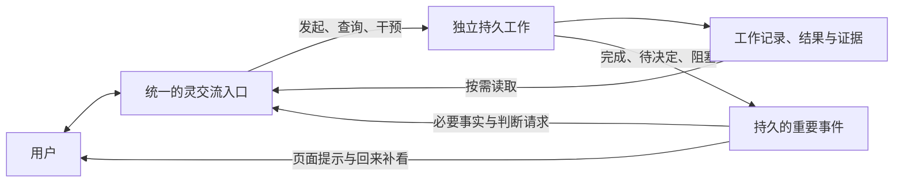

# LingNexus · 灵的第一阶段：持续性研究

研究日期：2026-10-20（Asia/Tokyo）。源码基线：[`31f3bbc`](https://github.com/nivalis2284-art/Nexus/commit/31f3bbc01afd5af53b5b084ff1fa6ee35ed52677)。需求：[PRD.md](PRD.md)。状态：**需求复核与方案研究，尚未正式开发**。本文给出证据、推荐方向与默认判断，不是详细实施计划，也不是持续性功能的验收报告。

本轮使用四个 **DeepSeek high** 子代理，分别调查任务生命周期、上下文与子代理、持久执行参考方案、成熟 Agent 案例；主代理复核普通聊天/网页入口、开展隔离探针并综合取舍。下文明确区分源码事实、研究推断、技术建议和用户确认。

## 1. 需求理解与本轮确认

### 1.1 需要交付的体验

灵正在执行复杂工作时，用户仍能继续交流、交付其他事项、询问和干预原工作；工作不因换话题或聊天连接结束而无故中断。复杂工具过程留在所属工作内，目标、状态、重要决定、结果与必要证据能重新取得。完成、需要决定/授权、无法继续时，主动简短反馈。

这里的“持续”首先指交互、工作状态和重要信息的连续性。它不要求模型一直推理，不要求只有一个物理上下文，也不要求先完成长期记忆、人格或自主目标生成。灵可以直接用工具处理简单事项；耗时工作可以独立执行，不强制使用子代理，更不要求固定层级和无限递归。

### 1.2 用户已确认的补充边界

以下来自本轮直接回答，具有产品决定效力：

| 事项 | 用户确认 | 对研究的约束 |
|---|---|---|
| 日常交流入口 | 提供统一的灵交流入口，可管理各项工作；保留现有会话和任务入口 | 要形成统一可感知的主体体验，不能仅让用户自行切换任务页；不强行合并或删除历史会话 |
| 主动通知接收范围 | Nexus 页面打开时主动提示；离线期间保留，回来后补看 | 本轮不要求系统通知、邮件、即时通信、浏览器关闭后推送或系统常驻服务 |
| 后续待决策项 | 先记录，按照 Agent 的理解与建议继续，无需频繁询问 | 本文给出默认选择和理由；未确认的技术建议不伪装为用户原话，也不扩展既定产品目标 |
| 当前工作阶段 | 仅复核需求、调查、研究和必要文档同步 | 不修改正式业务代码，不提前开始实施，不制定详细施工任务表 |

上传原文仍标注“待所有者最终确认”，本文不替用户改写为已完成最终验收。研究授权和以上补充确认已经明确，无需因此停下研究。

### 1.3 文档同步与历史决策

上传文件已逐字节复制为 `docs/PRD.md`，SHA-256：`5296962882CA1A92E639913D6CB7374D01E7F32BAEC1EEDB098B5149C04FE857`。后续确认集中保留在本文，不改写原文。明确被当前阶段替代的附件 [PRD](../2026-10-20-attachments/PRD.md) 和 [交付记录](../2026-10-20-attachments/PROGRESS.md) 已归档；交付正文仅修正移动后的维护归档链接，保留测试、决策和限制。

任务生命周期研究中的 [已确认边界 §1.3](../2026-10-19-task-lifecycle/RESEARCH.md#13-本会话已经确认的产品边界) 仍有价值：未安排任务默认手动开始、错过时间和重启前未运行队列等待用户、任务执行串行、手动挂起结束所属后台进程、等待审批时已有命令可完成。当前 PRD 可以据实际需求调整内部结构，但不应把新增持续交互误解为自动推翻这些边界。

上一轮附件能力是当前基线的一部分，应继续保护；归档不代表删除能力。`docs/愿景/`、`docs/参考/` 及其他历史材料没有明确被本 PRD 替代，保留原位，不派生额外任务。

## 2. 项目现状与实际差距

### 2.1 普通交流入口：长工作仍会占用整个聊天通道

**源码事实：**[server.py](../../../../nexus/web/server.py) 的 `BUSY` 是全局锁（L228），`_chat` 在 L698 非阻塞获取，未获取即返回 409；直到整轮 `_run_turn` 结束才释放。不是每个会话各自有独立运行通道。网页 [app.js](../../../../nexus/web/app.js) 的 `send`（L475）与提交监听（L1264 附近）使用单一 `state.running`；运行中提交触发停止语义，不能自然接收新的日常交流。

普通聊天内的 `spawn_subagent`（server.py L850）启动嵌套 Agent 后，使用 `asyncio.run` 等待结果；它隔离了一部分执行上下文，却没有释放父聊天的运行占用。流式输出直接写入本次 HTTP 响应；检测到断连写失败会请求停止，并在 `finally` 保存消息（L918–942）。不能把它视为独立于页面连接的长期工作。

**研究推断：**仅提高子代理深度、扩大上下文或移除锁，均不能满足本 PRD。锁还承担当前普通聊天、审批和全局运行资源的约束；直接删除会产生共享状态竞态，必须先明确运行归属。

### 2.2 持久任务：已经具备独立运行的基础

现有 [TaskController](../../../../nexus/runtime/controller.py)、[TaskAssembler](../../../../nexus/runtime/assembly.py)、[TaskStore](../../../../nexus/task/store.py) 构成独立于普通聊天的工作通道。SQLite 保存目标、进度、决定、证据、消息、操作、交互和事件；后台命令与持久任务不同，不能混为一谈。

**本轮隔离探针实测：**临时 home/workspace、真实 HTTP Handler 和 TaskController，任务执行器使用可控等待桩，聊天使用 `httpx.MockTransport` 假模型。任务处于 `running` 时，普通聊天得到 HTTP 200；聊天结束后，原任务仍为同一个运行任务。保持普通聊天的模型请求未完成，再从另一会话发送聊天，得到 HTTP 409。释放聊天后，原任务仍运行。它证明现有两种通道可以并存，未证明真实模型延迟、数小时稳定性或新持续性体验已经交付。

### 2.3 状态感知与通知：记录已有，统一回路缺失

[task_api.py](../../../../nexus/web/task_api.py) 可列任务、读取详情、控制暂停/继续/取消、读取带游标的任务事件；已有 `request_id` 和版本检查。短指令控制（L174 附近）支持明确的“暂停/继续/取消”及任务标题选择，不是通用任务监督语言层。

普通聊天装配未注册任务管理工具。[tools/tasks.py](../../../../nexus/tools/tasks.py) 的工具只在持久任务上下文中注入，用于该任务自己的进度、证据、完成和尝试记录；它们不能直接充当灵跨任务查询/委派/干预接口。

[tasks.js](../../../../nexus/web/tasks.js) 只在打开具体任务且页面可见时轮询详情（`armTaskPolling`）；切回普通会话会取消任务轮询。任务列表初次刷新及任务操作后更新，没有跨页面持续的重要事件收件机制。数据库 `events.seq` 已全局递增，但目前读取 API 按 `task_id` 查询；事件持久化不等于通知已投递，也不等于用户已读。

**实际差距：**统一的灵入口、关联工作目录、主体侧任务工具、全局重要事件筛选、持久待看记录、当前交流与任务通知并存、工作结果跨轮重新取得，尚未形成完整产品闭环。

### 2.4 子代理与上下文：隔离不等于持久证据

**源码事实：**[core/subagent.py](../../../../nexus/core/subagent.py) L92–105 收集所有文本增量和结束原因，不保存子工具轨迹；报告可能包含中间文字，不严格等于最终答复。`tools/subagent_tool.py` L45–51 返回 `stopped/steps/depth`，但父 Agent 的工具结果事件及网页落盘未完整保留这些字段；达到 `max_steps` 还会映射为 `ok=true`。因此“工具调用成功”“子工作正常完成”“已有完整证据”不能互相代替。

子上下文从一条独立任务提示开始，没有持久子会话 ID 和恢复入口。网页只为父上下文注入子代理工厂，子上下文没有继续委派工厂；深度上限常量不等于实际多级委派已接通。持久任务装配也未注入该工厂，且 [assembly.py](../../../../nexus/runtime/assembly.py) L78–90 使用 `mcp=None`。因此不能默认把现有普通聊天工作转到任务，就自动获得聊天侧全部子代理和 MCP 能力。

[compaction.py](../../../../nexus/core/compaction.py) 裁剪本次模型输入，不改写已有父会话 JSONL；普通聊天摘要也只用于当前内存历史，下一轮仍从 JSONL 重建。摘要没有证据引用或目标一致性证明；摘要输入还会截取单条消息。**推断：**长会话可能重复摘要，成本与重要事实保留质量需要实测；本轮没有真实模型测量。

还需区分存储接口支持持久写入和运行时实际落盘时机：普通聊天在轮次 `finally` 批量保存新消息；任务运行也在装配的 `finally` 调用 `save_run_messages`。工具操作意图/结果另有 SQLite 记录，但不等于所有流式文字和子轨迹逐步落盘。进程硬中断时，只能依赖已提交记录；本轮没有做断电/强杀故障注入。

持久任务 [callbacks.context_text](../../../../nexus/runtime/callbacks.py) L238–266 会重新提供结构化目标、步骤、决定、证据、阻碍和未知操作，比纯聊天摘要更适合作为工作事实来源。但只默认带入最近 20 条决定/证据，现有任务工具缺少历史证据分页查询；用户能在详情看到记录，不等于模型已有稳定检索接口。

### 2.5 控制与完成边界：本轮确认的组合问题

| 事项 | 源码与本轮观察 | 结论性质 |
|---|---|---|
| 等待授权时追加输入 | `TaskHTTP.messages` 对 `waiting_user` 直接提交运行。主代理用真实 TaskHTTP、未启动 Worker 的 TaskController 和临时 SQLite 复核：追加消息使任务 `waiting_user→queued`，控制版本 `3→4`，原审批仍为版本 3，随后回答报 `task changed before this answer` | **已复现的组合缺陷**。并非权限绕过，而是待决策记录失去可回答性；后续需保护等待语义或明确取代旧请求 |
| 等待时的执行容量 | 历史确认曾要求有后台命令时保留执行容量；当前 Controller 在返回 `waiting_user` 后释放 Worker，测试也要求等待态让出 Worker；Assembler 则保留该任务 JobRegistry | **历史决定与源码差异**。模型执行串行不等于全部后台命令串行；本轮未实测两任务命令重叠场景，不将旧文档的容量约束当作现状保证 |
| 运行中补充要求 | `messages` 写入持久记录，但 `TaskAssembler` 在本次运行开始时一次性构建模型消息；当前没有运行中安全消费新输入的机制 | **源码事实与影响推断**：消息已保存不等于正在执行的 Agent 已经采用；不能向用户伪报即时生效 |
| 一轮结束与目标完成 | `TaskController._execute` 将未明确 `task_finish` 的正常模型轮次结束转为 `paused`，并写“本轮结束；任务完成状态需独立验证” | **已有正确区分**，需要保留；要持续推进长工作还需区分可继续的内部让出、明确用户暂停和真正阻塞，不能盲目自动重排所有 paused 任务 |
| 完成依据的可信程度 | `TaskCallbacks.finish` 检查步骤、待交互、未知操作、阻碍和验证标签。临时库探针只填模型自报 `verification/ok=true` 与步骤 `verified`，无证据引用、无实际产物核对，仍进入 `completed` | **已实测的信任边界**，不是通用独立验证器。需记录证据来源和限制，不能称为已证明用户目标真实达成；不要求为任意任务构造万能裁判 |
| 阻塞与中断的表示 | 任务有 `completed/cancelled/waiting_user`；阻塞主要是 `blocked` 字段/挂起原因；中断主要由运行记录 `interrupted` 和未知操作表达 | **源码事实**。产品需清楚区分原因，未必需要把每种原因都新增为顶层状态 |

两个临时探针没有实际批准或执行文件写入，也没有调用真实模型。子代理另以临时库验证相同边界；以上主代理复核覆盖了真实 `TaskHTTP.messages` 路径，避免仅凭可人工构造的数据库状态推断产品 Bug。

### 2.6 可复用与必须补齐的对应关系

| 已有基础 | 对本 PRD 可直接借用的部分 | 仍需验证/补齐 |
|---|---|---|
| SQLite 任务权威状态、事件序号、控制版本、请求 ID | 稳定工作身份、查询与控制归属、重复操作处理 | 主体关联、全局重要事件投影、通知补读与用户已看状态 |
| 独立 TaskController 与任务 JobRegistry | 工作与普通交流并存、任务暂停/继续/取消 | 主体交接、输入消费边界、正常片段间继续与明确停止的区分 |
| 结构化目标、决定、证据、未知操作 | 跨重启重新取得已知工作事实 | 历史证据检索、子代理结束原因和必要轨迹、来源真实性界限 |
| 权限策略、持久交互和精确工具参数 | 人工决策回到原任务、原操作 | 等待期间新消息/控制变化的失效处理，跨入口展示与作答 |
| 普通会话、附件、Skill、MCP、子代理等既有能力 | 保留旧入口和数据，按需复用执行能力 | 核对任务装配的能力差异，避免转换工作后暗中失去工具 |

## 3. 技术调查与参考

资料于 2026-10-20 浏览核对。仅以官方文档、官方源码和原始论文支撑技术结论；论坛/搜索摘要只用于发现线索，不作为已实现能力的证据。在线文档和开发分支可能变化，不把未来开发分支内容视为已发布能力。外部系统证明的是设计有参考价值，不能替 Nexus 的实测验收。

### 3.1 执行持久化、等待与控制消息

- **LangGraph**：[Persistence](https://docs.langchain.com/oss/python/langgraph/persistence) 区分线程检查点和跨线程存储；[Interrupts](https://docs.langchain.com/oss/python/langgraph/interrupts) 使用持久检查点、稳定 `thread_id` 与恢复输入表达人工等待。需注意恢复会从节点开头再执行，之前的副作用不能盲目重做。借鉴任务身份、检查点和持久交互语义；现有任务状态机已覆盖一部分，没有证据支持整体迁移。原 `durable-execution` 链接本次已重定向至 Persistence，引用按实际内容处理。
- **Temporal**：[消息机制](https://docs.temporal.io/encyclopedia/workflow-message-passing) 区分只读查询、异步写入 Signal、可等待结果的 Update；[Activity](https://docs.temporal.io/activities) 建议副作用操作具备幂等性以处理重试。借鉴“查询状态”“发出控制”“确认控制已生效”的区分，以及外部操作结果记录。单机 Nexus 本轮没有引入独立 Temporal 服务、完整确定性重放和 Worker 集群的实际需要。

### 3.2 上下文与长任务研究

- Anthropic [上下文工程](https://www.anthropic.com/engineering/effective-context-engineering-for-ai-agents) 讨论压缩、结构化笔记和隔离的子代理上下文。对 Nexus 的启示是原始证据留在工作记录，主体取得必要事实，详细记录按需读取；不能把摘要视为无损事实来源。
- Anthropic [长任务 harness 经验](https://www.anthropic.com/engineering/effective-harnesses-for-long-running-agents) 强调可恢复的进度记录与实际验证，指出模型可能过早宣告完成。可复用 Nexus 已有决定、证据和完成门槛，不照搬其专门的 Coding Agent 初始化流程。
- [Lost in the Middle](https://arxiv.org/abs/2307.03172v3) 在所研究模型和检索任务中观察到相关信息位置影响表现。它支持评估信息选择与定位，不能推断当前 DeepSeek 在 Nexus 中必然有同等退化，也不能给出本项目的固定 token 阈值。
- [MemGPT](https://arxiv.org/abs/2310.08560v2) 探索上下文内外的分层存储与检索。可借鉴“持久保存与当次可见分开”；其长期记忆、个体演化或控制机制不能直接变成本阶段交付项。
- Anthropic [多 Agent 研究系统](https://www.anthropic.com/engineering/multi-agent-research-system) 提供委派、结果综合与协调经验。[Building effective agents](https://www.anthropic.com/engineering/building-effective-agents) 建议按问题需要组合简单模式。这里支持按实际需要隔离复杂工作，不支持所有请求强制多 Agent；外部评测收益也不能当作 Nexus 收益预测。

### 3.3 网页事件传递

[WHATWG SSE 规范](https://html.spec.whatwg.org/multipage/server-sent-events.html) 定义 `EventSource`、事件 ID 及重连时的 `Last-Event-ID`。SSE 适合单向网页提示，但协议本身不保存通知，也不负责已读状态。现有 HTTP 长轮询同样可以满足页面打开时主动显示。

**建议：**优先复用 HTTP 和已有事件序号，形成全局重要事件增量读取；是否使用长轮询或 SSE 属于实现选择。本阶段的交付关键是持久、补读、关联和去重，不是换用某个传输协议。暂不引入 WebSocket 服务、消息中间件或 Web Push。

### 3.4 成熟开源项目的具体案例

以下按固定源码提交阅读；主代理另复核关键契约、结果通知与启动返回路径。没有部署这些系统，也没有把开发快照等同正式发行版。

| 案例与固定参考 | 已核对的机制 | 对 Nexus 的参考与限制 |
|---|---|---|
| **OpenCode** `86ac38ad…`：[V2 Session 契约](https://github.com/anomalyco/opencode/blob/86ac38ad5622498eb85f62701e5e2f9042d04117/specs/v2/session.md)、[子代理完成回归](https://github.com/anomalyco/opencode/blob/86ac38ad5622498eb85f62701e5e2f9042d04117/packages/core/src/session/subagent-completion.ts) | 输入先持久接纳，安全步骤边界再进入模型历史；同会话有序，不同会话可并发。子代理完成以关联子会话 ID、状态及元数据的合成消息返回父会话 | 借鉴接收与执行分离、稳定关联及结果回归。核对的是 `dev` 快照，未确认对应发行版，不照搬其完整事件投影、Location 或插件体系 |
| **Letta Code** `531489bb…`：[任务执行](https://github.com/letta-ai/letta-code/blob/531489bb540f97332802ee991ca491d0ea087892/src/tools/impl/task.ts)、[通知格式](https://github.com/letta-ai/letta-code/blob/531489bb540f97332802ee991ca491d0ea087892/src/utils/task-notifications.ts) | 任务可后台执行；通知携带任务 ID、状态、摘要/结果及 transcript 路径，展示层与模型收到的结果分开处理 | 借鉴“简短通知 + 详细记录引用”。不能仅凭进程内完成回调断言重启后一定补发；此次未实测其离线恢复，也不引入完整记忆维护系统 |
| **OpenHands software-agent-sdk** `33d8aa29…`：[子会话启动工具](https://github.com/OpenHands/software-agent-sdk/blob/33d8aa29c3078d074799e2fbf5e847aeb2d71360/openhands-tools/openhands/tools/child_conversation/impl.py) | 启动工具 POST 创建请求后返回子会话 ID、状态、URL、工作区与隔离信息，不等待整项工作完成；超时错误明确提示子会话仍可能已经创建 | 借鉴“创建/提交成功后返回工作引用”，以及结果未知时先核对再重试。工具层本身没有证明产品通知、恢复和用户控制闭环 |
| **Generative Agents**：[原论文](https://arxiv.org/abs/2304.03442) | 将经历写入 memory stream，按相关性、新近性和重要性检索，再以反思/规划组织行为 | 支持保留经历、选择性读取的研究方向；实验关注模拟行为，不是工具副作用可靠性。其人格、反思循环和多 Agent 社会不进入本阶段 |

这些案例与现有 Nexus 的共同可用原则是：工作拥有稳定身份，接收输入不必等待执行结束，重要结果以有限内容和可定位引用回归，完整历史与当前模型上下文分开。**最优取舍判断：**借鉴这些行为边界，比为获得其中一项能力整体迁入另一 Agent 平台更符合当前项目基础与本阶段目标。

## 4. 候选方案与取舍

| 候选 | 能解决什么 | 未解决的问题与代价 | 判断 |
|---|---|---|---|
| 仅加提示词，让聊天 Agent 自行委派 | 可引导减少亲自执行 | 现有子代理同步等待，聊天仍被占用；通知和恢复无闭环 | 不足以满足 PRD |
| 仅把现有任务页改名为灵 | 可以展示独立任务状态 | 用户仍须切换查看；普通对话无法统一监督，缺主动反馈 | 不采用 |
| 在现有系统补齐灵交流入口、持久工作控制和重要事件反馈 | 复用 Agent、SQLite 任务、证据、权限、附件；直接对应体验缺口 | 需要处理主体上下文与工作事实的同步、通知补读、运行归属 | **推荐** |
| 全面切换 LangGraph / Temporal 等框架 | 可以获得某些运行时基础 | 需迁移已有工具、协议、恢复与数据语义；仍需自行做产品入口与通知 | 当前收益证据不足，不整体替换 |
| 先搭建多层多 Agent、长期记忆和人格系统 | 可服务部分长期愿景 | 超出本 PRD，成本高且不能自动保证交流不阻塞 | 留给独立后续需求 |

推荐方向保留模块化单机和当前数据基础，按产品行为补齐必要的协作边界。这是基于当前差距的技术选择，不把现有目录组织或 SQLite 永久固定为架构要求。

## 5. 推荐方向与必须守住的行为

以下是后续可采用的设计原则，均为**建议，尚未实现**。不指定类名、接口清单、迁移步骤或开发排期。

图中是信息流和产品职责，不表示需要新增对应数量的服务或 Agent；执行全过程不沿通知箭头回灌主体。

### 5.1 一个统一主体入口，多项独立工作

提供可重新进入的灵交流入口，保留普通会话和任务页。入口有稳定归属和工作关联，但其连续性不依赖一个无限增长的模型上下文。主交流由当前对话、必要工作状态和重要事件组成，使用现有压缩能力；新开会话不自动复制所有旧会话，也不强制把历史对话改成主干。

灵能够列出工作、读状态/证据、在已有授权内发起工作、发送补充要求、请求暂停/继续/取消。普通进度询问是只读操作，不应隐含恢复或新执行。描述含糊时先按当前讨论/最近明确关联定位；仍无法唯一定位则记录歧义、暂不对多个任务批量操作。

工作始终保有目标、约束、工作区、模型/权限来源、进度、决定、阻碍、下一步、结果和证据。灵取得状态投影；任务存储继续是工作的权威来源。投影应标明版本/时间与来源，过期时重新查询，不让模型摘要反向覆盖权威状态。

### 5.2 交流与执行解耦，不把运行锁简单删掉

耗时工作从普通聊天轮次转入独立持久任务，委派操作在创建/提交成功后返回工作引用，不等待任务结束。简单问答和短操作仍可直接进行；发现执行变长时应能交接已知目标、决定与证据，避免把已经生效的动作重新执行一遍。

选择这条方向还需补齐真正会用到的任务侧能力。当前子代理工厂和 MCP 未接入任务装配，不能先把复杂工作全部导过去，再将工具缺失当作可接受限制。并非要求顺便建设多级 Agent 平台，而是按实际交付场景保证已有可用工具、权限和必要证据不因交接而退化。

主体不等待某项任务完成，不通过阻塞式子代理工具持续占用整个聊天。主体自身的一次模型请求仍有自然延迟，不承诺任意时刻零延迟响应；新的用户输入可以被接收、排队或在清楚的控制边界应用，而不能把“发送另一问题”等同于停止原工作。

同一个主体上下文只允许有序更新，通知到来不并发改写正在构造的模型消息，也不取消当前日常交流。状态卡片可立即提示；需要灵解释或作判断的事件再进入下一次有序处理。用户输入优先于普通进度整理，任务完成不需等待另一次模型成功调用才能被用户看见。

当前持久任务执行保持串行起步，与主体交流并存；多个重工作可以接受、保存、排队，不能声称它们已同时实际推进。若后续代表性验收要求多个重工作同步推进，应基于该实际差距扩展执行容量，不能以技术便利削减要求。两条已有通道已经可能操作同一工作区，相关冲突是具体设计问题：只对相冲突的变更协调或等待，状态查询和日常交流不应被整个工作区锁长期阻塞。不默认引入自动 worktree，也不禁止灵直接使用现有工具。

### 5.3 重要事件先持久化，再显示和交回灵

优先让工作状态改变与对应重要事件在同一 SQLite 事务提交，再生成可重建的通知记录/投影。已有任务事件可以复用；无需建立通用事件总线。每条待反馈事件需要能确定对应任务、发生轮次/版本、事件身份、事实摘要和详情来源。

正常完成、决策/授权请求、无法自行解决的阻碍必须反馈。普通工具输出、自动重试和暂时失败不逐条打断；用户取消反馈与成功完成分开。重复读取、页面刷新、重复命令不造成重复完成报告；同一任务重新启用后的新完成则是不同事件。

网页收到提示、用户已看、用户已回答是不同事实。在线可见提示不能代替待授权记录；刷新或断线后从持久游标/待看记录补读。用户在其他会话或任务页时也能看到重要提示，不强制跳走、不清空草稿、不覆盖当前流式答案。若旧请求已失效，补看时显示当前处理结果，不能再给过期授权。

事实通知可以直接使用任务标题、状态、简短结果和来源链接；必要的语言整理或判断由灵完成。这样通知不会依赖额外模型请求的可用性，同时保留灵回应和协调的空间。离线补看不主动唤起模型、更不自动恢复已暂停的任务。

### 5.4 执行细节留在工作，结果可再次取得

完整任务消息、操作结果和证据留在所属任务。主体默认接收目标、最新状态、关键决定、结果摘要与可定位引用；按需分页查看历史、证据及产物，不把每次轮询或完整任务 transcript 反复注入交流上下文。

摘要应带来源和限制，不能成为唯一副本。既有保存内容不可因通知被读、主上下文压缩或工作执行结束而消失。任务记录的保留只提供本阶段所需的可查询经历，不宣称已有自动跨任务学习、完整长期记忆或人格连续性系统。

附件和产物按现有归属规则显式关联。将会话附件交给工作时，需要建立该工作允许读取的引用/原件关联；不能因为灵有统一入口就把所有历史附件全量开放。下载链接、原件和已发送附件记录应在旧会话/任务中继续可用。用户明确删除对象的既有语义保留，不将保护历史解释为无法删除。

### 5.5 用户干预与恢复继承已有可靠性边界

控制命令被接受、正在生效、已经生效需区分。例如“请求暂停”不能立即伪报为“已暂停”。改变运行中的目标需在可解释的执行边界应用；补充消息持久保存不等于执行器已经看到并采用，界面和灵都应能区分。

任务等待用户问题/授权时保留既有交互对象及作用范围，回答回到同一个任务与操作；普通交流继续。越过授权的操作仍需现有授权检查，通知或自然语言不能另开一条绕过权限的通路。方案失败可在目标内自主换路线，不因新增管理机制要求用户逐步批准。

恢复读取此前目标、决定、证据、下一步，并核实相关环境变化与未确认外部操作。不能承诺重新唤起旧进程、精确恢复任意隐藏思考或任意外部命令恰好执行一次；未知结果保留为未知，先核对现场再决定重试。服务不运行时本地工作不推进；恢复能力与系统常驻是两件事。

## 6. 其余问题的默认判断

用户已授权按建议继续；下表是当前采用的默认方向，不是等待回答的阻塞清单。若后续证据推翻默认，应补充原因和影响，而非悄悄扩大需求。

| 问题 | 当前默认 | 理由与限制 |
|---|---|---|
| 何时独立执行 | 灵按实际耗时、工具过程和当前交流需要判断；用户已要求现在开展的工作可转成持久任务并提交，告知任务引用 | 不强制固定复杂度分类，也不把讨论设想或仅创建草稿当执行授权；未要求执行的任务维持手动 |
| 是否每次恢复都要点击 | 已授权工作在正常执行范围内继续；用户明确暂停、重启中断、结果未知、权限等待仍遵守现有恢复边界 | 持续性不能变成无限重复调用，也不能变成每轮模型结束都要求用户重新下令 |
| 需要几个 Agent | 一套可交互主体和已有持久工作机制即可；子代理按任务需要使用 | 逻辑主体和物理 Agent 实例不必一一对应，不强制递归组织结构 |
| 多项工作如何安排 | 工作可以并存，执行通道先保留任务串行，日常交流独立 | 当前核心验收是工作不独占主体；暂不为并发修改引入额外调度平台 |
| 普通会话是否也收到通知 | 页面级可见重要提示，统一灵入口可以查询全部关联工作；具体会话保留自己的历史 | 不把通知当成所有普通会话共享全部原始上下文 |
| 重启后是否自动继续 | 默认保留既有等待确认/人工恢复语义；通知和已知结果可补看 | PRD 要求恢复能力，没有明确要求系统启动即自动执行所有旧工作 |
| 是否做“记忆” | 只做工作事实、结果与证据的持久保存和按需重新取得 | 语义记忆检索、人格、自主目标生成另议，不把工作存储包装成完整记忆系统 |
| 通知是否每次唤起模型 | 事实通知先可见；需要解释、协调、判断时再由灵处理 | 兼顾主体体验与模型不可用时的可靠反馈，不建立常驻自发思考循环 |
| 长工作是否永不停止 | 遇到真正完成、用户暂停/取消、授权等待、明确阻塞、预算/执行限制时有清楚状态 | 不以模型一轮结束当长期目标完成；也不以“持续性”为由绕过停止边界 |

## 7. 风险、待核实事项与验收观察点

以下是研究结论的适用边界及后续验收重点，不是本轮开发任务分解或已通过的验收项。

| 观察点 | 必须验证的事实 | 当前证据与限制 |
|---|---|---|
| 长工作期间多轮交流 | 日常问题得到回答，原工作持续推进、目标与执行归属不变 | 本轮只证明既有任务与聊天两通道可并存；尚无统一灵入口 |
| 主体直接执行变长 | 新问题仍可接收，工作交接无重复副作用或信息丢失 | 当前全局聊天锁与同步子代理不能满足，需要后续验证 |
| 等待问题/授权 | 主动显示、可以继续日常交流，回答只作用于原任务/操作 | 现有交互和版本机制可复用；跨入口回路未实现 |
| 完成/阻塞/取消 | 区分真实完成、无法继续、主动暂停/取消及等待授权；临时失败不刷屏 | 现有结构化状态是基础，不能只看最后一句回复 |
| 离线与重启 | 重要事件回来可补看，不重复通知、不自动给过期批准、不擅自补跑 | 本轮未实现通知记录/投影，也未实测此新流程 |
| 上下文保护 | 大量工具结果仍能找回，但主体输入不会随全部工作日志反复增长 | 需要观察真实模型请求内容与实际交互，不单靠 token 总数 |
| 用户调整要求 | 能看到要求已保存、待应用或已应用；不误改其他工作 | 运行中输入的消费边界和控制反馈需特别核实 |
| 旧能力与数据 | 原会话、任务、附件、模型协议、权限、子代理和工具保持可用 | 本轮未迁移用户数据；旧交付证据保留在归档 |
| 真实模型联合验证 | 有代表性的复杂工作、实际网页操作和模型自主判断成立 | 研究用假模型探针不是此项证据；开发阶段必须补真实模型验证 |

剩余技术不确定性包括：当前任务恢复对新增输入的可见时机、主体有序处理与通知公平性、同一工作区变更冲突的最小协调方式、模型在明确状态工具下的实际委派与完成判断表现。它们应通过源码复核或有针对性的验证收敛，不需要先做完整新框架。

## 8. 本轮验证及交付边界

- 主代理执行 `.venv/Scripts/python.exe -m pytest tests/test_http.py tests/test_web_runtime.py tests/test_web_maintenance.py -q`：**27 passed in 18.78s**，覆盖真实 HTTP、普通 Agent 装配、审批/提问、断连、会话持久化、任务控制归属等既有行为。
- `node tests/frontend_behavior.cjs`：**全部通过**。这是现有前端行为回归，不是新灵入口的界面验收。
- 任务生命周期子代理执行 `tests/test_task_controller.py`、`test_task_scheduler.py`、`test_task_runtime.py`、`test_task_completion_gate.py`、`test_task_interactions.py`、`test_task_store.py`：**38 passed**。两组 Python 检查范围不同，未声称本轮重新跑过全套 370 项。
- 临时目录中的并发探针使用真实 Handler、SQLite 和 TaskController，外部模型与长任务执行为桩；观察结果见 §2.2。探针结束清理临时资源，不访问用户日常数据。
- 控制/完成临时探针见 §2.5：真实消息入口可让旧审批失效；自报验证标签可通过完成门槛。它们揭示现状和后续关注点，本轮没有修复业务代码。
- 本轮只修改当前需求、研究、归档和导航文档；无生产依赖调整、无正式业务代码修改。上传 PRD 保持原文，既有历史证据按归档规则保留。

综合推荐：在现有 Nexus 上补齐**统一的灵交流入口、独立持久工作、可查询的重要事实及主动反馈回路**。复用现有执行基础，隔离繁杂过程，保证结果能重新取得；据实际验证再决定局部调整。当前研究不构成开发启动或用户最终验收，也不把未来自主性和完整记忆系统纳入这一阶段。
