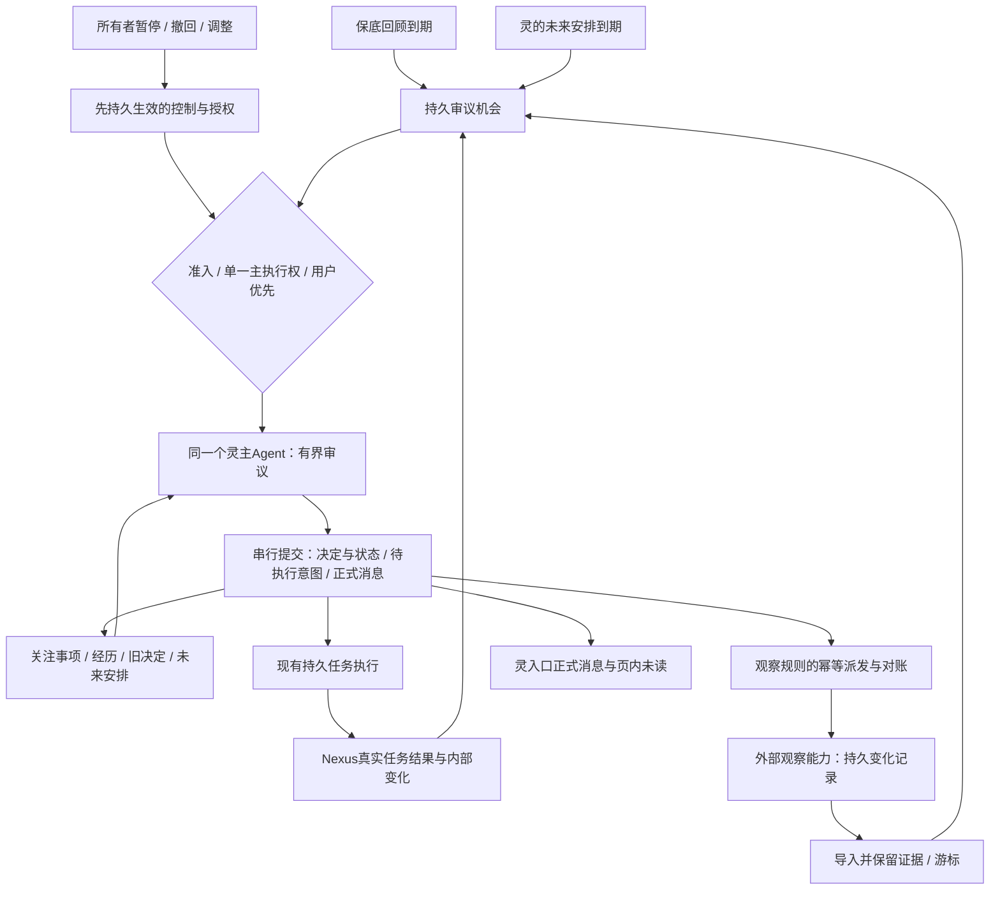

# LingNexus 自主性：方案 A、三源触发与可替换能力增量研究（4A）

研究日期：2026-10-21（Asia/Tokyo）。Nexus 源码基线：[`7d6293a`](https://github.com/nivalis2284-art/Nexus/commit/7d6293a67907d9395f539a1a86027f104c8d6b4f)。本文与 [原研究](RESEARCH.md)并存；依据 [主 PRD](PRD.md)和[补充 PRD](PRD-AUTONOMY-SUPPLEMENT.md)，参照 [PRODUCT](PRODUCT.md)、[ROADMAP](ROADMAP.md)及两份[概念与原则](../../../愿景/01-概念与原则.md)、[抽象需求](../../../愿景/02-具象理想.md)。

**阶段边界：仅增量 4A 研究与方案取舍。** 方案 A 已作为本轮研究主方向，下面的具体架构、运行授权与验证预算仍待所有者确认。未修改业务代码，未部署监听器，未运行 Nexus 付费模型或自主性实验；源码检查不等于运行实测。三名 DeepSeek high 子代理分别调查本地 DSH、MCP 与外部架构、Nexus 接入，主代理负责三源协调设计、证据复核与综合取舍。

仓库还存在较早的 [PRD-AUTONOMY-ARCHITECTURE-SUPPLEMENT](PRD-AUTONOMY-ARCHITECTURE-SUPPLEMENT.md)，本轮已参考。它将实际监听列为增量能力，而用户指定的更新补充 PRD 明确将“是否以独立 MCP 纳入首版”留待研究及所有者确认。本文推荐纳入一项可管理的真实观察能力，以独立 MCP 为首选形态，但不将这一推荐写成已批准需求；不覆盖、归档或暗改任何 PRD。

证据标记：**F**＝本地文档/源码事实；**S**＝一手公开资料；**D**＝工程推导及推荐；**H**＝尚需实验的行为或组合假设。除专门注明，本轮“核对”均指静态阅读，未启动对应程序验证。

## 1. 主要结论与这轮新增的决定依据

**D：推荐继续方案 A，采用 Nexus 持有重要状态与控制、唯一灵主 Agent 有界审议、外部观察以独立能力接入的组合。三源最终进入同一持久审议入口；首版不引入通用插件框架，也不让 Jev 成为不可绕过的闸门。**

具体推荐如下，均可在 4B 转为正式计划，但本报告不提前制定施工步骤：

1. **三源各自保有语义，合并考虑机会。** 保底回顾防止长期无审议；真实变化带来新证据；灵自行设置带理由、条件与版本的未来回顾。到期只交给主 Agent 再判断，不能直接发消息或执行旧草稿。
2. **观察内容外置，连续性留在 Nexus。** 建议纳入一个受 Nexus 服务管理的 stdio 观察 MCP 子进程，先支持所有者选定的本地文本资料范围。灵可以在获准范围内选对象、建立/修改/暂停/停止规则。服务保存可分页补取的变化记录，Nexus 保存关注意图、关键证据副本、控制与消费位置。
3. **先用可回取事件补足可靠性，再按实际延迟需要加推送。** Nexus 当前不消费 MCP 通知；首版通过专用后台适配器调用事件读取工具，不占模型轮次。通知以后可作加速提示，不能成为唯一事实来源。
4. **能力可替换不等于所有状态交给插件。** 观察器、内容提取、可选筛选、选材及提示策略可以替换；正式消息、目标和认识修订、用户暂停/撤回、已执行动作及来源归 Nexus 的权威记录。替换过程需迁移当前真实能力的契约与基线，不承诺任意未来实现零适配。
5. **先完成真实自主行为，再优化模型分工。** 主 Agent 仍负责提出目标、选择何时回顾、利用反证、决定行动与交流。监听规则只检测变化；Jev 即使以后接入，也只能提供可审计的建议，不能批准权限、吞掉控制或代表灵发言。

推荐独立观察 MCP 的依据是当前已提出的观察能力替换需求，以及不让各数据源进入 Nexus 核心的实际价值；不是声称 MCP 天然可靠、天然隔离。进程内普通 Python 观察适配器是有竞争力的退路，见 §8；完整迁移 DSH/Cordis 没有当前必要性。

## 2. 需求解释：保持两条原闭环，新增时间选择与观察主动权

主 PRD 的自主联系与自主目标闭环继续独立验收。补充要求增加的是：灵能够决定“接下来观察什么、何时值得重新考虑”，而非只等外部程序规定好的提醒。

**D：把三个不同层次显式分开：**

| 层次 | 应表达什么 | 不能据此直接断言什么 |
|---|---|---|
| 观察事实 | 某获准资料由版本 A 变到 B；任务真实失败；来源目前不可读 | 灵已经认为这件事重要，或来源说法已被证明 |
| 审议机会 | 关注条件满足、计划到期、保底回顾需要进行 | 必须开展任务、必须联系、已获新增授权 |
| 主 Agent 决定 | 为什么调查/等待/放弃，修改了何种认识，何时再考虑，是否值得交流 | 仅有模型叙述便证明行动已执行或消息已送达 |

“计划未来一天”推荐实现为**滚动的未来回顾安排**：主 Agent 可在一次审议中查看未来一天的已有安排，创建、修改、取消或留空；不要求每天额外启动一轮模型来填满日程。若所有者需要固定某时段作一次集中规划，可作为保底回顾的一种配置，而非第四个重复运行器。不同事项可有不同时间与条件。

高级记忆继续后移，但本版必须保留：目标从何而来、实际查过什么、结果怎样改变认识、为何等到某时/某条件、已经告诉所有者什么。只保留监听规则和任务列表不足以提供这份连续性。

## 3. Nexus 当前可复用处与真实接入缺口（F）

以下链接指向本仓库源码；具体函数用于定位，不能将“已有类”解释为自主能力已实现。

| 源码事实 | 对设计的影响 |
|---|---|
| [`nexus/mcp.py`](../../../../nexus/mcp.py)：协议常量 `2025-06-18`；仅 stdio；`initialize` 的客户端 capabilities 为 `{}`；`_read_loop` 忽略无 id 通知 | 不能直接接资源变化推送。无需为了首个观察源扩建全部 HTTP、sampling、资源订阅 |
| 同文件 `call_tool` 主要拼接文本 content，未保留任意结构化返回；[`mcp_tools.py`](../../../../nexus/tools/mcp_tools.py)进入普通工具结果裁剪 | 后台事件导入不能解析被裁剪的自然语言。需专用、严格校验、有限分页的机器读取；可约定单一 JSON text 内容并在进入通用裁剪前解析，或局部保留 structuredContent |
| [`runtime/connections.py`](../../../../nexus/runtime/connections.py) 与 [`assembly.py`](../../../../nexus/runtime/assembly.py)：每次任务执行启动自己的 MCP registry，结束关闭 | 长期观察服务不能直接放入普通每任务 MCP 配置，否则多份进程/观察、任务结束即停止。需要唯一服务生命周期所有者 |
| [`ling.py`](../../../../nexus/ling.py) `LingInbox` 只处理用户输入，写入 `kind=user`；[`server.py`](../../../../nexus/web/server.py) `_ling` 懒初始化 | 自主入口应随服务生命周期启动，不能伪造用户消息唤醒，也不能依赖用户先打开灵页 |
| `LingInbox` 有持久输入队列；普通 `_chat` 在 `BUSY` 占用时返回 409；`RUNNING`/内存审批是共享状态 | 保留用户优先、安全边界让行与独立取消归属；不能让后台审议新增长时间拒聊，不能复制一个不受协调的主执行器 |
| [`TaskScheduler`](../../../../nexus/runtime/scheduler.py) 处理已有任务的一次性 `schedules`；错过启动时刻走确认；任务表是任务外键 | 可以借鉴认领/幂等/错过处理，不把自主回顾塞成假任务，也不改旧任务重启语义 |
| [`TaskStore`](../../../../nexus/task/store.py) 有 SQLite 事务、events 表全局自增 seq、任务版本、操作/审批/结果；但 events() 接口按 task_id 查询；通知 JOIN tasks，带任务外键及级联删除 | 复用事务底座与真实结果，不声称已有跨任务自主事件流。新增自主权威记录不能被任务删除级联清空；任务外正式消息另有归属 |
| [`WorkService.start`](../../../../nexus/ling.py) 依赖用户 `input_id` 和最近用户附件；[`work` 工具](../../../../nexus/tools/work.py)以用户委派为语义 | 自主启动需审议/事项版本、授权引用、显式附件、稳定请求键；不能借最近聊天扩大授权 |
| [`assembly.py`](../../../../nexus/runtime/assembly.py) `_is_ling_task` 依靠带 `source_session_id` 的 user 记录识别灵委派续跑 | 自主归属须显式接入续跑判定与控制，不为获得续跑而伪造用户记录 |
| [`Agent`](../../../../nexus/core/agent.py) 有模型前/工具前/结果检查点、`execute_prepared`；[`TaskCallbacks`](../../../../nexus/runtime/callbacks.py) 有持久操作和审批、续跑/止损 | 复用模型循环与任务执行。目标控制、观察管理和自主预算须传播到续跑/子代理，不能仅检查建任务时 |
| [`ToolSpec`](../../../../nexus/tools/registry.py) 已支持依赖键、注册和统一调度；[`skills.py`](../../../../nexus/skills.py)已有技能发现 | 先采用普通模块＋明确适配器与现有能力注册，未显示需要一套 Cordis 依赖图宿主 |

还有两项必须纳入真实接入的 F 类限制：`ServerConfig` 没有 timeout 字段，stdio 默认请求超时 30s、单行上限 8MiB，不能向现有配置填一个 timeout 就声称长轮询已支持；Skill 只加载工作方法/指令，不注册后台生命周期或权限，任务运行中也不自动热重载。当前 MCP 测试主要验证文本工具调用与目录分页，没有覆盖观察事件/结构化结果/通知或规则控制，不能当作新链路的验证证据。

原研究 §3、§5 已解释消息双写、权限和恢复缺口，本轮沿用但不声称它们已经修复。持续性历史有实际模型与浏览器验收及后续修复记录；自主性仍未实现，不能把旧“完全没有真实联调”的说法推广到整个 Nexus。

## 4. DSH 本地部署与插件机制核对

### 4.1 找到的是真实安装产物，未找到完整 Git checkout（F）

| 项目 | 本地证据 |
|---|---|
| 实际桌面安装根 | `C:\Users\Nivalis\AppData\Local\Programs\DSH Desktop\resources\app`，有 package.json、lib、node_modules、打包配置 |
| 用户 profile 根 | `C:\Users\Nivalis\.dsh\profiles\desktop`，有配置、依赖清单和已安装能力；只读核对结构/包元数据，不将凭证或完整私人配置写入报告 |
| 核心包 | `@deepseek-ai/dsh`、`dsh-tools`、`dsh-session`、`dsh-mcp-client`、`dsh-agent-loop` 等均为 `0.2.0-rc.2` |
| 插件宿主 | `@deepseek-ai/cordis 4.0.4`，`cordis-plugin-loader 1.0.5`；桌面壳 `dsh-plugin-desktop 2.0.17` |
| 初始检索目录 | `C:\Users\Nivalis\Documents\deepseek-harness` 仅是 default-workspace 等工作材料，不是 Harness 源码仓库 |
| 证据限制 | 当前 PATH 没有 dsh 命令；安装目录无 .git，无法映射精确 Git commit。多数业务包为可读的 lib/*.js，Cordis/Loader 还包含 src/*.ts |

因此，本轮**已经核对本地安装代码**，不能继续沿用补充 PRD 生成环境中“Chat 无法读取本地 DSH”的限制性说明；同时也不能把编译包说成完整源码 checkout、当前运行 profile 已验证或热卸载实测成功。没有运行 DSH CLI、dump-config、插件安装/卸载或模型调用。

### 4.2 真实机制及其边界（F）

下表路径相对上述安装根的 `node_modules/@deepseek-ai/`；行号针对本地安装代码，不对应公开 master。主代理复核了 effect/unload、scoped 注册、持久后端关闭与 MCP dispose 的关键段落。

| 本地代码位置 | 已证实机制 | 不能外推的保证 |
|---|---|---|
| `cordis/src/context.ts:16`、`registry.ts:164`、`:300` | Context 提供服务/事件/插件注册；inject 在依赖服务可用时装载，服务变化可使依赖回调卸载/重跑 | 服务名依赖和作用域隔离是同进程对象管理，不是 OS 沙箱，也不证明新旧提供者语义等价 |
| `cordis/src/fiber.ts:402`、`:675` | effect 收集清理动作，**单个 effect 内**按逆序执行，重复 dispose 不重复执行；fiber 卸载等待各 disposer、记录异常并清理服务 store | fiber 级卸载有并发清理，不保证任意所有插件全局严格逆序；清理异常会记录，不能说卸载绝不会残留资源 |
| `cordis-plugin-loader/src/config/entry.ts:115`、`:207`；`tree.ts:82`、`:111` | 配置禁用 dispose fiber，修改可重挂载；Loader 可以 create/remove/update 条目、持久化组合树并导入模块 | 移除配置条目不等于删除业务数据、补偿副作用或完成数据迁移 |
| `dsh-tools/lib/index.js:2660`、`:2878`；`dsh-scope/lib/index.js:189` | global/agent scope 工具注册，局部可遮蔽全局；注册调用受所属 context 的 effect 管理并返回 disposer | 工具可见性不是授权。卸载后移除注册，不能撤回已经开始/完成的工具动作 |
| `cordis/src/events.ts:183`、`:194`、`:204`；`dsh-session-persistence-jsonl/lib/index.js:398` | 进程内并发/串行事件分派；JSONL 后端显式监听 session/event 和 flush，卸载关闭句柄并排空缓冲 | 事件总线本身不自动持久；仅有 on/emit 不能保证断线补取，后端关闭失败仍需处理 |
| `dsh-session-persistence-jsonl/lib/index.js:112`、`:398` | JSONL 追加有连续性与写句柄检查，关闭路径 flush/drain/释放句柄；本次核对的卸载路径没有删除会话日志 | 不代表所有显式删除 API 都不删数据；换持久后端/格式仍需兼容与迁移 |
| `dsh-storage/lib/index.js:35`、`:101` | 注册/挂载返回 disposer，注销只移除名称/挂载；后端由所属插件另行关闭 | “后端可换”不自动搬运旧记录；需要约定状态归属与迁移 |
| `dsh-mcp-client/lib/index.js:700`、`:809` | dispose 取消重连、关闭连接、等连接/同步链、注销工具；依赖 tools 服务装载，并可向其他服务提供资源/说明 | 关闭失败会报告不完整卸载；不能回滚 MCP 服务端已完成动作。客户端插件同 Host 进程，stdio 服务端另属子进程 |

### 4.3 与公开架构的对照及本项目取舍（S/D）

[DSH 官方架构文档](https://github.com/deepseek-ai/deepseek-harness/blob/master/docs/architecture.md)描述由 profile/bundle/patch 装配 Cordis 插件树，模型、工具、会话和循环都可由配置选择提供者；并区分持久 session 事实与 live Agent/能力事件。本地装配和生命周期代码与这个原则一致。公开 master 是动态版本，不能将其新增接口一律当作本地 `0.2.0-rc.2` 已安装能力。

**值得借鉴的是四个机制，而不是“一切插件化”的口号：**

- 每项长期资源有明确所有者及可等待的清理动作；Nexus 观察连接、后台扫描和重连不能归属一次任务的临时注册。
- 依赖不可用时明确报告能力未就绪，避免注册一个貌似可用却无法执行的工具；重连后需对账再恢复，不凭工具名称恢复旧授权。
- 真实事实/持久状态与现场事件分开；观察通知只是现场信号，事实仍需持久日志和证据。
- 卸载代码贡献与保留持久资料是不同动作；这直接支持 Nexus 的“状态属于灵，能力提供者可换”。

**当前不采用完整 DSH/Cordis 迁移。** Nexus 已有 Python Agent/任务/权限/MCP/UI；完整换宿主要适配 Node/Cordis 服务、profile 装配、工具及会话语义，重做能力和恢复回归，仍不能代替本 PRD 的自主目标与反馈机制。只引入 Cordis 也没有自动解决数据迁移和外部副作用。当前有依据的投入是观察适配器的少量契约、所有权、清理和数据边界，不是把权限、消息、任务都改成可卸载插件。

若未来确实需要多个运行能力提供者、动态装配依赖或整套执行器替换，可再次比较 Cordis/其他宿主；届时依据的是真实组合需求和可迁移状态，而不是因为本轮没采用就永远排除。这里的长期演进权符合愿景，但不要求今天预建所有未来能力。

## 5. 三源如何实际协同（D，尚未实现）

### 5.1 共同入口和各自的持久含义

这不是为三源各开一个模型循环。建议新增一个普通 Python 自主运行协调模块，以现有 SQLite 作持久边界、条件变量/有界定时查询作唤醒；模块数量由正式规划决定，无需通用事件总线或消息中间件。

| 来源 | 必须保存 | 到期/到达如何处理 | 什么才算已处理 |
|---|---|---|---|
| 时间保底 | 启用范围、最近完成的广泛回顾、下次保底到期及失败退避 | 产生一次可合并回顾机会。原报告 6h 只是候选配置，不是定时发言 | 主 Agent 实际完成覆盖该回顾的审议并保存决定；单纯收到事件/运行窄任务复核不能不断后移保底 |
| 真实变化 | 来源、观察/接收时间、规则版本、事实版本、关联事项、未复核状态 | 先持久记账；合并重复，确定性控制先执行；相关事实进入主 Agent | 成功提交引用该事实的判断，或有可审计的确定性无关/重复处理，不是用户读过通知 |
| 灵自主安排 | `plan_id`、事项及版本、为什么是这个时机、`due_at`、时区、有效条件/过期边界、状态/修订来源 | 到期成为机会，重新核对事项、证据、控制；可调查/等待/放弃/改时间 | 与本轮决定一起完成/替代/取消。认领不是已经思考过 |

保底不能因大量普通事件到达而无限延期；同样，模型刚完成一次充分回顾时，不必为同一分钟到期的保底再跑一次。区分“做了模型请求”与“完成了本次应覆盖的回顾”。长时间有用户交互时可延后自主机会，界面显示暂缓原因，不能抢占交互来满足时钟指标。

### 5.2 合并、去重、并发与错误边界

1. **先入账，后唤醒。** 来源导入的事实、机会与游标在事务中保存。内存信号只是加速，重启可从数据库发现待审议事项。
2. **只认领一个有界批次。** 批次记录事件集合/水位、已到期安排、控制版本和相关事项版本。保底、同事项计划和同一变化可以在一轮中共同出现；不同事项可同轮考虑，不把它们抹成同一个事实。
3. **精确重复与语义重复分开。** 重复传送用来源 epoch＋序号/事件 ID 去重；内容 A→B→A 是两个变化，不能只凭哈希永久丢掉第二个 A。是否与其他关注同题由主 Agent 在上下文中判断。
4. **认领后到达的事件留待下一次。** 模型只消费自己真实读取的事实。若新证据改变当前候选行动，提交前要求重新读取/审议受影响部分；不能把批次水位以后的事件一起标已处理。
5. **提交结果与消费进度一起落地。** 审议失败、被交互打断或提交冲突时，不提前推进“已采用”游标；保存已取得的读取证据，有限退避后再考虑。不得每个时钟 tick 重试模型。
6. **区分三种防重复。** 事件重复不重复导入；同一行动意图不重复开工；正式消息不重复创建/展示。需要不同稳定 ID，不能用一个冷却计时器替代。
7. **确定性控制不排在模型之后。** 暂停、撤回、授权缩小先持久前进控制版本，取消未提交计划/派发资格，再让主 Agent 理解其含义。不能先问 Jev“是否重要”再暂停。

机会自身具有稳定 ID/唯一键，认领关联审议运行 ID。首版是同一服务内的唯一所有者，不引入分布式租约；服务重启把本进程未完成的审议标为 interrupted，对账已提交意图后释放未消费机会，不能永久卡在 claimed，也不能重复派发已提交动作。变化来源明确区分 internal/external：任务结果直接从 Nexus 接入，不绕观察 MCP。保底是否被覆盖以审议记录中的材料/事项覆盖和明确决定为依据，而非请求数；后续实测其最长等待时间，用户持续占用和预算不足须标为例外，不能承诺无条件实时。

模型连续提出极近回顾时间或重复动作时，运行时按所有者批准的调用/时间/资源边界拒绝并记录等待原因；主 Agent 可改成合理等待。不能秘密丢弃计划，也不为表示自主而允许零间隔循环。

### 5.3 自主规划的具体表达与修订

推荐单次绝对时刻＋时区说明，不先做自由 Cron 表达式或模型生成可执行脚本。相对时间在提交时解析为 UTC，并保留原时区/理由；夏令时歧义、过去时间、越过资源范围应返回明确校验结果。

主 Agent 的结构化决定可表达：`关注Q；在资料预计更新后复核；明日下午某时；若先有相关变化则提前；若Q已解决则取消；否则届时评估是否继续等待`。这只是回顾意图，不是到点自动执行某工具的命令。用户并未逐项安排这个时间。

真实变化提前到达时，旧计划先作为背景带入；主 Agent 可以认定已被本轮覆盖，改到更晚，或保留另一独立目的。相关事项被所有者撤回时，运行时可确定性废止其计划，不等模型同意。单纯无关聊天不取消全部目标和安排。

到期时资料未更新，可以读健康状态后继续等待或改观察条件；不需要捏造结果。服务睡眠/停止后错过多个时刻，恢复时合并成一次“已错过，需要按现在事实重议”的机会，保留原计划历史；不补执行每一次旧时刻，不直接发送旧草稿。过时计划有明确取消/过期记录，不能默默消失。

## 6. 观察与独立 MCP：完整可实施候选（D/H）

### 6.1 首个观察源与变化定义

**推荐以所有者选定的本地文本资料目录/文件集作首个真实观察源**，服务独立于 Nexus 业务进程，先支持普通 UTF-8 文本/Markdown 的新增、内容版本变化和删除/不可读状态。所有者批准可读范围和数量/大小/频率边界，灵自行选择范围内的具体对象与理由，可修改规则；不是所有者替灵写死全部监听任务。

选择理由：能够承接已有资料和非编程研究/创作话题，不要求新增账户、网络凭证或外部收费；内容版本和动作结果易核查；适合实际展示观察器替换。**这只是首个来源的推荐，不把自主性永久限制为本地文件，也不把目录变化直接当有意义目标。** 首版是否改用指定公开资料 URL，应由真实使用价值决定。

推荐小范围定期快照扫描为第一实现，保存内容摘要/哈希、读取版本和有界原文；不只比较 mtime。读取前后元数据变化则短暂重读或标不稳定，不把半写入内容当确定事实。首次建立监听保存 baseline，标记为初次观察，不伪称刚发生更新。路径解析、实际读取对象都应在授权范围内，包括符号链接/Windows junction；不通过规则扩大到整个磁盘。

**重要限制：**快照扫描只能证明观察时刻状态，不保证捕获扫描间出现又消失的所有瞬态版本。断线期间“从A到C”不能编成完整 A→B→C。若业务需要全量事件历史，必须使用本身提供版本/事件日志的数据源；不能由文件通知或 MCP 补出从未观测的事实。

[watchfiles 官方 API](https://watchfiles.helpmanual.io/api/watch/)提供变更合并、停止事件和轮询回退，可作低延迟的可替换实现；通知还可能是元数据变化，因此仍需按内容核对。当前首个有界资料范围没有证明需要引入该依赖，先选简单扫描；若延迟/文件数实测不合适，再加 OS 通知＋对账扫描，而非放弃持久事件契约。〔S/D〕

有竞争的外部来源是**获准固定 HTTP 文本资源**：条件 GET 以 ETag/Last-Modified 减少传输，200 后比较受控内容，304 复用已保存基线。[RFC 9110](https://www.rfc-editor.org/rfc/rfc9110.html#name-conditional-requests)支持这些协议语义；“返回变了”不自动代表值得思考。需额外处理重定向后的授权对象、页面噪音、来源条款/限速与不可用，故不默认建设通用网页抓取或任意脚本平台。〔S/D〕

### 6.2 服务生命周期与最小契约

建议观察服务是一个独立可执行包，由 Nexus 自主服务拥有唯一 stdio 连接；不随某轮聊天/任务退出，不混入每任务都启动的 MCP 列表。整个 Nexus 服务退出时关闭该子进程；浏览器关闭不停止；机器睡眠/服务关闭只承诺已存状态，不承诺继续观察。

服务端推荐普通 Python 实现，利用官方 MCP SDK 提供 tools，固定一个实际支持 Nexus `2025-06-18` 握手的版本；4B 必须核实版本兼容并锁定依赖，不能盲用最新版。扫描与日志是该能力的业务代码，MCP SDK 只是接口实现；本轮不安装包、不创建服务。每个所有者数据目录只有一个采集实例，重复启动须明确拒绝或只连接已有所有者，不能让多个任务各自采集。

连接可以复用现有 stdio 传输的底层机制，**新增的是明确的长期所有权、重连对账和后台事件读取适配器**。主 Agent 工具通过这个受控所有者操作观察意图，工作 Agent 默认只读需要的已获准证据；不能各自启动同一后台监听。首版不要求共享任意第三方 MCP 连接或重写现有全部 MCP 行为。

专用配置与普通全局 `mcp.servers` 分开，显式指定命令/工作目录与所有者数据位置；不把原始观察控制工具直接注入聊天、任务及子代理的通用 MCP registry。现有 `permission.target` 不识别任意 MCP 对象，默认 ask 只拦一部分内置写/命令，`read_only=False` 也不是审批保证。观察适配器须在派发时核对 watch ID、动作、参数、授权和控制版本；只有唯一主 Agent 可提交上层观察/目标变更，子代理不可自续权限。用户原有明确委派能力保留原语义。

以下为观察能力自己的应用契约示例，**不是 MCP 标准方法，也不是已存在工具**：

| 操作 | 最低请求/结果语义 |
|---|---|
| `status` / `watches_list` | 能力/契约版本、provider epoch、活动规则及版本、健康、可读最早事件位置；区分配置存在与正在运行 |
| `watch_put` | Nexus 稳定 watch ID、spec/version、授权范围引用、控制版本和幂等 request ID；返回实际接受的版本及 baseline，不用模型口头“已监听”作成功 |
| `watch_pause` / `watch_stop` | 指定 watch ID、期望版本与请求 ID，返回停止确认；保留历史；不要求删掉证据才能卸载 |
| `watch_resume` | 仍在当前授权内的暂停规则才能显式恢复；已停止/撤回规则不能用 resume 复活；保留停采区间和新基线说明 |
| `events_read` | 单一所有者按 provider epoch＋全局日志游标读取全部规则的事件，不在分页上临时按 watch 过滤；固定顺序、最大条数/字节、next cursor、gap 状态；重复读取不删除，错误不推进位置 |
| `evidence_read` | 按明确版本取回有界原文/差异与内容指纹；源不存在明确报告，不从当前内容伪造旧版本 |

规则内容包含稳定逻辑来源、观察对象/选择范围、变化类型、扫描间隔/有效期、关联事项、选择理由。语义问题“何种变化可能推翻解释”供主 Agent 理解；确定性检测条件可限制文件类型/对象，不要求用正则一次判定全部语义价值。

**两种状态必须分开：**Nexus 保存“希望建立/暂停/撤销的观察及版本”；服务保存“实际已应用的规则/扫描基线/原始事件”。模型提交 watch 变更意图后，权威事务保存为 pending，后台幂等派发，再确认 active 或 failed。进程在请求已生效、回包未到时中断，先按 ID/版本查询，不盲目再建；错误作为真实反馈进入下次审议。

### 6.3 可靠送达与证据归属

推荐后台周期性调用 `events_read`，不让主 Agent 每次先调用模型才发现变化。返回一页完整、可验证的 JSON 后，将事件与必需证据副本写入 Nexus，再同事务推进导入游标；中途失败重读同页，依稳定事件 ID 去重。独立的“已导入”和“主 Agent 已采用”位置不能混为一谈。

provider epoch 是持久日志身份：普通进程重启仍沿用，日志重置或更换实现才产生新身份。规则版本、观察进程一次运行和事件位置分别记录，不以时间戳充当唯一游标；不能每次重连清空去重历史或把新日志第 1 条接在旧位置之后。

当前通用 MCP 工具路径可能丢 structuredContent、裁剪文本；后台适配器必须绕开自然语言展示裁剪，校验完整 schema、页面顺序、大小与 next cursor。不能成功解析半页就越过整页游标。大证据按版本分页获取，无法完整保留时明确标缺口并不作高置信行动依据。

首版事件读取快速返回有界页/空页，不做超过默认 30s 的长轮询；分页按编码字节限制并留出 JSON 转义/协议开销，远低于单行 8MiB，不以字符数直接估算。服务异常时有限退避并显示健康状态，不能后台无提示地无限重连。需要另设超时可由专用连接显式传入，不能假设普通 MCP 配置已支持。

观察服务若保留窗口不足，须返回 gap 和可用最早位置。Nexus 记录缺失区间，重新建立当前基线，请主 Agent 按“不知道期间发生过什么”判断；不能悄悄跳到最新却声称没漏。首版少量规则不自动删除事件，达到所有者批准的存储上限停止新采集并明确报错；如未来按消费位置回收，须另有在 Nexus 提交后才确认的幂等确认协议，不能把 events_read 成功当作已消费，也不能无限增长或无声删历史。

**重要证据不能仅以服务私有 URI 留下。** 被主 Agent 用于目标/决定/正式消息的原文片段、版本、来源、时间和必要解释在 Nexus 所有者数据目录保留；完整大文件不必全复制，但应保留足以支持当时判断的授权内容及缺失说明。导入证据的附件/文件路径不得被任务删除级联清空。更换服务后，即使旧来源暂不可读，仍能解释旧决定。

### 6.4 暂停、撤回与恢复

全局自主暂停先使 Nexus 控制版本持久生效，立即禁止新模型、采集、任务/规则派发与自主消息的准入，再暂停全部自主规则并关闭/停止该自主观察子进程；保存最后确认情况。单个 watch 暂停只停该规则，不能关闭仍服务其他有效规则的进程。若服务无响应，不在 UI 声称已完成远端停止；本地受控进程可终止，但已经发出的读取/请求可能完成。

为处理父进程异常退出后观察仍活着的实际生命周期问题，服务应响应 stdin EOF，且扫描前核对有限的运行许可有效期；没有续期便停止自主采集。许可不是模型可自续的授权。它只用于当前受控观察进程，不建设全局租约框架；检测间隔及最坏停止延迟必须实测，不能承诺远程瞬时撤销。

迟到的结果只有可对应暂停生效前已派发读取/操作时，才作为该操作的结果入账，标明实际时序且不引发新审议/开工；无法对应或暂停后新采集的记录隔离为异常，不当作合法自主新经历。控制确认依派发/运行标识及版本，不只信任外部时钟。暂停不默认许可廉价后台继续扫描；恢复需记录停采区间。撤回某事项同时废止其未来安排、规则期望状态和待派发意图；已经撤回的观察 ID 保留 tombstone，不能由服务重连自动恢复。

恢复时先对账 epoch、规则版本、基线、控制与待处理事实；原暂停状态绝不被服务“active”回报覆盖。只恢复仍获准的观察。停机期间未观测的变化如实标缺口；未知外部动作继续沿用现有任务人工核查边界。恢复不是补跑所有错过的计划。

### 6.5 什么值得唤起：规则与 Jev 的取舍

| 事件种类 | 推荐处理 | 误判与漏判约束 |
|---|---|---|
| 暂停、撤回、授权变更 | 直接执行确定性控制；无需模型筛选 | 低分、超时或服务故障都不能阻止控制 |
| 已确认任务结果、审批响应、明确等待条件的变化 | 持久关联事项，交主 Agent 复核，可与其他机会合并 | 不因通知已读/辅助模型低分而丢失 |
| 同事件重传、内容实际未变、自己写审计日志 | 精确去重/不产生新变化，保留必要来源/健康记录 | 不把审议日志或通知自身再次触发成无限循环 |
| 普通获准资料内容变化 | 按规则聚合和频率边界进入待复核；重要性由主 Agent 判断 | 不假设“任何字节变动都要立即一次模型”；最迟在可配置复核机会读到相关记录 |
| 不可判断/不稳定内容/来源不可用 | 标未知与健康状态，退避，必要时主 Agent 判断是否换方法 | 不把失败伪装成无变化；不无休止重试 |

**D：首版不选 Jev 评分硬阈值。** 已限定来源与聚合后，是否真有足量噪音需要额外分类尚无数据。多一层既增加调用也可能挡住新颖目标，违背先验证行为的顺序。可配置的速率/重复合并是资源控制，不声称衡量目标意义。

未来若普通变化量证明确有需求，可让 Jev 为同一批已持久导入事实建议“立即/合并/稍后复核”，保存模型版本、输入依据与结果；低置信/新类型转主 Agent，确定性事件旁路，待后续保底审议抽查被延后的事实，评估真正漏掉的主 Agent 选择。不能只统计与另一个分类器的一致率，也不能把 0.8 当自然校准概率。本轮未测 Jev，不断言其无效或可靠。

## 7. 方案 A 的端到端实现与核心边界（D）

### 7.1 唯一主 Agent 怎样运行

服务启动恢复时创建自主运行所有者，不等首条用户消息；启用状态、授权和预算满足后，三源机会由同一主决策协调器认领。审议使用与灵一致的模型/身份配置，读取共享的相关交流、关注事项、事实与反馈；独立有界上下文承载内部工作，不产生第二个能对外自主发言的 Agent。

内部轮次可读取获准的有界证据、提议目标/认识修订、安排下次回顾、观察变更、实际工作及正式消息。工具接口中的变更先是提案；**只有一个串行提交入口**按当前控制、事项/来源版本、用户新输入与权限检查后，落地决定、状态、未来安排、待派发动作及正式消息。外部动作在事务后幂等派发，不在 SQLite 事务内等待模型或 MCP。

重调查、复杂搜索、文档处理和实际写操作进入现有持久任务，而非在主审议长时占用交互。任务携带自主归属/目标版本、显式附件与授权范围；MCP、Skill、子代理仍走已有工具底座和自主授权交集。工作结果按任务/运行/证据版本形成持久待复核事实，不从“通知是否已读”判断灵是否理解。

对实际关联的自主任务，重要结果入账与自主待复核记录应在同一 TaskStore 事务中保留必要摘要/证据引用，或具有同等可对账的持久意图；不能只依赖内存回调，也不能等任务记录被级联删除后才复制事实。现有所有用户任务不自动进入灵的观察范围。

目标没有变化也允许安排一次有理由的未来回顾，或者不安排额外回顾而依保底。目标已完成、失败或证据反驳时，主 Agent 可以修改问题/观察对象、停止监听和撤销旧计划；不能仅写“我学到了”却继续原动作。

### 7.2 交互、审批和正式消息

主决策权串行；自主轮次开始前没有待处理用户交互，运行中在安全模型/工具边界让行。不能只共享一个 `BUSY` 然后让普通聊天收到后台忙碌 409；需有自主来源可识别的准入/让行与取消归属，保留原聊天流式语义。长远端请求的最坏让行延迟受取消/超时限制，应测量。

真实副作用审批复用任务持久交互；上层范围/目标请求另有稳定自主决策记录，显示在灵入口，释放主交互通道。审批绑定对象、参数和版本。追加普通消息不取消等待的原请求；明确改变相关目标则显式作废，不能清空全局内存审批了事。

正式自主消息与来源、稳定消息 ID、未读、提交键在 SQLite 权威记录中保存；前端和主模型上下文都读取同一消息投影，JSONL 如有副本按同 ID 幂等重建。消息不要求假任务；内部审议草稿不直接流式显示。服务运行而页面关闭时保存，页面回来补看；不擅加站外送达。详见[原研究 §5.6–5.9](RESEARCH.md)。

### 7.3 什么必须留在 Nexus，什么可以替换

“留在 Nexus”指本版由所有者可控的权威数据和运行边界承担，并非将来永远不许重写这些代码。重要的是换实现时仍能解释事实与控制。

| 责任 | 本版归属与理由 | 替换方式及不保留什么 |
|---|---|---|
| 目标、来源、决定、认识修订、正式交流 | Nexus 权威记录；构成灵已发生的重要经历 | 可读结构化数据＋来源/证据迁移；不依赖某模型私有会话才能解释 |
| 启用/暂停/撤回、授权、预算准入、唯一提交权 | Nexus 控制；必须优先于插件/模型，重启有效 | 版本化控制及归属保留；能力安装不能自动扩权/恢复 |
| 未来回顾承诺与触发消费位置 | Nexus；避免换规划器就遗忘时间/重新触发 | 新策略读取现有安排并显式修订；不执行序列化旧函数/闭包 |
| 扫描/抓取/解析、数据源专有配置与基线 | 独立观察能力＋小型 Nexus 适配器 | 按当前 watch 契约替换；重要内容已导入，专有基线不能直接当新实现可用 |
| 初筛、历史选材、目标形成/规划提示策略 | 可替换普通模块/Skill，输入共享状态，输出有版本的建议/决定 | 保留旧策略版本和已提交结果；不迁移原始隐式推理或推断新旧模型人格完全等价 |
| MCP/附件/Skill/子代理具体能力 | 沿用现有工具和执行底座 | 运行记录保留工具/版本和结果；不要求每项变成内部插件 |
| 通知展示/JSONL投影 | 可替换 UI/读取适配 | 从正式消息重建；插件卸载不能删除真实已发送历史 |

**最小扩展面是实际观察适配器，不是插件市场。** 普通代码模块提供少量明确操作，显式配置实现，启动时验证契约版本，缺失则标能力不可用。新增观察源时替换适配器/服务；无须热加载任意代码、自动解析全系统依赖或把主控制拆成可随意卸载插件。可为真实接入点保留清晰接口，不为未来所有未知技术预造统一基类。

### 7.4 真实替换一项观察能力时怎样保护状态

以“定时扫描观察器换成 watchfiles 驱动观察器”为最小替换验收候选；也可保持契约换独立服务实现。**以下是设计审查路径，未实际执行：**

1. 暂停该能力的派发，持久保留当前 watch ID、规格、关联事项、期望暂停/撤回状态、控制版本；记录最后已确认游标和可读事件范围，能安全读取则补取。现有 MCP close 会终止进程，不能承诺排空正在进行的读取；无法确认处标 unknown。重要证据导入并校验，备份 Nexus 与观察服务当前数据。
2. 停止旧服务，记录停止确认或未知状态；旧 provider generation 失去提交/派发资格。若仍有未确认操作，不让新服务假定从未执行。
3. 新实现报告契约版本、来源语义和新 epoch；按 Nexus 当前有效规则重建。已暂停/撤回规则保持停止，不能从旧服务活动列表反向恢复。沿用逻辑 watch ID，运行实例/游标是新的。
4. 能导入旧内容基线时核对内容与来源，不能导入则读取当前快照、标迁移基线和观察间隙；不将新 baseline 当新发现，不承诺捕捉替换期间的瞬态变化。
5. 迟到旧事件可以保留历史，只有符合旧实际采集/授权时序的事实可进入证据；不触发被撤回目标。不跨 epoch 比较序号大小，旧源 URI 附带旧实现版本。
6. 校验正式消息、开放/结束目标、证据、认识、未来安排和用户控制保持；仅仍获准观察可启用。失败保持能力不可用，核心聊天/历史可读，按明确备份和控制版本回退，不能用旧备份覆盖用户后来撤回。

数据导出需含 schema 版本、稳定 ID、关系、时间/时区、来源、状态和内容校验；凭证只保留引用，不能导出到研究文档。当前两项实现若规则语义不同，应显式降级/请求选择，不能拿“都叫 MCP”宣称可无损互换。

## 8. 技术选型比较：竞争路线而非框架清单

| 路线 | 真实优点 | 当前代价/局限 | 本轮取舍 D |
|---|---|---|---|
| **A1：Nexus 连续性与控制＋独立观察 MCP＋持久补取** | 数据源实现外置；沿用现有工具协议；可独立替换/终止观察；三源统一；具备可测试状态归属 | 两边状态与游标、进程管理和对账必须新增；MCP不自动保证可靠性/OS沙箱；存在扫描和补取延迟 | **推荐**。实际纳入一个来源，不全面插件化 |
| **A2：Nexus 普通 Python 观察适配器＋同样的权威状态/三源协调** | 少进程/协议，直接事务接入；首个本地资料源最少接线；也能模块替换 | 数据源故障/阻塞同进程；扩展来源会侵入运行宿主；以后外置须迁移运行基线 | 有竞争力的低复杂度退路。若独立部署负担超出收益，可经所有者确认采用，仍须证明实际观察和替换保状态 |
| A3：独立非 MCP 子进程＋小型 JSON/stdio 或 IPC | 同样可拥有持久日志与独立生命周期；可只实现本项目少量接口 | 要自建协议校验、错误/超时与能力描述；失去现有 MCP 工具发现和其他客户端复用 | 认真保留的协议简化退路；当前已有 MCP 工具通道，选 A1 的增量可控，没有证据为此另造一套 IPC 更省事 |
| A1 的 HTTP MCP 服务变体 | 独立服务可接受多客户端；支持未来远端常开来源、通知加速 | 当前 Nexus 无 HTTP MCP；还需服务部署/认证/恢复；离线队列仍自己定义 | 有真实远端宿主需求再选，当前不预建 |
| DSH/Cordis 内部插件化思路 | 能明确能力提供者与消费者、依赖/清理，较多能力真正可组合 | 完整采用牵涉运行时、装配和能力模型迁移；撤销注册不等于数据迁移/动作回滚 | 借鉴生命周期与状态分离，当前不迁移整个 Harness |
| OpenClaw 原生插件/服务 | 成熟的清单、启用、注册和消费分层，官方说明服务与能力范围 | 原生插件与 Gateway 同进程、并非沙箱；不直接适配 Nexus Python 底座 | 参考清单与激活分离，当前不引入该宿主 |
| Python pluggy 钩子/提供者注册 | 轻量、成熟的 hookspec/hookimpl、注册和卸载，适合实际有多个提供者竞争的接口 | 本身不提供后台观察、重要状态持久化或迁移；一次实现也引入发现和钩子分派约定 | 当前普通模块/显式适配器更直接；多提供者需求真实出现时可局部采用，不迁移控制面 |
| 只有 Skill 或任意生成脚本 | Skill便于替换方法，脚本可灵活扩展 | Skill不提供常驻生命周期/可靠事件；任意脚本多了执行与恢复边界 | Skill可辅助使用规则；自由脚本待真实来源无法用规则表达时单独评估 |

[OpenClaw 官方插件架构](https://docs.openclaw.ai/plugins/architecture)区分清单发现、启用验证、运行注册和能力消费，并明确原生插件同进程运行，不提供沙箱保证。它支持“插件拥有明确能力边界”的参考，但不支持“插件化自然安全/状态自然迁移”的外推。〔S〕

[Agent Skills 规范](https://agentskills.io/specification)定义技能目录、SKILL.md 与可选脚本/参考材料及渐进加载；不能据此推出后台服务、事件持久化和卸载事务。Nexus 可以用 Skill 告诉主 Agent 如何选择观察与解释反馈，实际控制和数据可靠性仍由运行实现保证。〔S/D〕

[pluggy 官方文档](https://pluggy.readthedocs.io/en/stable/)给出规范/实现分离及注册、卸载机制，是比完整 Harness 更轻的真实扩展候选；它解决调用扩展点，仍要应用自己承担状态和生命周期。本轮没有第二个实际内部提供者需要自动发现，因此暂不新增此依赖；这是按当前需求控制范围，而非认为 Python 无法插件化。〔S/D〕

### 8.1 MCP 标准究竟提供什么

[与 Nexus 对应的 MCP 2025-06-18 资源规范](https://modelcontextprotocol.io/specification/2025-06-18/server/resources)有可选 `resources/subscribe` 和 URI 更新通知。它通知的是资源更新，需要客户端实际支持；不定义本报告的 watch 管理、事件永久存储、消费者确认或业务去重。〔S〕

[MCP 2025-11-25 传输规范](https://modelcontextprotocol.io/specification/2025-11-25/basic/transports)允许 Streamable HTTP 的独立 SSE 接收与可选重连补发；并不是所有服务都实现重播，更不保证 Nexus 控制版本或语义幂等。stdio 也可传服务通知，但 Nexus 目前忽略，不能套用新规范声称现客户端已支持。〔S/F〕

本轮还核对了官方 TypeScript SDK 的 [2026-07-28 协议迁移说明](https://ts.sdk.modelcontextprotocol.io/v2/migration/support-2026-07-28)，其中存在新版 `subscriptions/listen` 及显式协商要求。**当前 Nexus 客户端基线仅为 2025-06-18**，2025-11-25 HTTP 与 2026-07-28 订阅只是后续规范参考；本轮不依赖新版机制，不能通过更新文档中的方法名就获得客户端支持。〔S/D〕

**D：首版选 pull 不等于否定事件驱动。** 外部服务主动检测，先持久产生事件；Nexus 无模型成本地补取后由变化驱动审议。需要更低延迟时，增加通知唤起补取；丢一条通知也能通过游标找回事实。当前不为“必须推送”的形式要求升级整个 MCP 客户端。

[APScheduler 3.x 官方文档](https://apscheduler.readthedocs.io/en/3.x/userguide.html#missed-job-executions-and-coalescing)讨论错过时刻与合并执行，支持本轮“保留时刻、恢复合并”的参考。它不替灵选未来考虑的理由；当前已有持久调度经验且需求有限，不新增 APScheduler 作为前置依赖，不混用 3.x 与 master 的不同接口。〔S/D〕

### 8.2 运行代价与消费边界

本地扫描和补取事件无需调用模型，但有磁盘、进程、存储和延迟代价。若扫描间隔为 S、补取间隔为 P，在健康状态下变化进入 Nexus 的等待约不超过 S＋P，再加实际读取/传输；这不是主 Agent 立即响应保证，还受用户优先、合并窗口和模型耗时影响。断线、睡眠、限额或错误退避时不成立。具体参数根据实际资料规模和体验测量，不把低延迟与低资源同时当免费保证。

总模型消费仍包含保底/计划/变化审议、真实工作、验证、压缩、子代理及重试；实际外部付费工具另计。合并三源不会天然把账单降为原来的三分之一，新的自主安排也可能增加请求。选 A1 的理由是状态与能力边界，不是未测的节费比例。继续沿用原研究的共享资源上限，不能换规则、换任务或重启进程便重置额度；Jev 是否节省总成本只能在行为达标且有真实事件分布后验证。

## 9. 最小完整纵向体验及验证方式（D/H，未执行）

### 9.1 一个体现三源与实际反馈的场景

所有者此前与灵讨论某个非编程问题，选定一组真实资料目录，允许有界阅读、研究/创作并保存产物；没有布置“发现差异、监听某文件、某时比较”的具体任务。

1. 保底回顾中，主 Agent 从真实旧交流及资料提出一个可追溯的未解问题 Q，选择先调查而不联系。实际结果揭示现有资料不足；Q 的认识和等待理由保存。
2. 灵自行选择在授权范围内观察某资料，提交规则；服务确认 baseline。灵认为第二天某时值得复核，自行安排并说明理由，也允许不安排其他事项。界面能查看依据、观察状态和安排历史，不显示内部推理。
3. 在计划到期前，资料确实发生内容变化；观察服务保存 B 版本及事件，Nexus 导入。主 Agent 读新证据后发现最初解释受反驳，修改 Q 的方向、取消或改期旧安排，并产生实际调查/产物。这里不能预写模型应发现的目标或决定。
4. 事件被重复传送，同时旧计划/保底临近：可以合并一次审议，不多开同一任务或多发同一消息。无新内容的反例中，时间仍可触发重新思考，但灵合理等待，不按时问候。
5. 有值得交流的新认识且时机合适时，由同一个灵主 Agent 选择正式发送；打开页面能看到页内提示及来源，离线回来能补看。发言不要求新任务，也不由观察器/工作 Agent 代发。
6. 所有者撤回 Q；其规则、计划和派生工作停止。替换/重启观察器后 Q 和历史消息仍在，迟到事件不能使它恢复。普通聊天、附件/MCP/子代理及等待中的其他审批正常。

这只是验收场景结构，不是实现中的固定业务模板；真实材料、模型决定和实际操作结果必须保留。时间可加速，不能把受控时间测试写成自然运行数天的证据。

### 9.2 面向正式验证的证据矩阵

| 验证对象 | 需要取得的证据与反例 | 不能用什么代替 |
|---|---|---|
| 主 PRD 两条自主闭环 | 非预写目标及来源、实际行动/产物、反证后选择变化、主动联系正反例、真实 UI | 规则命中数、模型自称理解、只跑假模型 |
| 三源协调 | 同时/错峰到达，合并批次与消费水位，运行中再来事件，保底不饿死 | 仅检查有三个 timer/函数 |
| 自主规划 | 主 Agent 选时及理由、到期重议、变化提前/延后、取消、无额外安排、时区和过期 | 用户预写全部时刻；到期执行旧文本 |
| 观察管理 | 建立/列出/改/暂停/停止实际规则，真实基线和版本、无变化/元数据变化/内容变化/不可读 | mock 直接向 Nexus 注入“更新了”就宣称监听成功 |
| 补取与断线 | 导入提交前后崩溃、同页重读、分页/裁剪/格式错误、epoch重置、真实gap | 仅证明服务发出一条通知 |
| 撤回/暂停 | 先落控制、并发派发、无响应服务、晚到结果、重启仍暂停、其他用户任务不受牵连 | 模型口头承诺不再做；全局 cancel_all |
| 替换连续性 | §7.4 的实际一项观察能力替换，旧证据可读、正式消息不重复、撤回不复活、基线差异明确 | 成功卸载/安装包便算替换完成 |
| 用户优先和既有能力 | 普通聊天与灵入口、真实审批追加消息、附件/MCP/Skill/子代理及续跑权限，测让行延迟 | 仅后台无用户时的正常路径 |

程序级确定性测试可用时钟/替身验证事务、消费、控制、幂等；产品行为必须用真实主 Agent、真实观察源和界面。需在正式执行前明确模型端点、资料范围和调用/输出/工具/金额边界，本轮未获得也未使用付费实验许可。

### 9.3 未证实假设与止损

- **H1：**主 Agent 能在有界相关历史中提出有意义的目标，并自己选择合理回顾时机；若只照抄待办/固定周期，需修正选材与决策，不靠新增调度器掩盖。
- **H2：**简单规则观察的事实粒度足以让主 Agent利用反证；若持续只检测噪音，应调整观察对象/提取方式。新模型筛选不能代替来源质量。
- **H3：**单服务观察＋补取在当前本机范围内满足及时性和恢复；需要实测检测延迟、补取延迟、交互让行和停止延迟。若部署管理明显损害体验，A2是实在退路，不能无限修同一个协议问题。
- **H4：**Nexus 的最小认识/来源状态足以跨次影响实际行为；若只存不读或回读后选择不变，不能以插件可替换宣称连续性成立。

同一故障在多种有依据尝试后无新信息，应保留输入/版本、现象、尝试和失败分类，转向局部替代或记录阻塞。先定位模型判断、证据、协议、执行还是控制问题；不得降低 PRD、删掉必要反例或把静态设计宣布为产品验收。

## 10. 所有者需要确认的关键取舍

方案 A 的研究方向已明确，无需再次询问是否开始研究。以下集中呈报；不要求所有者决定内部字段/模块名，也不因本报告推送自动进入 4B。

| 关键选择 | 本轮推荐 | 若不同意的实际变化 |
|---|---|---|
| 首版实际观察与外置范围 | 纳入一项独立 stdio 观察 MCP；先用获准本地文本资料，灵可自主管理规则 | 可选 A2 普通适配器或指定公开资料源；完全不纳入真实观察需确认补充范围与后续路径 |
| 核心与可替换能力 | Nexus 保留重要事实/目标/消息/控制与提交；观察实现外置，策略可局部替换；不引入完整插件宿主 | 若要求整套自主性外置为 Harness 插件，需重新评估状态、依赖和迁移代价 |
| 三源与自主时间安排 | 统一审议入口，持久一次性回顾安排＋滚动规划；保底可配置，变化可修订计划 | 若必须固定每日集中规划，作为明确体验配置，仍避免重复模型轮次；具体数值未获批准 |
| 服务和停止边界 | Nexus 服务运行时观察/活动，页内送达与离线补看；全局自主暂停也停止其观察与派生执行 | 若要求 Nexus 退出仍观察、关机仍工作或站外送达，需新增宿主/渠道授权，不能伪称已有 |
| 真实自主授权与付费验证 | 明确可观察资料、能做的读/写/工具、数据外发与资源上限；批准后才运行真实行为验证 | 本轮无收费或长期启用许可；所有实际动作都需逐目标命令则无法验证完整自主行动闭环 |

**推荐选型已经具体到可以支撑后续正式规划，但行为质量和组合可靠性尚未实测。** 下一关口是所有者确认这些关键取舍，再进入 4B；本轮不生成正式实施计划、不修改 PRD 或源码。

## 11. 本轮交付与复核边界

- 保留原 PRD、两份补充 PRD、原研究、愿景和历史证据，只新增本报告。
- 外部资料限定为官方规范/文档与项目源码，区分本地版本事实、公开动态文档与本报告建议；本地 DSH 能否核对及具体范围见 §4。
- 交付前核查 Markdown、本地链接、来源、文档变更范围以及远端分歧；只提交本轮报告，正常合并与推送，不强制覆盖远端。
- 本轮验证是文档与源码证据审查；未跑业务回归、未安装新依赖、未部署服务或运行模型实验，不声称软件已交付或自主性验收通过。
